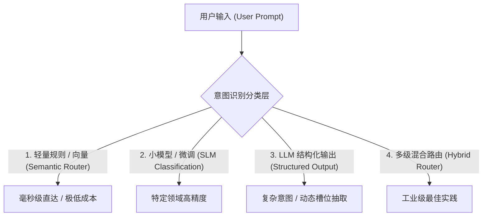
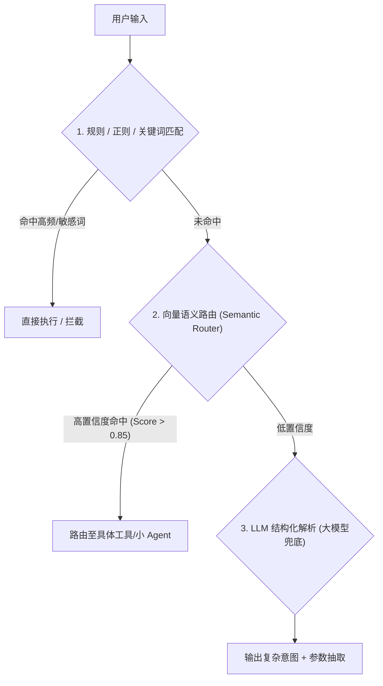

# Agent 应用中的意图识别与实现方案

## 笔记概览

### 知识鸟瞰

1. 概念定义与核心价值                           [前提·定义]
   └─ 铺垫 → 核心主张
2. 4 种主流实现方案                              [核心·机制]
   ├─ 方案 1：LLM + Structured Output
   ├─ 方案 2：向量相似度 / Semantic Router
   ├─ 方案 3：轻量级分类模型微调 (SLM)
   └─ 方案 4：混合多级路由 (Hybrid Router)
   └─ 关系：方案 1 ↔ 方案 2 ↔ 方案 3 ↔ 方案 4，成本/延迟/灵活度权衡
3. 核心挑战与解决方案                           [实践·深化]
4. 总结与架构选型建议                           [落地·行动]

主线：笔记从 Agent 意图识别的定义与演进出发，对比 4 种不同技术复杂度的实现方案，解析复合意图与歧义等工程难题，最终给出分阶段的工业级落地路线。

### 各节内容概要

| 章节/部分 | 核心内容 | 关键要点 |
| :--- | :--- | :--- |
| 1. 什么是 Agent 中的意图识别？ | 意图识别的定义、从传统 NLP 到 Agent 的演进逻辑 | 意图识别是 Agent 路由大脑，决定调用什么 Tool / 子 Agent |
| 2. 为什么意图识别至关重要？ | 分析降本增效、准确路由与安全边界防御三大维度 | 避免盲目调用大模型、缩短响应延时、防御恶意 Prompt |
| 3. 4 种主流实现方案 | 详细剖析 LLM 结构化输出、Semantic Router 向量路由、小模型微调和混合多级路由 | 从简单灵活性到毫秒级响应，再到工业级级联漏斗架构 |
| 4. 核心挑战与解决方案 | 针对复合意图、槽位缺失/歧义、上下文依赖及域外拒答的应对策略 | 采用任务拆解、反问澄清循环、上下文重写及安全兜底 |
| 5. 总结与架构选型建议 | 原型期、上线优化期与多 Agent 系统的选型指导路线 | 从 LLM Structured Output 入手，演进至 Hybrid Router |

---

## 一、什么是 Agent 中的意图识别？

在 AI Agent（智能体）架构中，**意图识别（Intent Recognition / Intent Classification）** 是 Agent 的“神经中枢”和“路由大脑”。它是 Agent 理解用户需求的**第一关**，决定了后续调用什么工具、触发哪个子 Agent、或者进入哪条执行路径。

简单来说，意图识别就是**将用户输入的非结构化自然语言，转化为系统可执行的结构化目标/动作（Action/Route）的过程**。

### 1. 传统 NLP vs. Agent 时代的意图识别
*   **传统 NLP 时代**：通常是单标签分类任务（如：把“我想退货”分类为 `intent: return_goods`），然后结合槽位填充（Slot Filling）提取 `item_id`。
*   **Agent 时代**：意图识别升维成了**语义理解与动态路由（Semantic Understanding & Routing）**。Agent 需要从一句复杂、甚至模糊的话中识别出：
    1. **目标（Goal）**：用户到底想干什么？
    2. **动作路径（Route/Tools）**：该调用 API、查数据库、执行代码，还是转人工？
    3. **参数/槽位（Arguments/Slots）**：执行目标所需的参数有哪些？
    4. **复合意图（Multi-Intent）**：这句话是否包含多个并行或串行的任务？

---

## 二、为什么意图识别对 Agent 至关重要？

1. **降本增效（Cost & Latency Optimization）**：
   * 不是所有问题都需要调用昂贵且慢的大模型（如 GPT-4 / Claude 3.5 Sonnet）。如果识别出只是简单招呼，可以用小模型或规则直接回复。
2. **准确路由（Tool / Sub-Agent Routing）**：
   * 当 Agent 拥有几十甚至上百个 Tool/Plugin 时，直接把所有 Tool 丢给 LLM 会导致 Prompt 超长、提示词幻觉和选择错误。通过意图识别，先路由到特定领域，再精简关联工具。
3. **安全与边界防御（Guardrails）**：
   * 识别用户是否包含 Prompt 注入、越狱、非法请求或超出 Agent 能力范围（Out of Domain）的意图，及时拦截。

---

## 三、Agent 意图识别的 4 种主流实现方案

在实际工程中，意图识别方案从简单到复杂主要有以下 4 种：



---

### 方案 1：基于大模型结构化输出（LLM + Structured Output / Function Calling）

最常用、最灵活的方案。直接利用 LLM 的上下文理解能力，让其输出符合特定 Schema（如 JSON 或 Pydantic）的意图结果。

#### 示例代码（Python + Pydantic + OpenAI）：

```python
from enum import Enum
from typing import List, Optional
from pydantic import BaseModel, Field
from openai import OpenAI

class IntentType(str, Enum):
    SEARCH_KNOWLEDGE = "search_knowledge" # 查询知识库
    EXECUTE_CODE = "execute_code"         # 执行代码分析
    CREATE_TICKET = "create_ticket"       # 创建工单
    CHITCHAT = "chitchat"                 # 闲聊
    UNKNOWN = "unknown"                   # 未知/超出范围

class IntentResult(BaseModel):
    primary_intent: IntentType = Field(description="主意图分类")
    confidence: float = Field(description="置信度 0.0-1.0")
    slots: dict = Field(default_factory=dict, description="提取的关键槽位参数，如 keywords, code_snippet 等")
    reasoning: str = Field(description="分类的简短判断逻辑")

client = OpenAI()

def parse_intent(user_input: str) -> IntentResult:
    completion = client.beta.chat.completions.parse(
        model="gpt-4o-mini", # 可选用快速轻量的模型
        messages=[
            {"role": "system", "content": "你是一个意图识别专家，请分析用户输入的意图并提取关键参数。"},
            {"role": "user", "content": user_input},
        ],
        response_format=IntentResult,
    )
    return completion.choices[0].message.parsed

# 测试
result = parse_intent("帮我查一下昨天线上 Hyperion 系统的 OOM 日志，另外建个工单跟进")
print(result.model_dump_json(indent=2))
```

*   **优点**：语义理解极强，自带槽位提取（Slot Extraction），能处理复杂表达。
*   **缺点**：存在数十毫秒到数百毫秒延时，消耗 Token 成本。

---

### 方案 2：基于向量相似度 / Semantic Router（语义路由）

对于**高频、确定性较强的意图**，使用 Embedding 向量匹配比调用 LLM 快得多。开源框架如 `semantic-router` 就是基于此原理。

#### 实现逻辑：
1. 为每个意图预设若干典型 Prompt 示例（Utterances/Anchors）。
2. 使用 Embedding 模型计算这些示例的向量。
3. 当用户输入到来时，计算用户输入的 Embedding，与意图向量库做**余弦相似度（Cosine Similarity）**比对。
4. 超过阈值（如 > 0.82）即命中该意图。

```python
# 逻辑示意代码
import numpy as np

intents_db = {
    "query_weather": ["今天天气怎么样", "明天会下雨吗", "北京气温多少"],
    "book_flight": ["帮我买一张机票", "查一下去上海的航班", "预订机票"]
}

# 预先计算并缓存 intents_db 中所有句子的 Embeddings
# 运行时：
# user_embedding = get_embedding(user_input)
# target_intent = find_most_similar_intent(user_embedding, intents_db, threshold=0.8)
```

*   **优点**：**毫秒级响应（<20ms）**，无 LLM API 成本。
*   **缺点**：无法灵活抽取动态参数（槽位），泛化能力受限于预设的 Anchor 样本数量。

---

### 方案 3：轻量级分类模型微调（SLM / Fine-tuned Classifiers）

在端侧或隐私敏感场景，可以使用微调的小模型（如 BERT、RoBERTa、DeBERTa，或者 1B~3B 参数的小语言模型如 Qwen2.5-1.5B / Llama-3-3B）。

*   **实现步骤**：
    1. 收集历史日志，标注（User Input -> Intent Label）数据集。
    2. 微调分类头（Sequence Classification）或 LoRA。
    3. 部署为专门的微服务。
*   **适用场景**：垂直行业固定客服意图、工业级大规模并发系统。

---

### 方案 4：混合多级路由（Hybrid Multi-Stage Routing）—— 工业级最佳实践

在大型生产级 Agent 系统中，通常不会只用单一方案，而是采用**分级漏斗架构**：



1. **第一级（Fast Layer）**：正则与黑白名单拦截（如："帮助"、"退出"、敏感词拦截）。
2. **第二级（Semantic Layer）**：向量语义路由，处理 80% 的高频常见意图（速度极快、成本极低）。
3. **第三级（Deep Reasoning Layer）**：LLM 结构化输出/Function Calling，处理长尾、多意图、复杂上下文意图。

---

## 四、Agent 意图识别的核心挑战与解决方案

在复杂 Agent 应用中，意图识别经常会遇到以下难题：

| 挑战场景 | 常见表现 | 工业级解决方案 |
| :--- | :--- | :--- |
| **1. 复合意图 (Multi-Intent)** | “帮我汇总这份报告，然后发邮件给张三，顺便订个下午的会议室” | **任务拆解（Task Decomposition）**：让 LLM 输出意图列表 `List[Intent]`，由 Orchestrator（编排器）串行或并行执行。 |
| **2. 歧义与槽位缺失** | “帮我查一下航班”（未说明时间、起降地） | **反问澄清循环（Clarification Loop）**：识别出缺失必需槽位时，触发 `Intent: AskForClarification`，向用户追问。 |
| **3. 上下文依赖（Contextual Intent）** | 1轮：“苹果多少钱？”<br>2轮：“那香蕉呢？”（隐式意图：查询香蕉的价格） | **Context-Aware Parsing**：将历史记忆（Memory）传入意图解析器，或使用 Re-writer 先把用户输入补全为完整句子。 |
| **4. 域外拒答 (Out-of-Domain / OOD)** | 给保险 Agent 提问：“怎么做红烧肉？” | **Fallback / Safety Guardrails**：在 Intent Enum 中必须包含 `UNKNOWN` / `OUT_OF_BOUNDS`，提示用户 Agent 的职责边界。 |

---

## 五、总结与架构选型建议

要为你的 Agent 设计意图识别系统，可以参考以下选型路线：

1. **原型开发 / 快速验证阶段**：
   * **首选 LLM + Structured Output (Function Calling)**。开发最快，几行代码就能完成意图分类 + 参数提取。
2. **业务上线 / 优化性能阶段**：
   * 引入 **Semantic Router（向量路由）** 拦截高频固定意图，降低 LLM 调用 API 开销并缩短响应首帧延迟（TTFT）。
3. **复杂多 Agent 系统（Multi-Agent System）**：
   * 采用 **Supervisor / Router Agent 模式**，使用专用的路由 Prompt，结合多意图拆解与状态机（如 LangGraph / AutoGen 中的 Router 节点）。

---

## 核心概念速查

| 概念 | 一句话 | 类比 | 为什么重要 |
| :--- | :--- | :--- | :--- |
| 意图识别 (Intent Recognition) | 将自然语言转化为结构化目标、动作与参数的过程 | 医院导诊台的问诊分类 | 决定 Agent 后续的工具调用与路由路径 |
| 语义路由 (Semantic Router) | 基于向量相似度快速将输入匹配至预设意图的轻量机制 | 门禁卡快速感应刷卡 | 提供 <20ms 响应且零 LLM 成本 |
| 结构化输出 (Structured Output) | 强制 LLM 按照 Pydantic/JSON Schema 规范格式化返回 | 填写标准化的入职登记表 | 保证意图与槽位参数可以被代码直接消费 |
| 复合意图拆解 (Task Decomposition) | 将一句包含多动作的输入拆分为可顺序/并行执行的任务链 | 生产流水线拆解多道工序 | 解决复杂命令下单一 Tool 无法调用的问题 |

---

## 核心要点

- `[定义]` **意图识别是 Agent 的路由大脑**：在 Agent 架构中，意图识别不仅是分类，更涵盖目标判断、动作路由、槽位提取与安全防御。
- `[机制]` **混合多级路由（Hybrid Router）是工业级最佳实践**：采用“规则/正则 -> 向量 Semantic Router -> LLM Structured Output 兜底”的级联漏斗，兼顾毫秒级响应与深层语义理解。
- `[限制]` **向量路由缺乏动态参数提取能力**：基于 Embedding 的 Semantic Router 虽快，但无法直接抽取动态槽位（如时间、实体 ID），需配合正则或后续 LLM 节点使用。
- `[行动原则]` **按发展阶段选型架构**：原型期采用 LLM + Structured Output 快速验证；上线后引入 Semantic Router 拦截高频意图降本增效；复杂系统使用 Supervisor/Router 节点控制状态机。

---

## 参考来源

- 人工智能 Agent 架构最佳实践
