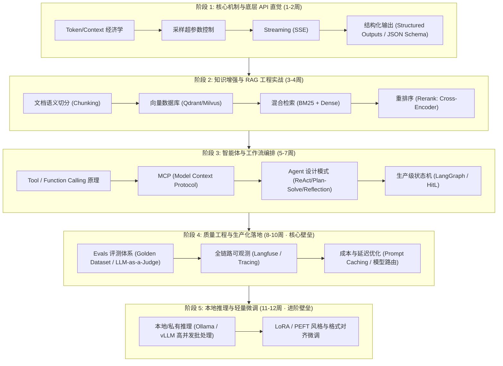

# AI Engineer 系统化学习路线与实战转型指南

## 导读

在传统 CRUD 开发门槛被大模型迅速拉低的背景下，“AI Engineer（人工智能应用/工程化工程师）”已成为软件工程演进中最确定、最稀缺的方向之一。

很多工程师在转型时容易陷入误区：要么盲目去啃微积分、矩阵求导和反向传播公式，试图从零训练模型；要么仅仅停留在调用几行 OpenAI API、套用现成脚手架写个玩具级别的“ChatPDF”。

本指南旨在为传统/后端程序员提供一套结构清晰、面向工业级交付的转型框架：明确 **AI Engineer 的核心是经典软件工程（80%）与大模型编排范式（20%）的结合**，并通过五阶技术递进、生产级评测监控与高工程密度的项目设计，完成真正的技术护城河构建。

---

## 结构鸟瞰



---

## 认知对齐：AI Researcher 与 AI Engineer 的分工边界

转型前必须彻底厘清这两类岗位的根本差异，避免在错误的赛道上内耗：

| 维度 | AI Researcher (算法研究员/科学家) | AI Engineer (大模型工程化工程师) |
| :--- | :--- | :--- |
| **核心使命** | 探索模型架构、提升基础推理与泛化上限 | 将大模型作为基础算子，构建可靠、稳定、低成本的业务系统 |
| **核心输入** | 海量无标注语料、GPU 集群、预训练损失函数 | 业务需求、私有数据、业务 API、业务约束与 SLA |
| **底层要求** | 深度学习理论、高等数学、PyTorch/CUDA 底层算子 | **经典软件工程素养（DB、API、并发、网络、缓存、状态机）** |
| **交付产物** | Base Model 权重、学术论文、Benchmark 跑分 | 生产级 Agent 系统、垂直场景 RAG、企业级智能化工作流 |
| **核心挑战** | 算力成本、梯度爆炸/消失、Scaling Law 瓶颈 | **模型幻觉抑制、输出确定性保证、长链路延迟、Token 成本控制、故障兜底** |

> [!important] 核心心法
> **企业从来不缺只会调用 API 写 Demo 的人，也不缺少数顶尖算法科学家；最极度匮乏的，是能把大模型“不确定、易幻觉、高延迟”的输出，转化为“稳定、可审计、高可用”的企业级生产代码的工程师。**

---

## 五阶系统化技术路线

### 阶段一：LLM 运行机制直觉与原生 API 交互（第 1 ~ 2 周）

脱离任何高级封装库（如早期臃肿的 LangChain），直接使用 Python/TypeScript 原生 SDK（OpenAI、Anthropic 或 Gemini 官方客户端）编写代码。

#### 1. 核心掌握概念
- **Token 经济学**：
  - 理解 BPE（Byte-Pair Encoding）分词算法，理解为什么中英 Token 比例不同；
  - 掌握上下文窗口限制（Context Window Limit）与计费模型（Prompt Tokens vs Completion Tokens）。
- **超参数控制**：
  - `Temperature`：概率分布平滑度（严谨场景取 `0.0~0.2`，创意发散场景取 `0.7~1.0`）；
  - `Top-p`（核采样）：候选词累积概率截断；
  - `Stop Sequences`：截断序列在特定格式生成中的作用。
- **对话角色范式**：
  - `system`（人设、规则边界与输出格式强约定）；
  - `user`（动态输入与上下文填充）；
  - `assistant`（模型回复与历史多轮状态维护）。
- **流式传输（Streaming）**：
  - 理解基于 HTTP 的 Server-Sent Events (SSE) 协议原理与前端流式打字机交互实现。
- **结构化输出（Structured Outputs）**：
  - 掌握 JSON Schema 约束下的强确定性输出；使用 Pydantic (Python) 或 Zod (TypeScript) 实现输出强校验与重试。

---

### 阶段二：知识增强与 RAG 工程实战（第 3 ~ 4 周）

Naive RAG（向量相似度比对）在真实业务场景中往往准确率惨不忍睹。本阶段目标是掌握工业级 **Advanced / Modular RAG** 链路。

#### 1. 核心技术环节
1. **文档提取与语义切分（Chunking）**：
   - 抛弃简单的定长切分，针对 Markdown、PDF、表格、代码文件采用“语义感知切分”；
   - 权衡 Chunk Size 与 Chunk Overlap 对上下文完整性与检索精度的影响。
2. **向量化与向量库实战**：
   - 掌握主流 Embedding 选型（text-embedding-3、BGE-large-zh、Cohere）；
   - 深入掌握至少一款生产级向量数据库：**Qdrant**（Rust 编写，过滤性能强悍）、**Milvus** 或 **pgvector**（已有 PostgreSQL 基础设施的低成本首选）。
3. **混合检索（Hybrid Search）**：
   - 单纯密集向量（Dense Retrieval）对专有名词、错误拼写、订单编号/ID 极易失真；
   - 工业级标准解法：**稀疏关键词检索（BM25） + 密集向量检索（Dense Vector）**，并通过 RRF（Reciprocal Rank Fusion）算法融合排序。
4. **重排序（Reranking）——精度质变点**：
   - 采用 Cross-Encoder 架构模型（如 `bge-reranker-large` 或 Cohere Rerank）；
   - 从召回的前 50 个候选块中进行深层语义精排，截取 Top 3~5 喂给大模型，显著降低模型上下文噪音与 Token 消耗。

---

### 阶段三：智能体与工作流编排（Agentic Workflows）（第 5 ~ 7 周）

让 LLM 从“文本生成器”蜕变为具备自主感知、规划、工具调用能力的“数字代理”。

#### 1. 工具调用（Tool / Function Calling）机制
- 深入掌握：模型如何根据系统 Prompt 提供的 JSON Schema 生成调用指令 -> 应用宿主环境拦截并执行真实业务代码 -> 将执行结果再包装进 Context 喂回模型 -> 模型生成最终应答的全链路。

#### 2. 新兴事实标准：MCP（Model Context Protocol）
- Anthropic 推出的开放协议，统一了大模型与本地文件、开发工具、企业数据库之间的调用标准；
- **掌握 MCP 的架构角色**：Host（如 IDE、Agent 宿主）、Client 与 Server；
- **实操要求**：亲手用 TypeScript/Python 编写一个具备资源发现（Resources）与工具暴露（Tools）的自定义 MCP Server。

#### 3. Agent 核心架构模式
- **ReAct（Reasoning + Acting）**：`Thought -> Action -> Observation` 循环推进；
- **Plan-and-Solve**：复杂任务的大粒度拆解与分步执行；
- **Reflection / Self-Correction**：增加检查机制（自我审查代码与数据格式），发现异常触发自动纠错。

#### 4. 生产级编排技术：LangGraph
- 告别线性 Chain，拥抱**图状态机（Graph State Machine）**：
  - **State（状态对象）**：全局流转与更新的数据上下文；
  - **Nodes（节点）**：大模型调用或业务执行逻辑；
  - **Edges（条件边）**：根据节点执行结果动态决定下一跳；
  - **Human-in-the-loop（人工介入门禁）**：在执行退款、删库、发邮件等不可逆高危动作前挂起等待人工确认。

---

### 阶段四：质量工程与生产化落地（第 8 ~ 10 周 · 关键壁垒）

> **评测（Evals）与可观测性是区分“写 Demo 的玩具开发者”与“年薪百万的生产级 AI 工程师”的分水岭。**

#### 1. 评测工程体系（Evals）
- **不要用肉眼做 Prompt 调优**：Prompt 改动一行，系统整体准确率可能莫名下滑；
- **构建黄金测试集（Golden Dataset）**：沉淀 50~200 个真实业务输入、标准期望输出与边界测试用例；
- **评测手段组合**：
  - *确定性断言*：JSON 格式合法性、字段完整性、正则匹配；
  - *语义指标*：ROUGE / BLEU（适合摘要类任务）；
  - *LLM-as-a-Judge*：使用最强推理模型（如 GPT-4o / Claude 3.5 Sonnet）根据明确制定的评分细则（Rubrics）对回答打分；
- **工具链**：DeepEval、Promptfoo、Ragas。

#### 2. 全链路可观测（Tracing & Observability）
- 引入 **Langfuse**（开源首选，支持私有化部署）或 **Arize Phoenix**；
- 记录每次调用的完整调用链：Prompt 真实输入、中间思考过程、Tool 入参与返回值、Token 账单、首字延迟（TTFT）与总耗时。

#### 3. 成本与延迟极致优化
- **Prompt Caching**：利用 Anthropic / OpenAI 的 Prompt 缓存机制，对长 System Prompt 或静态知识库前缀进行缓存，降低 80%~90% 的调用成本并大幅降低首字延迟；
- **模型分级路由（Model Routing）**：
  - 简单分类与参数提取：路由给小模型（如 GPT-4o-mini、DeepSeek-V3）；
  - 核心复杂推理与规划：路由给大模型（如 Claude 3.5 Sonnet、GPT-4o）。

---

### 阶段五：本地推理与轻量微调（第 11 ~ 12 周 · 进阶壁垒）

#### 1. 本地模型与私有化部署引擎
- **本地开发调试**：掌握 **Ollama** 运行 Qwen、Llama 等开源模型；
- **生产级高并发推理引擎**：深入掌握 **vLLM**：
  - PagedAttention 显存优化原理；
  - Continuous Batching（动态连续批处理）对高并发吞吐量的提升机制。

#### 2. 微调（Fine-Tuning）的工程定位
- **什么时候才需要微调？**
  - 需要模型 100% 遵守严苛的特定领域格式；
  - 需要模型深度学习某种特殊的交互口吻与品牌风格；
  - 目标任务非常固定，需要用小参数模型替代大参数模型以降低 95% 成本。
- **微调不能做什么？**
  - 不要指望微调来给模型灌输经常变动的业务知识（知识更新成本极高，极易产生灾难性遗忘，必须依赖 RAG）。
- **技术要点**：掌握 LoRA / QLoRA 概念，能使用 LLaMA-Factory 跑通轻量级指令微调。

---

## 必读经典资料与权威资源库

### 1. 思想奠基与行业圣经长文
- **[The Rise of the AI Engineer](https://www.latent.space/p/reverse-engineer-ai-engineer)** - *Swyx (Shawn Wang)*  
  *AI Engineer 名词开山之作，清晰阐述从 ML Engineer 到 AI Engineer 的产业分工重构。*
- **[Building LLM applications for production](https://huyenchip.com/2023/04/11/llm-engineering.html)** - *Chip Huyen*  
  *工业级落地的圣经长文，深度剖析 RAG、上下文工程、评估、延迟与缓存等生产挑战。*
- **[Patterns for Building LLM-based Systems & Products](https://eugeneyan.com/writing/llm-patterns/)** - *Eugene Yan*  
  *全面梳理企业落地的 7 种核心工程模式，图文并茂，极其严谨。*
- **[Your AI Product Needs Evals](https://hamel.dev/blog/posts/evals/)** - *Hamel Husain*  
  *工业界公认关于 Evals 评测体系写得最深刻、最具实操性的指南。*
- **[State of GPT & Intro to Large Language Models](https://www.youtube.com/watch?v=bZQun8Y4L2A)** - *Andrej Karpathy (YouTube)*  
  *用两个小时彻底搞懂预训练、微调、RLHF、思维链的最强技术讲解。*

### 2. 官方精选实战课程
- **[DeepLearning.AI 系列短课](https://www.deeplearning.ai/short-courses/)**（吴恩达联合主流厂商出品，1~2小时/门，配可运行环境）：
  - *LangGraph: Build Resilient Agentic Applications*
  - *Advanced Retrieval for AI with Chroma / Building Hybrid Search*
  - *LLMOps: Building Real-World Applications with Evals*
- **[Anthropic Prompt Engineering Tutorial](https://github.com/anthropics/prompt-eng-interactive-tutorial)**：官方开源交互式 Prompt 进阶教程。
- **[OpenAI Cookbook](https://github.com/openai/openai-cookbook)**：官方生产级用例与代码模式合集。

### 3. 生产级开源工具选型矩阵
- **编排框架**：`langchain-ai/langgraph`
- **可观测平台**：`langfuse/langfuse`
- **评测框架**：`confident-ai/deepeval`
- **向量数据库**：`qdrant/qdrant`
- **高性能推理服务**：`vllm-project/vllm`、`ollama/ollama`

---

## 破局项目设计：构建具备简历竞争力的作品

**严禁在简历上写千篇一律的“基于 LangChain 的知识库问答 Demo（ChatPDF）”。**

建议针对真实企业痛点，打造一个包含**完整生产工程链路**的项目：

### 推荐项目：企业级智能运维与工单诊断 Agent（ITSM Diagnostic Agent）

```
[用户/告警触发] 
      │
      ▼
[LangGraph 状态机编排] 
      │
      ├──> [意图识别与安全校验] 
      │
      ├──> [混合检索 RAG] ──> (BM25 + 向量检索 + BGE Rerank 过滤运维手册)
      │
      ├──> [MCP 工具调用] ──> (调用 GitHub API、查 Prometheus 指标、查只读数据库)
      │
      ├──> [高危执行拦截门禁] ──> (Human-in-the-Loop 需运维负责人二次确认)
      │
      └──> [诊断报告生成与闭环]
            │
            ▼
[全链路可观测 & 质量基准]
(接入 Langfuse 追踪延迟/成本 + 50 个复杂工单黄金评测集 CI/CD 自动化拦截)
```

**该项目在面试中能展示的工程硬实力**：
1. **协议层**：使用最新的 **MCP 协议**对接真实的工具集，具备协议扩展性；
2. **检索层**：采用 **混合检索 + Rerank**，解决“专有错误代码与机器名称匹配失真”的问题；
3. **流程层**：使用 **LangGraph** 实现持久化状态机流转与人工安全审批（Human-in-the-loop）；
4. **工程严谨性**：集成 **Langfuse** 进行成本与延迟监控；构建 **Eval 黄金测试集**，将评测结果作为 CI/CD 流水线的质量门禁。

---

## 相关索引与演进

- 关联总览：[[1. 技术研发/AI应用开发/AI 应用开发学习体系.md|AI 应用开发学习体系]]
- 针对 Java 后端转型细节：[[1. 技术研发/AI应用开发/Java 转 AI 应用开发/Java 后端转 AI 应用开发学习路线.md|Java 后端转 AI 应用开发学习路线]]
- Agent 意图识别专题：[[1. 技术研发/AI应用开发/Agent/Agent 应用中的意图识别与实现方案.md|Agent 应用中的意图识别与实现方案]]
