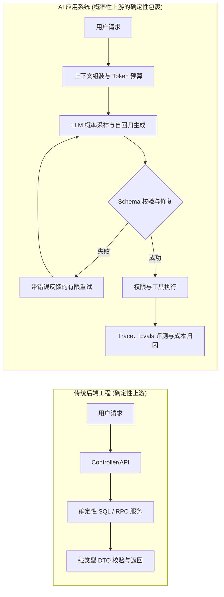
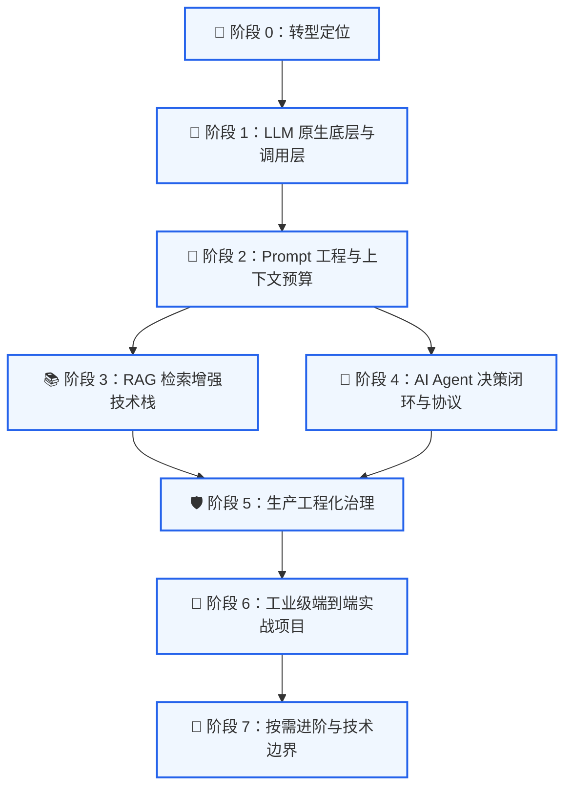
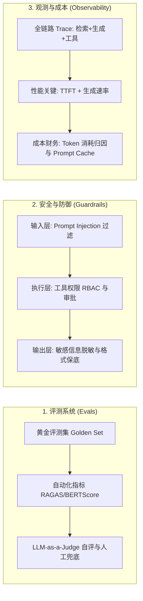

# Java 转 AI 应用开发 MOC（知识地图）

> [!TIP] 🗺️ **Obsidian Canvas 原生无限白板已同步生成**
> 本知识地图配套专属的可视化拓扑白板：**[[Java 转 AI 应用开发 知识白板.canvas|🗺️ 打开 Java 转 AI 应用开发 知识白板.canvas]]**。
> 白板内包含**三级层层嵌套分组**、**实体笔记卡片直接嵌入**、**核心心智模型解析**与**阶段演进箭头连线**，支持鼠标平移缩放与沉浸式探索。

---

## 📌 导航目录 (Table of Contents)

- [[#Key Takeaways|Key Takeaways]]
- [[#🗺️ 转型路线总览与心智迁移|转型路线总览与心智迁移]]
  - [[#传统后端 vs AI 应用工程|传统后端 vs AI 应用工程]]
  - [[#心智模型切片嵌入|心智模型切片嵌入]]
- [[#🌲 树状路线全景地图（分阶段与切片嵌入）|树状路线全景地图（分阶段与切片嵌入）]]
  - [[#阶段 0：转型定位与能力迁移|阶段 0：转型定位与能力迁移]]
  - [[#阶段 1：LLM 原生机制与 Java 接入层|阶段 1：LLM 原生机制与 Java 接入层]]
  - [[#阶段 2：Prompt 规格与上下文工程|阶段 2：Prompt 规格与上下文工程]]
  - [[#阶段 3：RAG 私有知识库检索增强|阶段 3：RAG 私有知识库检索增强]]
  - [[#阶段 4：AI Agent 决策闭环与工具协议|阶段 4：AI Agent 决策闭环与工具协议]]
  - [[#阶段 5：生产工程化与系统治理|阶段 5：生产工程化与系统治理]]
  - [[#阶段 6：工业级端到端实战项目|阶段 6：工业级端到端实战项目]]
  - [[#阶段 7：按需进阶与技术边界|阶段 7：按需进阶与技术边界]]
- [[#🛡️ 贯穿全周期的三大控制面|贯穿全周期的三大控制面]]
- [[#📊 笔记专题状态与验收矩阵|笔记专题状态与验收矩阵]]
- [[#🔗 关联高维索引与前置材料|关联高维索引与前置材料]]

---

## Key Takeaways

- **定位清晰**：AI 应用工程的本质是**80% 经典软件工程（接口治理、状态、异步、事务、权限、观测与成本）+ 20% 大模型概率编排范式**。不是抛弃 Java 后端沉淀去研究模型反向传播，而是用工程确定性包裹模型概率性。
- **MOC 组织逻辑**：以树状拓扑为主干，向上承接全局战略（[[Java 后端转 AI 应用开发学习路线]]），横向贯穿工程三要素（评测、安全、观测），向下聚合专题笔记与切片引用（Transclusion）。
- **学习顺序不可倒置**：必须先打通 `Token/上下文/采样` 与 `结构化输出/Function Calling` 最小调用层，再向外延展到 RAG（解决“模型不知道”）与 Agent（解决“模型如何行动”）。
- **严格实践验收**：阅读不是完成，产出可运行代码、评测 Golden Set、Trace 追踪与故障防御决策才算落地（详见 [[学习进度与实践清单]]）。

---

## 🗺️ 转型路线总览与心智迁移

### 传统后端 vs AI 应用工程

| 核心维度 | 传统 Java 后端系统 | AI 应用系统 (AI Engineer) | 迁移与应对策略 |
| :--- | :--- | :--- | :--- |
| **上游特性** | 确定性状态机、微服务接口、ACID 数据库 | **概率采样、自回归文本生成、非确定性** | 引入 JSON Schema 强校验、Output Parser 与有限容错重试 |
| **核心资源** | CPU、内存、线程池、数据库连接池 | **上下文窗口（Context Window）、Token 预算、TPM/RPM** | 建立 Token 预算分配公式，分层规划 System/Context/Output 空间 |
| **主要故障** | 连接超时、空指针、并发锁死、死锁 | **模型幻觉、格式漂移、越狱注入、输出截断、成本骤升** | 引入 Guardrails 防护栏、Few-Shot 引导、Prompt Injection 纵深防御 |
| **测试与验证**| JUnit 单元测试、集成测试、Mock 测试 | **Golden Set 黄金样本集、LLM-as-a-Judge、RAG 三元组评测** | 建立贯穿式的 Evals 评测体系，杜绝“改了提示词全凭感觉看” |
| **可观测性** | APM 链路、Metrics（QPS/RT）、Log4j | **Trace 树（调用链+检索证据+工具轨迹）、TTFT、Token 消耗** | 接入 OpenTelemetry / Langfuse / Trace 统一治理大模型网关 |

### 心智模型切片嵌入

> [!NOTE] 引用自 [[Java 后端转 AI 应用开发学习路线#核心心智模型]]
> 
> ![[Java 后端转 AI 应用开发学习路线#核心心智模型]]

---

## 🌲 树状路线全景地图（分阶段与切片嵌入）

---

### 阶段 0：转型定位与能力迁移

- 🎯 **核心任务**：确立“AI 应用工程”而非“算法调参”的角色定位；梳理已有 Spring、微服务、高并发与事务能力在 AI 场景的复用路径。
- 🔗 **核心笔记与外部导航**：
  - [[00-转型定位/后端开发者转型 AI Agent]]
  - 关联学习：[[1. 技术研发/AI应用开发/AI Engineer 系统化学习路线与实战转型指南.md|AI Engineer 系统化学习路线与实战转型指南]]

---

### 阶段 1：LLM 原生机制与 Java 接入层

- 🎯 **核心任务**：深入理解自回归解码原理、Token 经济学、上下文窗口与采样超参数；使用 Java 完成非流式/流式调用与强类型结构化输出。
- 🌿 **分级子节点**：
  - 1.1 **模型运行机理**：`[[01. 模型基础与交互/LLM 运行机制：Token、上下文窗口与采样参数]]`
  - 1.2 **数据契约控制**：`[[01. 模型基础与交互/大模型结构化输出：从 JSON 契约到 Function Calling 落地]]`
  - 1.3 **接入工程落地**：`[[01. 模型基础与交互/LLM API 调用工程]]`
  - 1.4 **框架技术选型**：`[[01. 模型基础与交互/Java AI 框架选型]]`（Spring AI vs LangChain4j vs Spring AI Alibaba）
- 📄 **核心专题切片嵌入**：

> [!ABSTRACT] 运行机制核心认知：Token、窗口与采样
> 
> ![[01. 模型基础与交互/LLM 运行机制：Token、上下文窗口与采样参数#Key Takeaways]]

> [!ABSTRACT] 结构化输出契约：从 JSON 文本到执行边界
> 
> ![[01. 模型基础与交互/大模型结构化输出：从 JSON 契约到 Function Calling 落地#Key Takeaways]]

---

### 阶段 2：Prompt 规格与上下文工程

- 🎯 **核心任务**：将 Prompt 视为可版本化、可灰度发布、可评测的系统规格资产；建立多层 Prompt 注入纵深防御与动态 Token 预算管理。
- 🌿 **分级子节点**：
  - 2.1 **提示词规格工程**：`[[02. Prompt与上下文工程/大模型提示词工程与实用技巧指南]]`
  - 2.2 **上下文编排预算**：`[[02. Prompt与上下文工程/上下文工程]]`
- 📄 **核心专题切片嵌入**：

> [!ABSTRACT] 提示词工程落地原则：行为规格与安全纵深
> 
> ![[02. Prompt与上下文工程/大模型提示词工程与实用技巧指南#Key Takeaways]]

---

### 阶段 3：RAG 私有知识库检索增强

- 🎯 **核心任务**：解决“模型不知道私有数据”的问题；构建包括解析、切分、向量化、混合检索、Rerank 与上下文合成的生产级 RAG 管道。
- 🌿 **分级子节点**：
  - 3.1 **RAG 评估与治理**：`[[03. RAG知识检索/RAG|RAG 核心评估与治理闭环]]`
  - 3.2 **文档处理与切分**：`[[03. RAG知识检索/RAG 文档处理与切分]]`（Chunk 策略、Metadata 注入、多模态解析）
  - 3.3 **向量化与存储**：`[[03. RAG知识检索/RAG 向量索引与向量数据库]]`（Milvus、Pgvector、ES）
  - 3.4 **生命周期管理**：`[[03. RAG知识检索/RAG 知识库更新]]`（增量更新、版本废弃、软删除）
  - 3.5 **高级检索优化**：`[[03. RAG知识检索/RAG 检索优化]]`（HyDE、多路召回、RRF 融合、Cross-Encoder Rerank）
  - 3.6 **高阶知识图谱**：`[[03. RAG知识检索/GraphRAG]]`（实体关系抽取、社区摘要、Text2Cypher）

---

### 阶段 4：AI Agent 决策闭环与工具协议

- 🎯 **核心任务**：解决“模型如何执行行动”的问题；基于 ReAct 循环构建具备工具调用、短期/长期记忆与动态工作流的有界自主智能体。
- 🌿 **分级子节点**：
  - 4.1 **Agent 基础与执行循环**：`[[04. Agent智能体工程/AI Agent 基础]]`
  - 4.2 **意图识别与路由实现**：`[[04. Agent智能体工程/Agent 应用中的意图识别与实现方案]]`
  - 4.3 **状态与记忆体系**：`[[04. Agent智能体工程/AI Agent 记忆系统]]`（短程滑动窗口、总结压缩、长程向量记忆）
  - 4.4 **工具扩展与规范**：`[[04. Agent智能体工程/Agent Skills]]`
  - 4.5 **标准化互通协议**：`[[04. Agent智能体工程/MCP 协议]]`（Model Context Protocol 客户端与服务器端落地）
  - 4.6 **底座治理框架**：`[[04. Agent智能体工程/Harness Engineering]]`（步数截断、循环保护、Human-in-the-Loop 审批）
  - 4.7 **编排与状态图**：`[[04. Agent智能体工程/Workflow、Graph 与 Loop]]`（LangGraph、Spring AI 状态机）
- 📄 **核心专题切片嵌入**：

> [!ABSTRACT] Agent 核心架构：有界循环与安全底线
> 
> ![[04. Agent智能体工程/AI Agent 基础#Key Takeaways]]

---

### 阶段 5：生产工程化与系统治理

- 🎯 **核心任务**：将 Demo 升级为可支撑高并发高可用的企业生产系统；建设网关、安全围栏、全链路监控与自动化评测。
- 🌿 **分级子节点**：
  - 5.1 **分布式架构设计**：`[[05. 工程架构与实战/AI 应用系统设计]]`（异步任务队列、长轮询/SSE 连接保持）
  - 5.2 **多模态与代码工程落地**：`[[05. 工程架构与实战/OpenCode与DeepSeek多模态代码开发最佳实践|OpenCode 与 DeepSeek 多模态代码开发最佳实践]]`
  - 5.3 **大模型统一网关**：`[[05. 工程架构与实战/大模型网关]]`（供应商路由、负载均衡、熔断降级、缓存 Cache）
  - 5.4 **质量评测体系**：`[[05. 工程架构与实战/AI 应用评测体系]]`（Golden Set 构造、RAGAS、语义相似度、回归防劣化）
  - 5.5 **合规与安全防线**：`[[05. 工程架构与实战/AI 应用安全与合规]]`（数据脱敏、内容审查 Guardrails、权限隔离）

---

### 阶段 6：工业级端到端实战项目

- 🎯 **核心任务**：串联全栈能力，完成至少 3 个不同工程密度的端到端代表作；沉淀架构图、评测数据与复盘报告。
- 🌿 **项目实战矩阵**：
  - 6.1 **项目 1：[[06-项目实战/企业知识库问答项目]]**
    - 亮点：PDF/Markdown 高保真切分 + 混合检索 + Rerank + 引用溯源 + 权限过滤。
  - 6.2 **项目 2：[[06-项目实战/多工具 Agent 项目]]**
    - 亮点：基于 Spring AI / LangChain4j + MCP 协议 + 钉钉/企微审批 HitL + 事务回滚。
  - 6.3 **项目 3：[[06-项目实战/智能面试平台项目]]**
    - 亮点：多轮动态追问 + 结构化打分 + 实时语音交互 + 异步报告生成。
- 📄 **实践进度切片嵌入**：

> [!CHECKLIST] 实践检验黄金法则
> 
> ![[学习进度与实践清单#Key Takeaways]]

---

### 阶段 7：按需进阶与技术边界

- 🎯 **核心任务**：针对项目实际瓶颈展开定向学习，拒绝盲目技术堆叠。
- 🌿 **进阶拓展节点**：
  - 7.1 **语音与多模态**：`[[07-进阶与复盘/AI 语音技术]]`（ASR、TTS、流式双工对话）
  - 7.2 **面试准备与复盘**：`[[07-进阶与复盘/AI 应用开发面试复盘]]`（系统设计题、高频追问点、故障排查案卷）

---

## 🛡️ 贯穿全周期的三大控制面

AI 工程化区别于玩具项目的核心，在于以下三大控制面必须从 Phase 1 起始就贯穿始终：

---

## 📊 笔记专题状态与验收矩阵

| 阶段分类 | 专题笔记名称 | 状态 | 核心交付成果与验收标准 |
| :--- | :--- | :---: | :--- |
| **主线战略** | [[Java 后端转 AI 应用开发学习路线]] | `evergreen` | 明确技术演进路径、心智模型转换、边界与原则 |
| **进度管理** | [[学习进度与实践清单]] | `evergreen` | 以代码仓库、评测证据和架构决策管理学习闭环 |
| **阶段 1** | [[01. 模型基础与交互/LLM 运行机制：Token、上下文窗口与采样参数]] | `draft` | 掌握 Token 计量、上下文预算公式与采样调参实验 |
| **阶段 1** | [[01. 模型基础与交互/大模型结构化输出：从 JSON 契约到 Function Calling 落地]] | `draft` | 落地 Java 端强校验、JSON Schema 约束与可恢复重试 |
| **阶段 2** | [[02. Prompt与上下文工程/大模型提示词工程与实用技巧指南]] | `evergreen` | Prompt 外置模板化、版本化发布、防注入三层防御 |
| **阶段 3** | [[03. RAG知识检索/RAG\|RAG 核心评估与治理闭环]] | `draft` | 掌握 RAG 三元组指标、MRR/Hit Rate 与多路召回重排 |
| **阶段 4** | [[04. Agent智能体工程/AI Agent 基础]] | `planned` | 厘清 Tool Loop、ReAct 循环、状态持久化与有界终止 |
| **阶段 4** | [[04. Agent智能体工程/Agent 应用中的意图识别与实现方案]] | `evergreen` | 四种意图路由方案设计、工业选型与复杂场景应对 |
| **阶段 5** | [[05. 工程架构与实战/OpenCode与DeepSeek多模态代码开发最佳实践\|OpenCode 与 DeepSeek 多模态最佳实践]] | `evergreen` | 视觉与代码两阶段解耦、结构化 UI 规格生成与成本压降 |
| **白板全景** | [[Java 转 AI 应用开发 知识白板.canvas]] | `evergreen` | 官方原生 Canvas 白板，三级分组嵌套与可视化拓扑连线 |

---

## 🔗 关联高维索引与前置材料

- 🧭 **知识库控制中枢**：
  - [[wiki/hot|Hot Cache 动态上下文]] — 关注当前 AI Engineer 技能树演进
  - [[wiki/overview|知识库总览地图]] — 5 大中文物理目录总索引
- 📚 **全库横向专题关联**：
  - [[1. 技术研发/AI应用开发/AI Engineer 系统化学习路线与实战转型指南.md|AI Engineer 系统化学习路线与实战转型指南]]
  - [[1. 技术研发/AI应用开发/_课程与资料留存/README.md|外部课程与参考资料留存说明]]
  - [[1. 技术研发/AI应用开发/_课程与资料留存/Java-to-AI/Java-Go 开发者 AI 应用开发与 Agent 学习路线.md|Java/Go 开发者 AI 应用开发与 Agent 学习路线]]
  - [[1. 技术研发/AI应用开发/_课程与资料留存/AI 应用开发学习体系(JavaGuide).md|AI 应用开发学习体系(JavaGuide)]]
  - [[1. 技术研发/AI应用开发/_课程与资料留存/吴恩达-Agentic-AI/吴恩达 Agentic AI 课程笔记.md|吴恩达 Agentic AI 课程笔记]]
