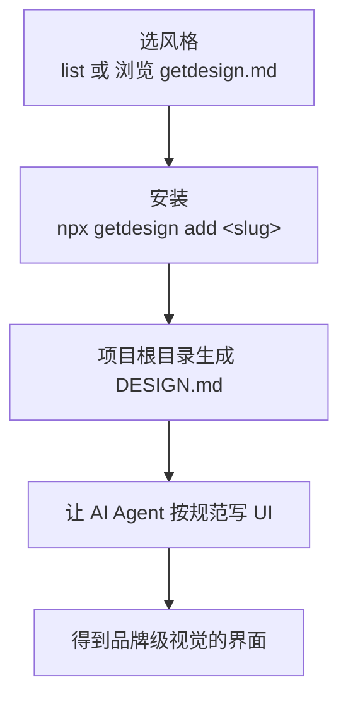

# awesome-design-md 安装使用与 AI 前端设计规范实践指南

## 笔记概览

### 知识鸟瞰

1. **AI 生成 UI 平庸的问题** [前提·定义] → AI 默认产出的前端界面千篇一律、缺乏品牌质感
2. **DESIGN.md 概念（Google Stitch 提出）** [核心·机制] → 用纯文本设计系统文档告诉 AI「页面应该长什么样」——铺垫 → 核心
3. **awesome-design-md 精选库** [核心·资源] → 收录 73 家知名品牌的 DESIGN.md 规范文件（Vercel、Claude、Stripe…）
4. **安装方式：npx 官方 CLI** [实践·行动] → `npx getdesign list` / `npx getdesign add <slug>`，一行命令生成 DESIGN.md —— 问题 → 方案
5. **在 AI Agent 中使用** [实践·行动] → 让 Cursor / Claude Code 等依据 DESIGN.md 还原高级视觉 —— 原因 → 结果
6. **扩展与限制** [限制·边界] → 伴侣工具解构任意网站、MIT 授权、仅限公开 CSS 值

**主线 (Main Thread)**：AI 写 UI 太丑 → DESIGN.md 把「好看的视觉规范」文本化 → awesome-design-md 批量收集大厂规范 → npx 一行命令装进项目 → AI 一键还原品牌级界面。

### 各节内容概要

| 章节/部分 | 核心内容 | 关键要点 |
|-----------|----------|----------|
| 这个项目是干嘛的 | DESIGN.md 概念与仓库定位 | AGENTS.md 管「怎么建」，DESIGN.md 管「长什么样」；73 家品牌、9 段式格式 |
| 如何安装（推荐 npx） | 官方 CLI `getdesign` | `list` 浏览模板、`add <slug>` 生成文件、`--force`/`--out` 参数 |
| 其他安装方式 | 免安装复制 / 网页直链 / 伴侣 CLI / curl | 不同场景的取舍对比表 |
| 如何使用 | 三步工作流 + Prompt 示例 | 项目根目录放 DESIGN.md，Agent 按规范画 UI |
| 可用品牌一览 | 73 家品牌分类 | AI/DevTools/Fintech/汽车等 10 大类 |
| 注意事项与限制 | 覆盖行为、Node 版本、授权 | MIT、as-is、token 仅代表公开 CSS 值 |

---

## 这个项目是干嘛的

### 问题：为什么 AI 写的界面总是「差一口气」？

AI 编码助手（Cursor、Claude Code、Codex 等）很会写逻辑，但默认生成的 UI 往往**视觉平庸**——布局合理但配色、字体、间距、卡片质感都像是「通用模板」，缺少品牌感和设计细节。

### 解法：DESIGN.md —— 把设计系统写成纯文本

Google Stitch 提出了一个关键概念：

> DESIGN.md 是 **AI Agent 能直接读取的纯文本设计系统文档**，告诉它页面应该长什么样。

它只是**一个 Markdown 文件**——不需要 Figma 导出、不需要 JSON Schema、不需要任何特殊工具。把对应内容丢进项目，AI 就能照着还原。

两个文件的分工：

| 文件 | 谁读 | 定义什么 |
|------|------|----------|
| `AGENTS.md` | 编码 Agent | 如何构建项目（代码规范、构建流程、业务逻辑） |
| `DESIGN.md` | 设计 Agent | 页面应该如何呈现（配色、字体、组件、布局、动效） |

### awesome-design-md：批量收集「好看」的规范

[VoltAgent/awesome-design-md](https://github.com/VoltAgent/awesome-design-md) 是一个**精选资源库**：它从真实高颜值网站中解构出 **73 家品牌**的 DESIGN.md 规范文件（Claude、Cursor、Vercel、Stripe、Linear、Supabase、Nike、Tesla…）。

每份规范都遵循 Stitch 的 **9 段式格式**：

1. Visual Theme（视觉主题）
2. Color Palette & Roles（配色与色板角色）
3. Typography Rules（字体规则）
4. Component Stylings（组件样式）
5. Layout Principles（布局原则）
6. Depth & Elevation（深度与层级）
7. Do's and Don'ts（该做与不该做）
8. Responsive Behavior（响应式行为）
9. Agent Prompt Guide（Agent 提示指南）

每个站点还附带 `preview.html` 与 `preview-dark.html` 两个可视化预览文件，方便先「看效果」再决定用哪家。

---

## 如何安装：推荐 npx（官方 CLI）

> [!tip] 核心结论
> 这个仓库**本身不需要安装任何东西**（它是纯文本资源库）。但为了避免每次手动复制粘贴，官方在仓库 `cli/` 目录里维护了一个 npm CLI 包 **`getdesign`**，**推荐直接用 npx 运行**，一行命令即可把指定品牌的 DESIGN.md 装进项目。

前置要求：**Node.js ≥ 18**（npx 自带，无需额外安装）。

### 方式一（推荐）：npx getdesign —— 官方 CLI

```bash
# 1. 浏览所有可用的设计规范模板（会打印 slug 与一句话描述）
npx getdesign list

# 2. 一键把指定品牌的规范写入当前项目根目录的 ./DESIGN.md
npx getdesign add <slug>
# 例如：
npx getdesign add vercel
npx getdesign add claude
npx getdesign add stripe
```

| 参数 | 作用 | 示例 |
|------|------|------|
| `--force` | 覆盖已存在的 `DESIGN.md`（默认不覆盖） | `npx getdesign add stripe --force` |
| `--out <path>` | 写入自定义路径，而非项目根目录 | `npx getdesign add stripe --out ./docs/design.md` |

> [!note] 默认覆盖行为
> 如果项目根目录已存在 `DESIGN.md`，CLI **不会**直接覆盖，而是把模板保存到嵌套目录（如 `<slug>/DESIGN.md`）；只有显式加 `--force` 才会覆盖。

可选：全局安装（之后可直接 `getdesign ...` 而不用每次 `npx`）：

```bash
npm install -g getdesign
```

### 方式二：零安装 —— 复制 or 网页直链

如果不想跑任何 Node 命令：

1. 在 [getdesign.md](https://getdesign.md) 网站浏览并挑选风格
2. 通过每站点的直链（如 `https://getdesign.md/claude/design-md`）获取内容
3. 粘贴到项目根目录的 `DESIGN.md`；或在 Prompt 中直接附上该链接，让支持读 URL 的 Agent 自行拉取

```text
项目结构示例：
your-project/
├── src/
├── package.json
├── AGENTS.md        # (可选) 逻辑指导
└── DESIGN.md        # 视觉设计规范指导
```

### 方式三：伴侣工具 `npx @getdesign/cli <url>` —— 解构任意网站

看中了某个**仓库里没有收录**的网站？`@getdesign/cli` 可以直接在终端里抓取一个上线页面，分析其视觉系统，生成一份可用的 design.md 规范：

```bash
npx @getdesign/cli <url>
```

> [!warning] 需确认
> 该包（v0.1.3）定位为「从在线网站生成生产级 design.md 规范」的伴侣工具，具体参数与输出格式以包内说明为准——它比官方 `getdesign` 新且文档较少，作为高级用法使用。

### 方式四：curl 直接下载（可选）

若想绕过 npm，也可直接抓取规范文件原始内容（需确认仓库内文件的准确路径结构 `需确认`）：

```bash
curl -sSL <design-md 文件直链> -o DESIGN.md
```

---

## 如何使用

### 三步工作流



1. **选风格**：`npx getdesign list` 或访问 getdesign.md，挑选目标品牌
2. **安装**：`npx getdesign add <slug>`（可用 `--force` / `--out` 调整）
3. **使用**：在 AI Agent 中发起 Prompt，让它先读 DESIGN.md 再写 UI

### Prompt 示例

> 生成新页面：
> 「请参考根目录下的 DESIGN.md 规范，帮我用 React 和 Tailwind CSS 实现一个高颜值的 SaaS 仪表盘页面。」

> 重构现有组件：
> 「请按照 DESIGN.md 中定义的 Color Tokens 和 Card 规则，重构当前的登录弹窗 UI。」

> [!tip] 固定指令
> 建议在项目的 Agent 配置（如 AGENTS.md）中常驻一条规则，让 AI 每次改动 UI 前都先读规范：
> **「Before writing or changing any UI in this project, read `DESIGN.md` at the root.」（在编写或改动本项目任何 UI 之前，先阅读根目录的 DESIGN.md。）**

---

## 可用品牌一览（73 家精选）

| 类别 | 品牌 |
|------|------|
| AI 与 LLM 平台 (12) | Claude、Cohere、ElevenLabs、Minimax、Mistral AI、Ollama、OpenCode AI、Replicate、Runway、Together AI、VoltAgent、xAI |
| 开发者工具与 IDE (7) | Cursor、Expo、Lovable、Raycast、Superhuman、Vercel、Warp |
| 后端 / 数据库 / DevOps (8) | ClickHouse、Composio、HashiCorp、MongoDB、PostHog、Sanity、Sentry、Supabase |
| 效率与 SaaS (7) | Cal.com、Intercom、Linear、Mintlify、Notion、Resend、Zapier |
| 设计与创意工具 (6) | Airtable、Clay、Figma、Framer、Miro、Webflow |
| 金融科技与加密 (7) | Binance、Coinbase、Kraken、Mastercard、Revolut、Stripe、Wise |
| 电商与零售 (5) | Airbnb、Meta、Nike、Shopify、Starbucks |
| 媒体与消费科技 (12) | Apple、HP、IBM、NVIDIA、Pinterest、PlayStation、SpaceX、Spotify、The Verge、Uber、Vodafone、WIRED |
| 汽车 (7) | BMW、BMW M、Bugatti、Ferrari、Lamborghini、Renault、Tesla |
| 复古网页 (2) | Dell (1996)、Nintendo.com (2001)——每周六更新的年代感设计 |

> [!note] 请求新品牌
> 若需要特定品牌，可通过 getdesign.md/request 提交请求（支持私密请求）。

---

## 核心概念速查

| 概念 | 一句话说明 | 直观类比 | 为什么重要 |
|------|-----------|----------|------------|
| DESIGN.md | 给 AI 读的纯文本设计系统文档 | 给装修工人看的「设计图纸」 | 让 AI 从「写出能看的 UI」升级为「还原品牌级 UI」 |
| AGENTS.md | 给编码 Agent 的项目构建规范 | 施工队长的「施工流程手册」 | 与 DESIGN.md 分工：逻辑归它，视觉归 DESIGN.md |
| `npx getdesign` | 官方 CLI，一键把品牌规范写入项目 | 从「设计素材库」一键下载图纸 | 免去手动复制粘贴的重复劳动 |
| `@getdesign/cli` | 伴侣工具，解构任意在线网站为规范 | 「逆向工程」任意网站的设计 | 覆盖精选库之外的网站 |
| 9 段式 Stitch 格式 | 规范文件的固定结构（主题/配色/字体/组件/布局…） | 标准化的「图纸模板」 | 保证每份规范都完整、可被 Agent 可靠解析 |

---

## 核心要点

- [结论] DESIGN.md 是 Google Stitch 提出的纯文本设计系统概念，只需一个 Markdown 文件即可让 AI 编码 Agent 还原出特定品牌的高级视觉；awesome-design-md 把这一概念落地为 73 家品牌的精选规范库。
- [机制] AGENTS.md 与 DESIGN.md 形成职责分工：前者定义「项目怎么建」（构建流程、业务逻辑），后者定义「页面长什么样」（配色、字体、组件、布局），二者配合让 AI 既有正确逻辑又有高级审美。
- [行动原则] 安装**优先使用官方 CLI**：`npx getdesign list` 浏览模板，`npx getdesign add <slug>` 一键生成项目根目录的 DESIGN.md；已存在时默认不覆盖，需加 `--force`，可用 `--out` 指定路径。
- [条件] 使用前提是 Node.js ≥ 18；`getdesign` 包（v0.6.24）与仓库同源（位于仓库 `cli/` 目录），由 VoltAgent 官方维护。
- [限制] 仓库为 MIT 授权、文件「按原样提供」；各规范中的 token 仅代表**公开可见的 CSS 值**，项目不主张任何站点视觉形象的版权归属。

---

## 与本库相关笔记

- [[Claude Code 最佳实践指南]] —— DESIGN.md 主要配合 Claude Code 等编码 Agent 使用
- [[Spec Kit 与 SDD 规范驱动开发实践指南]] —— 同样是「给 AI 前置规范」的思路，但面向开发流程而非视觉
- [[gstack 概述与使用指南]] —— 另一套 AI 编程工作流技能套件
- [[Superpowers 安装使用与 AI 编程工作流实践指南]] —— 用 skills 规训 AI 研发流程的方法论

---

## 参考来源

- 项目仓库：<https://github.com/VoltAgent/awesome-design-md>
- 官网 / 规范浏览：<https://getdesign.md>
- 官方 CLI（npm）：<https://www.npmjs.com/package/getdesign>
- 伴侣 CLI（npm）：<https://www.npmjs.com/package/@getdesign/cli>
