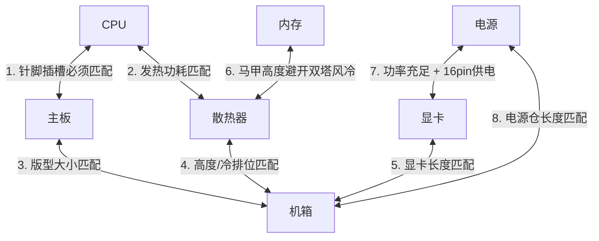

# DIY 电脑主机八大件选购与配置指南

面向台式机 DIY 组装与硬件升级，系统梳理构成电脑主机的“八大核心硬件”（CPU、主板、内存、显卡、固态硬盘、电源、散热器、机箱）的作用定位、关键技术指标、主流品牌梯队以及实战兼容避坑心法。

---

## 目录

- [Key Takeaways](#key-takeaways)
- [八大件选购决策速查表](#八大件选购决策速查表)
- [1. CPU（中央处理器）：运算中枢与大脑](#1-cpu中央处理器运算中枢与大脑)
- [2. 主板（Motherboard）：扩展平台与供电基石](#2-主板motherboard扩展平台与供电基石)
- [3. 内存（RAM）：高速多任务暂存池](#3-内存ram高速多任务暂存池)
- [4. 显卡（GPU）：图形与 AI 算力引擎](#4-显卡gpu图形与-ai-算力引擎)
- [5. 固态硬盘（SSD）：长期数据存储仓库](#5-固态硬盘ssd长期数据存储仓库)
- [6. 电源（PSU）：系统供电心脏与安全底线](#6-电源psu系统供电心脏与安全底线)
- [7. 散热器（Cooler）：温度压制与性能稳定器](#7-散热器cooler温度压制与性能稳定器)
- [8. 机箱（Case）：硬件骨架与风道容器](#8-机箱case硬件骨架与风道容器)
- [整机装机兼容性核对清单](#整机装机兼容性核对清单)
- [不同用途的预算分配模型](#不同用途的预算分配模型)

---

## Key Takeaways

1. **木桶效应与瓶颈**：整机性能由短板决定，但预算应向核心诉求倾斜——**纯游戏机显卡优先（占总预算约 40%~50%）**；**生产力/编程/AI 开发重 CPU、内存容量与高速存储**。
2. **绝对不能省的硬件**：**电源**和**主板供电**。劣质电源会毁损整机硬件（“红星炸弹”），供电缩水的主板会导致高端 CPU 降频甚至缩缸。
3. **物理兼容三大死线**：
   - 显卡长度 vs 机箱显卡限长；
   - 风冷散热器高度 vs 机箱散热限高（水冷排尺寸 vs 机箱冷排位兼容）；
   - CPU 插槽接口（Socket）与主板芯片组必须严格匹配（如 Intel LGA1700 / LGA1851，AMD AM5）。
4. **内存与存储选购原则**：
   - 内存首选 **双通道（16G×2 起步）**，认准海力士（Hynix A-die/M-die）颗粒；
   - 固态硬盘认准 **原厂 3D TLC 颗粒**，严禁核心系统盘贪便宜选择劣质 QLC 或黑片白片盘。

---

## 八大件选购决策速查表

| 硬件 | 核心作用 | 关键指标 | 推荐一线/优选品牌 | 选购避坑重点 |
| :--- | :--- | :--- | :--- | :--- |
| **CPU** | 运算逻辑、指令处理 | 单核主频、多核线程数、三级缓存、架构制程 | **Intel**、**AMD** | 游戏首选大三缓（X3D）；生产力兼顾多核与编解码 |
| **主板** | 部件通信与供电 | 芯片组级别（B/Z/X 系列）、供电相数、版型、M.2拓展 | **华硕、微星、技嘉**（一线）；铭瑄、七彩虹、华擎（性价比） | 避免“丐版”主板带高端高功耗 CPU 导致降频 |
| **内存** | 高速数据缓冲 | 代数（DDR5）、容量（32G标配）、频率与时序、颗粒 | **芝奇、海盗船、宏碁掠夺者、金士顿、光威/阿斯加特** | 必须组双通道；AMD 选 6000MHz C30 甜点频 |
| **显卡** | 图形渲染与 AI 计算 | 核心架构、显存容量/位宽、光追与超分技术（DLSS/FSR） | **N卡**：华硕、微星、七彩虹、影驰、索泰 **A卡**：蓝宝石、撼讯、讯景 | 2K 分辨率显存建议 12G+，4K/AI 建议 16G+；核对机箱限长 |
| **固态硬盘** | 系统与数据存储 | 接口协议（PCIe 4.0 NVMe）、TLC原厂颗粒、TBW寿命、缓存 | **致态、三星、西数 WD_BLACK、铠侠、美光英睿达** | 警惕劣质 QLC 与贴牌黑片颗粒；认准 5 年质保 |
| **电源** | 供电中枢与安全 | 额定功率（留足余量）、80 PLUS金牌、ATX 3.0/3.1、全模组 | **海韵、振华、长城、台达、航嘉、海盗船、安钛克** | 严禁杂牌“虚标电源”；40/50 系显卡认准 ATX 3.0 原生 16-pin |
| **散热器** | CPU 降温防缩肛 | 解热能力（TDP）、风冷热管数/规格、水冷排尺寸（240/360） | **风冷**：利民、超频三、猫头鹰 **水冷**：瓦尔基里、利民、九州风神、NZXT | 功耗 180W 内选双塔风冷无维护焦虑；水冷认准漏液包赔条款 |
| **机箱** | 骨架与风道容器 | 主板支持版型、散热/显卡限长限高、风道结构、前置 I/O | **联力、分形工艺、先马、乔思伯、追风者、NZXT** | 海景房颜值虽高但需规划好垂直风道；优选带前置 Type-C 机箱 |

---

## 1. CPU（中央处理器）：运算中枢与大脑

### 核心指标
- **单核主频 vs 多核多线程**：
  - **单核性能**：决定绝大部分电竞游戏帧率、操作系统响应速度及轻度日常流畅度。
  - **多核性能**：决定 3D 渲染、视频压制导出、代码编译、虚拟机多开等高负荷生产力效率。
- **三级缓存（L3 Cache）**：
  - 对网络竞技游戏（如 CS2、永劫无间、魔兽世界、各类 MMORPG）以及帧率稳定性（1% Low 帧）影响巨大。
- **制程与架构**：架构效率比单纯看主频更关键，新一代架构 IPC（每时钟周期指令数）提升显著。
- **功耗与接口**：
  - 功耗（TDP / PL2）决定搭配的主板供电等级和散热器规格；
  - 接口直接锁死主板针脚（如 Intel LGA1700、LGA1851；AMD AM5）。

### 品牌梯队与定位
- **Intel（英特尔）**：
  - **Core i5 / i7 / i9 与 Ultra 系列**：大小核架构调度成熟，单核稳定，Adobe 生产力生态（QuickSync 硬件加速）支持最好。带 `K` 支持超频，带 `F` 无内置核显。
- **AMD**：
  - **Ryzen 锐龙 7000 / 9000 系列**：能效比极高，发热更可控；
  - **X3D 系列（如 R7 7800X3D / 9800X3D）**：集成 3D V-Cache，当之无愧的游戏利器；AM5 平台接口承诺周期长，未来升级无需换主板。

---

## 2. 主板（Motherboard）：扩展平台与供电基石

### 核心指标
- **芯片组级别**：
  - **Intel 平台**：
    - `H系列`（入门办公，拓展弱）；
    - `B系列`（如 B760，主流性价比主力，支持内存超频，不支持 CPU 倍频超频）；
    - `Z系列`（如 Z790，高端发烧友，供电奢华，支持 CPU/内存全超频，PCIe 通道拉满）。
  - **AMD 平台**：
    - `A系列`（入门）；
    - `B系列`（如 B650，甜点主力，支持 PBO 与内存超频，接口丰富）；
    - `X系列`（如 X670 / X870，旗舰拓展与多 PCIe 5.0 通道）。
- **供电规格（VRM / DrMOS）**：
  - 决定主板能否持续稳定输出大电流给 CPU。关注供电相数、单相安培数（如 60A/70A/90A DrMOS）以及是否有大面积金属散热鳍片。
- **版型规格**：
  - **ATX（标准大板）**：扩展性最好，通常 4 个 M.2、多条 PCIe 插槽，适合大机箱。
  - **M-ATX（紧凑中板）**：装机主力，性价比最高，兼顾扩展与体积。
  - **ITX（迷你小板）**：尺寸最小（17×17cm），适合小钢炮，价格昂贵且对走线散热要求高。
- **外设与连接**：
  - M.2 NVMe 插槽数量与协议（支持 PCIe 4.0 / 5.0）；
  - 板载高速 Wi-Fi 6E/7、2.5G 网口、前置 Type-C 20Gbps 拓展插座。

### 品牌推荐
- **一线御三家（BIOS 成熟度与做工售后最好）**：
  - **华硕 (ASUS)**：ROG 玩家国度（纯血旗舰）、TUF GAMING（电竞特工，皮实耐用）、天选 / 吹雪（二次元高颜值）、Prime（大师基础款）。
  - **微星 (MSI)**：MEG/MPG（高端）、MAG 迫击炮 / 战斧导弹（中端爆款常青树）、PRO（商务性价比）。
  - **技嘉 (GIGABYTE)**：AORUS 雕族（大雕/小雕）、魔鹰 Gaming。
- **高性价比二线**：
  - **铭瑄 (Maxsun)**：终结者系列（性价比极高、供电给得很足）、电竞之心。
  - **七彩虹 (Colorful)**：CVN 系列（用料扎实）、战斧系列。
  - **华擎 (ASRock)**：妖板设计、极限性价比。

---

## 3. 内存（RAM）：高速多任务暂存池

### 核心指标
- **代数标准**：**DDR5 为当前标准主流**（起步频率 4800MHz~8000MHz+）；DDR4 仅在极低预算或老平台升级时选用。两者物理防呆槽不同，主板插槽互不兼容。
- **容量与通道原则**：
  - **必须组双通道**：利用 CPU 双通道内存控制器翻倍带宽（如 16GB×2 远优于单根 32GB）。
  - **容量推荐**：普通游戏与日常推荐 **32GB (16G×2)**；视频剪辑、AI 训练、虚幻引擎、重度多开推荐 **64GB (32G×2)** 起步。
- **频率与时序（CL）**：
  - **频率越高速率越高**；**时序越小延迟越低**。
  - **AMD 平台甜点频**：6000MHz ~ 6400MHz（时序建议选择 C30 或 C32），超过此频率通常会导致分频使延迟反升。
  - **Intel 平台**：支持更高 XMP 频率（6800MHz~7600MHz+）。
- **颗粒体质（核心）**：
  - **海力士（SK Hynix）**：A-die 与 M-die 是超频与低时序表现最好的颗粒，首选。
  - 三星与美光：中规中矩，超频上限略逊于海力士。

### 品牌推荐
- **顶级/发烧超频**：**芝奇 (G.Skill)**（幻锋戟/皇家戟）、**美商海盗船 (Corsair)**（统治者铂金/复仇者）。
- **主流高品质**：**宏碁掠夺者 (Predator)**（Hermes冰刃/Pallas炫光）、**金士顿 (Kingston)**（FURY系列）、**威刚 (ADATA)**。
- **国产高性价比**：**光威 (Gloway)**（神武/天策）、**阿斯加特 (Asgard)**、**金百达 (KingBank)**（刃系列/银爵，常采用原厂原印海力士颗粒）。

---

## 4. 显卡（GPU）：图形与 AI 算力引擎

### 核心指标
- **显示核心与架构**：
  - 核心架构是显卡性能的决定性因素。目前市场主力为 NVIDIA GeForce RTX 40 系列及 AMD Radeon RX 7000 系列。
- **显存容量（VRAM）与位宽**：
  - **1080P 游戏**：8GB 基本够用；
  - **2K 高画质游戏**：推荐 12GB 起步；
  - **4K 极致画质 / 本地大语言模型 / SD绘图**：强烈推荐 **16GB 以上**（AI 运算非常吃显存，显存爆掉直接无法运行或速度暴跌）。
- **技术生态**：
  - **NVIDIA（N卡）**：光线追踪性能领先；DLSS 3/3.5/4 帧生成算法成熟；CUDA 生态垄断机器学习与专业渲染；NVENC 视频硬件编码器效率极高。
  - **AMD（A卡）**：光栅游戏性能性价比高，同价位显存给得更大，但光追与 AI 生产力生态较弱。
- **散热与功耗设计**：
  - 双风扇适合小机箱（长约 240mm 内）；三风扇散热好、静音好，但长度常超 300~330mm，对机箱有较高要求。

### 品牌推荐
- **N卡 AIC 核心合作厂商**：
  - **旗舰第一梯队**：华硕（ROG猛禽 / TUF）、微星（SUPRIM超龙 / 魔龙 GAMING X TRIO）。
  - **主力出货一线**：七彩虹（iGame Vulcan火神 / Neptune水神 / Ultra）、影驰（HOF名人堂 / 星曜 / 金属大师）。
  - **高性价比主力**：索泰（AMP / 天启）、映众（超级冰龙）、耕升、万丽。
- **A卡 AIB 核心合作厂商**：
  - **蓝宝石 (Sapphire)**（A卡龙头，超白金/白金版）、**撼讯 (PowerColor)**（红魔/暗黑犬）、**讯景 (XFX)**（海外版三风扇）。

---

## 5. 固态硬盘（SSD）：长期数据存储仓库

### 核心指标
- **协议与接口**：
  - **M.2 NVMe (PCIe 4.0 x4)**：目前绝对黄金标准，满血顺序读取达 7000~7400 MB/s，发热与售价平衡。
  - **PCIe 5.0 SSD**：读取突破 10000 MB/s，但发热量极大，必须加装主动风扇散热，价格昂贵，普通用户边际收益低。
  - **SATA 盘**：老式 2.5 寸，速率上限 550 MB/s，仅用作大容量仓库盘。
- **闪存颗粒等级**：
  - **原厂 3D TLC**：寿命（PE周期）、长期写入速度与可靠性最优秀，推荐选购。
  - **QLC 颗粒**：缓外掉速严重（常跌至几MB/s），寿命和稳定性较差，非超低价不建议作系统盘。
  - **警惕黑片/白片**：部分极低价品牌使用晶圆测试残次品封装的颗粒，存在丢盘甚至暴毙风险。
- **独立外置缓存（DRAM Cache）**：
  - **有缓盘**（独立 LPDDR 芯片）：应对大文件连续读写、复杂碎片小文件及作系统盘性能更稳定。
  - **无缓盘（HMB 技术）**：调用一小部分内存作为缓存，发热量更低，性价比高，作普通游戏盘/从盘极佳。
- **寿命指标（TBW）与保修**：
  - 1TB 容量通常拥有 600TBW 写入寿命；认准正规官方 **5 年质保**。

### 品牌推荐
- **原厂芯片制造商（自研主控/原厂自封颗粒，稳定性最高）**：
  - **致态 (Zhitai)**：长江存储（YMTC）原厂，晶栈 Xtacking 架构，温控极优、兼具稳定性，代表型号：TiPlus7100（无缓神盘）、TiPro7000（带独立缓存旗舰）。
  - **三星 (Samsung)**：SSD 行业巨头，综合读写性能顶级，代表型号：990 Pro、980 Pro。
  - **西部数据 (Western Digital / WD_BLACK)**：黑盘电竞首选，代表型号：SN850X（带缓旗舰）、SN770（高性价比无缓）。
  - **铠侠 (Kioxia，原东芝内存)**：原厂颗粒，性价比极高，代表型号：RC20（经典有缓入门）、SD10 / SE10。
  - **美光英睿达 (Crucial)**：T500、P3 Plus 等。

---

## 6. 电源（PSU）：系统供电心脏与安全底线

### 核心指标
- **额定功率（W）**：
  - 计算法则：`(CPU最大睿频功耗 + 显卡满载功耗 + 其他硬件100W) ÷ 0.8`。
  - **推荐配置对照**：
    - i5 / R5 + RTX 4060 / 4060Ti：**550W ~ 650W**；
    - i7 / R7 + RTX 4070 / 4070Ti Super：**750W ~ 850W**；
    - i9 / R9 + RTX 4080 / 4090 / 5090：**850W ~ 1000W ~ 1200W+**。
- **80 PLUS 转换效率认证**：
  - 认准 **80 PLUS 金牌（Gold）**，典型负载转换效率达 90% 以上，发热低且省电。
- **规范标准：ATX 3.0 / ATX 3.1**：
  - 具备抗瞬时峰值功耗能力（抗 200% 整机瞬时功耗冲击）；
  - 配备原生 **PCIe 5.0 12V-2x6 / 12VHPWR 16-pin** 供电线，避免使用老旧转接线导致显卡接口融化。
- **模块化结构**：
  - **全模组（Full Modular）**：按需插线，机箱走线清爽无冗余线缆，首选；
  - 非模组：所有线材固定焊死，低预算适用。
- **内部用料**：
  - 主电容认准 105℃ 日系电容；架构优选主动式 PFC + 全桥 LLC 谐振 + 同步整流 + DC-DC 架构。

### 品牌推荐
- **老牌标杆与代工巨头（研发实力最顶尖）**：
  - **海韵 (Seasonic)**（FOCUS / PRIME 系列，电源界标杆，质保长达 10~12 年）。
  - **振华 (Super Flower)**（LEADEX 系列，九宫格模组口，静音稳定）。
  - **台达 (Delta)**（工业级巨头，品控稳如磐石）。
- **主流一线大牌**：
  - **长城 (Great Wall)**（国产老字号，猎金部落系列）。
  - **航嘉 (Huntkey)**（WD 系列 / MVP 系列）。
  - **美商海盗船 (Corsair)**（RMx / RMe 系列）。
  - **微星 (MSI)**（MAG A-GL / MEG 系列）。
  - **安钛克 (Antec)**（NE金牌系列）。
  - **追风者 (Phanteks)**（AMP 系列，海韵代工）。

---

## 7. 散热器（Cooler）：温度压制与性能稳定器

### 核心指标
- **风冷 vs 水冷选型对比**：

| 对比维度 | 双塔风冷散热器 | 一体式水冷（AIO 240/360） |
| :--- | :--- | :--- |
| **工作原理** | 铜底/热管导热 + 铝鳍片 + 风扇吹透 | 水冷头吸热 + 水泵循环 + 冷排大面积散热 |
| **维护与寿命** | 结构极简，无寿命上限，风扇坏了换风扇 | 水泵有寿命，存在极小概率漏液与水道堵塞风险 |
| **解热上限** | 极限通常在 220W~250W 左右 | 360冷排可压制 280W~350W+ 瞬时高功耗 |
| **颜值与兼容** | 体积巨大，可能挡高马甲内存 | 冷头外观科技感强（带数显/屏幕），机箱内部通透 |
| **适用人群** | 追求稳定性、零维护焦虑、预算注重性价比 | 高端高发热 CPU（如 i7/i9）、追求机箱海景房颜值 |

- **解热能力（TDP）与热管规格**：
  - 单塔 4 热管：适合 120W 以内低功耗 CPU；
  - 双塔 6/7 热管（如 AG620、PA120）：适合 180W~230W 主流级 CPU；
  - 360 一体式水冷：高功耗旗舰 CPU 首选。
- **风扇噪音与轴承**：
  - 优选 **FDB / S-FDB 动态液压轴承**风扇，高转速下无机械摩擦轴噪，寿命更长。

### 品牌推荐
- **风冷领域**：
  - **利民 (Thermalright)**：行业卷王，性价比极高（PA120、FC140、Phantom Spirit 120、AX120R）。
  - **超频三 (PCCOOLER)**：东海系列、K4/RZ600。
  - **九州风神 (DeepCool)**：冰立方 AK400/AK620、大霜塔。
  - **猫头鹰 (Noctua)**：风冷静音天花板（NH-D15、NH-U12A），做工与静音极强，价格偏高。
- **水冷领域**：
  - **瓦尔基里 (Valkyrie)**：GL360、VK 系列，冷头带屏幕、做工与解热强劲。
  - **利民 (Thermalright)**：Aqua Elite、Frozen Prism 冰封棱镜系列（高性价比水冷）。
  - **九州风神 (DeepCool)**：冰堡垒系列。
  - **高端旗舰**：**恩杰 (NZXT)**（Kraken 海妖系列）、**华硕 ROG**（龙神 / 龙王系列）。

---

## 8. 机箱（Case）：硬件骨架与风道容器

### 核心指标
- **结构与风道设计**：
  - **传统 Mesh 网孔风道机箱**：前面板金属网孔大面积进风，后部及顶部出风。散热效能最优秀，核心硬件温度最低。
  - **全景海景房机箱**：前面板 + 侧面板双面高透钢化玻璃，无立柱遮挡，观感极佳。风道改为侧进风、底进风、顶出风，需合理配置风扇反叶/正叶。
- **必须严格核对的“五大物理尺寸”**：
  1. **主板兼容版型**：是否支持 ITX / M-ATX / ATX / E-ATX；
  2. **显卡限长**：机箱标称限长必须大于显卡实际长度至少 20mm（防止卡前置风扇或水冷排）；
  3. **CPU 风冷限高**：双塔风冷高度通常为 155mm~165mm，机箱限高需预留空间；
  4. **水冷排支持位**：顶部或前部是否支持 240mm / 360mm 冷排位；
  5. **电源限长**：全模组电源插线后长度需匹配机箱电源仓空间。
- **细节做工与易用性**：
  - **板材厚度**：SPCC 钢板厚度建议 ≥ 0.7mm，防止机箱变形及机壳风扇共振震动；
  - **前置 I/O 接口**：务必选择带有前置 **USB 3.2 Type-C** 接口的机箱，日常插手机、移动固态硬盘极方便；
  - **理线空间与防尘网**：背板预留理线深度（≥ 20mm），底座与顶部带可拆洗磁吸防尘滤网。

### 品牌推荐
- **实用与高性价比**：
  - **先马 (SAMA)**：黑洞（静音）、大波浪、平头哥系列。
  - **爱国者 (aigo)**：星璨岚 / 星璨大眼萌（高性价比海景房）。
  - **动力火车、玩嘉**。
- **质感、做工与创新设计**：
  - **联力 (Lian Li)**：包豪斯 O11 系列（双面透海景房鼻祖）、鬼斧系列、L-Connect 灯控积木风扇。
  - **分形工艺 (Fractal Design)**：北欧极简奢华风，木质面板设计（North、Define、Torrent 散热天花板）。
  - **乔思伯 (JONSBO)**：全铝外壳、紧凑型 MATX/ITX 机箱（D31/D41、TK 系列双弯折玻璃）。
  - **NZXT (恩杰)**：H5/H6/H7/H9 系列，极简工业设计与理线槽优化出色。
  - **追风者 (Phanteks)**：NV 系列、XT Pro 系列。

---

## 整机装机兼容性核对清单

在正式下单采购配件前，对照下表逐一核实兼容性，可避免 95% 以上的翻车退换货问题：

1. **CPU ↔ 主板**：针脚插槽是否匹配？（如 LGA1700 必须搭配 600/700 系列主板；AM5 搭配 600/800 系列主板）。
2. **CPU ↔ 散热器**：散热器是否包含当前平台的安装扣具？解热功耗能否压住 CPU 烤机功耗？
3. **散热器 ↔ 机箱**：风冷高度是否超标？水冷排装在顶部是否会与主板散热装甲或高马甲内存打架？
4. **显卡 ↔ 机箱**：显卡长度是否在机箱限长之内？前置安装冷排是否会缩减显卡容纳空间？
5. **显卡 ↔ 电源**：电源额定功率是否留有 100~200W 余量？高端显卡是否有独立 12V-2x6 原生线缆？
6. **主板 ↔ 机箱**：机箱主板螺柱位置是否兼容 M-ATX 或 ATX？机箱前置 Type-C 跳线主板是否有对应插口？

---

## 不同用途的预算分配模型

### 1. 3A 竞技游戏型（核心：显卡第一）
* **预算比例**：显卡（45%~50%） > CPU+主板（25%） > 内存+硬盘（15%） > 电源+机箱+散热（10%~15%）。
* **配置逻辑**：CPU 选单核性能强、带大三级缓存的主流型号（如 AMD 7800X3D 或 i5-13600KF/14600KF）；省下预算最大化堆显卡（如 RTX 4070Ti Super / 4080 Super）；搭配 32GB 内存与主流 360 水冷或双塔风冷。

### 2. 生产力 / 编程开发 / AI 训练型（核心：多核、内存与显存容量）
* **预算比例**：CPU+主板（30%） > 显卡（30%） > 内存+硬盘（25%） > 电源+机箱+散热（15%）。
* **配置逻辑**：CPU 选用多核多线程的旗舰/次旗舰（如 i7/i9 或 R9）；内存直接拉满 64GB 乃至 128GB；固态硬盘选用读写寿命极佳的原厂带缓旗舰（如致态 TiPro7000 或三星 990 Pro）；显卡必须选用大显存 N 卡（16GB+ VRAM，用于 CUDA 加速及模型推理）。

### 3. 家用办公 / 轻度影音流（核心：静音、稳定与高性价比）
* **预算比例**：CPU（带核显）+主板（40%） > 固态+内存（30%） > 电源+机箱+散热（30%），无需独立显卡。
* **配置逻辑**：选用带强劲核显的 CPU；搭配高性价比 M-ATX 紧凑主板；单塔静音风冷与 500W 金牌电源，故障率低且安静省电。
