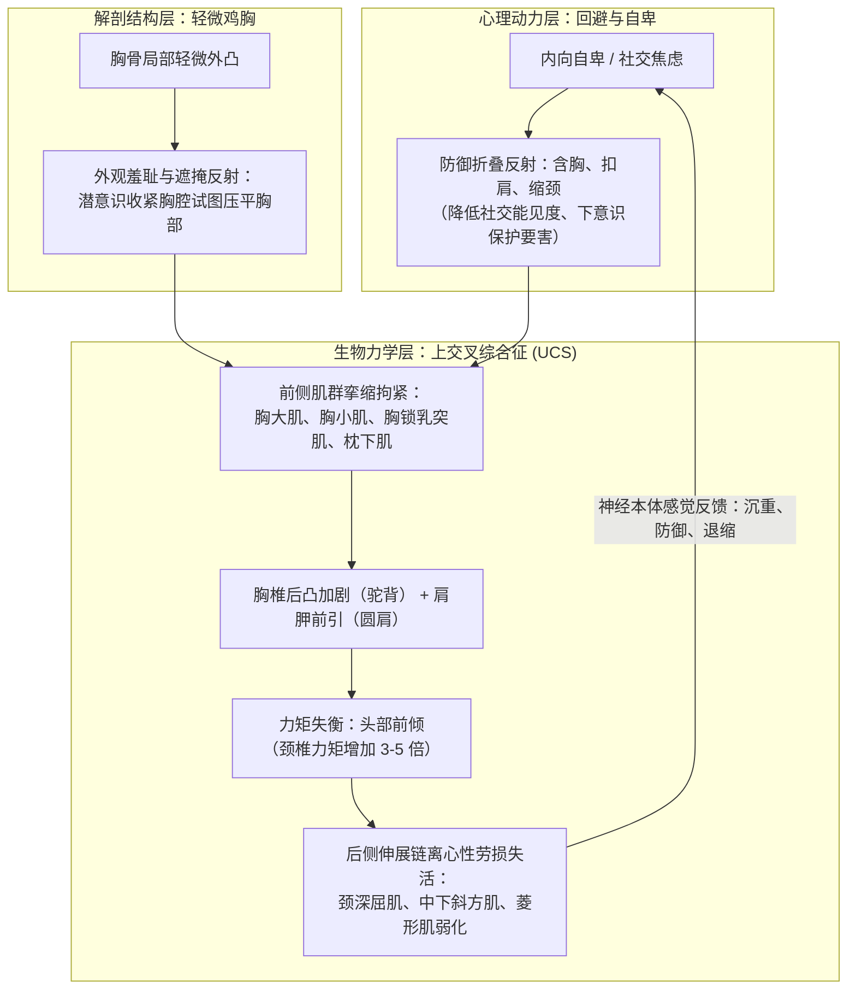
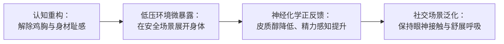

# 体态矫正与具身重塑指南——驼背、脖颈前倾与轻微鸡胸调整方案

## Key Takeaways

- **26 岁完全可以矫正**：成骨虽在 20 岁左右闭合，但姿势性驼背与颈前倾本质是**软组织张力失衡（肌纤维长度、筋膜拘紧与神经募集抑制）**与**动作模式（本体感觉）失调**。结缔组织与肌力在人的一生中皆具高度可塑性，26 岁正是肌肉和神经适应力极佳的黄金期。
- **物理与心理的恶性循环**：轻微鸡胸带来的“外观掩饰反射”，与内向、自卑、社交回避引发的“哺乳动物防御折叠反射（含胸缩颈以保护喉部与胸腔、缩小体态能见度）”双重叠加，导致前侧胸肌与后颈枕下肌高度挛缩，中下斜方肌与颈深屈肌长期失活。
- **好体态不是“死板紧绷”，而是“轻盈中立”**：多数人矫正时最容易犯的错误是“过度挺胸”（导致肋骨外翻、腰椎前凸代偿）。真正对齐的核心在于**百会穴上引、下巴微收、坐骨/足底三点承重、肋骨下沉**。
- **轻微鸡胸的天然优势**：在通过针对性训练强化胸大肌（尤其是上胸与胸骨束）及背部菱形肌后，发达饱满的胸背肌肉轮廓会完美自然修饰胸骨起伏，反而呈现出更立体深邃的胸部视觉厚度。
- **具身认知（Embodied Cognition）杠杆**：身体姿态直接反向塑造内分泌与神经递质。舒展开放的身体语言不仅能减轻颈椎负担，更是打破“自卑-收缩-更自卑”心理死结的最直接物理杠杆。

---

## 导读：关于 26 岁的身体可塑性

你所经历的长期困扰，并不是不可逆转的生理宿命。

首先给出一个笃定的临床与运动康复共识：**26 岁绝对能够显著纠正，甚至彻底重建体态**。

人体骨骼系统的骺线虽已闭合，骨骼本身不再像青少年那样具有大幅度的可塑延展，但**姿势性“驼背”与“脖颈前倾”（上交叉综合征）的物理本体从来不是骨骼畸形，而是“肌肉张力失调”、“结缔组织与筋膜粘连短缩”以及“大脑中枢神经控制模式的固化”**。

```
【简易自测】
背靠一面平整墙壁，脚跟离墙约 10-15 cm，臀部和上背部紧贴墙面。
在自然呼吸状态下，尝试微微收下巴，看后脑勺能否在无严重刺痛、无刻意仰头的前提下触碰到墙壁？
→ 只要后脑勺可以触碰墙面，或者在他人辅助/自己发力下拉直上背部，这就属于典型的“功能性/姿势性体态问题”，完全可以通过系统化的肌肉再平衡与神经重塑恢复中立位。
```

---

## 一、 根源解构：生物力学、结构特征与心理防御的交织

你的体态现状并非单一孤立的生活习惯所致，而是**物理力学、生理结构与心理防御机制三者长期共同雕刻**的结果。



### 1. 生物力学：上交叉综合征（Upper Crossed Syndrome, UCS）

正常成年人头部重量约为 5 kg（10–12 磅）。头部重心的理想物理对齐是**耳垂垂直对准肩峰**。
- 头部每向前移动 **2.5 cm（1 英寸）**，因力臂增大，颈椎与周围肌肉承受的等效重力负荷就会呈指数级增加：
  - 前倾 15°：约 12 kg
  - 前倾 30°：约 18 kg
  - 前倾 45°：约 22 kg
  - 前倾 60°：可达近 27 kg（相当于脖子上挂了一个 8 岁儿童）。
- **两组交错失衡的肌群对**：
  - **过紧、痉挛短缩组**：胸大肌/胸小肌、上斜方肌、肩胛提肌、胸锁乳突肌、后颈枕下肌群。
  - **无力、被拉长抑制组**：颈深屈肌（头长肌、颈长肌）、中下斜方肌、菱形肌、前锯肌。

### 2. 结构特征：轻微“鸡胸”的双重代偿作用

鸡胸（Pectus Carinatum）表现为胸骨或肋软骨轻度向前隆起。轻微鸡胸通常不影响心肺脏器功能，但它在**形态学与心理学**上造成了极深的影响：
- **物理维度的呼吸与胸廓代偿**：肋软骨与胸骨的轻度不对称，往往导致胸骨活动度受限、胸廓下部容易肋骨外翻，造成正常的胸腹联合式 360 度深呼吸受阻。呼吸容易变浅，更频繁地过度调用胸锁乳突肌与斜角肌来协助抬高胸腔呼吸，加剧了颈前侧的代偿紧绷。
- **心理维度的“遮掩本能”**：在生长发育的青春期，个体若察觉到自己胸骨与众不同，会产生本能的外观羞耻感。潜意识最直接的保护动作就是——**含胸扣肩、塌陷胸膛、弓起背部**，试图利用内凹的姿态在衣物下把突出的胸骨“藏”起来。这种年深日久的姿势习惯，如同给上交叉综合征套上了物理锚点。

### 3. 心理动力学：具身认知（Embodied Cognition）与防御折叠

身心从不是割裂的两套系统，身体是潜意识情绪的直接几何表达：
- **哺乳动物的“冷冻与屈曲反射（Freeze & Flexion Reflex）”**：当个体处于低自尊、缺乏安全感、社交退缩或社交焦虑时，自主神经系统的背侧迷走神经常常被激活。身体会下意识模拟面对掠食者时的防御体态——**弯曲躯干保护前胸（心脏与内脏），内扣肩膀缩紧脖颈（保护脆弱的颈动脉与气管），尽可能缩小自己在三维物理空间中的占地面积**。
- **具身认知的双向通路**：
  - “心控身”：心理上的自卑与害怕被关注，命令身体折叠缩减；
  - “身锁心”：折叠紧绷的身体持续向大脑杏仁核和下丘脑发送“我正处于威胁、脆弱、低能量、逃避竞争”的本体感觉信号，从而抑制多巴胺和睾酮分泌，反向强化了心理上的自卑和社交回避。

---

## 二、 正确体态基准：中立位与动态对齐

许多人在立志纠正驼背时，往往采取**用力后夹肩膀、拼命往前挺胸**的错误做法。这种矫枉过正会导致**肋骨外翻（Rib Flare）、腰椎过度前凸代偿、下背部剧痛**。

体态矫正的目标不是僵硬紧绷的军姿，而是**各关节自然承重、肌肉张力最小的“动态中立位”**。

### 1. 标准站姿（Standing Alignment）

从侧面观察，应满足一条贯穿重心的**垂直铅垂线**：**耳垂 → 肩峰 → 股骨大转子（髋骨外侧隆起） → 膝关节前缘 → 外踝前侧**。

| 身体部位 | 正确对齐标准 | 易犯代偿错误 | 核心心法/动作意念 |
| :--- | :--- | :--- | :--- |
| **头颈** | 耳垂正对肩峰，后颈自然拉长 | 仰头当做抬头；或下巴过度前伸 | **“百会穴悬丝上提”**：想象头顶中心有一根丝线将整个人向上悬吊，同时微微收下颌（挤出一点微双下巴的感觉）。 |
| **肩背** | 肩胛骨自然下沉微展，肩峰位于胸廓侧中线 | 死命向后夹紧肩胛骨、耸肩 | **“让锁骨微笑展开”**：肩膀向后转半圈后自然沉下，双侧腋窝像轻轻夹住一张纸。 |
| **胸腹** | 胸廓端正，下侧肋骨向下向内收拢 | 挺胸挺到下肋骨向上撅起（肋骨外翻） | **“扣紧胸骨纽扣”**：腹横肌微收（约 20% 发力），保持腹压，胸腔与骨盆像两个上下平行的碗。 |
| **骨盆/腰椎** | 骨盆保持中立，腰椎保持自然生理轻度微曲 | 撅屁股塌腰（骨盆前倾）或屁股夹扁下垂（骨盆后倾） | **“骨盆是一盆水平的水”**：不向前洒水（前倾），也不向后泼水（后倾）。 |
| **双足** | 双脚与髋同宽，脚尖微向外 5-10°，足底三点承重 | 内八字、膝盖内扣、脚底扁平受力 | **“三脚架抓地”**：大脚趾球、小脚趾球、脚后跟均等承受体重。 |

---

### 2. 标准坐姿（Ergonomic Sitting Alignment）

久坐是颈前倾与圆肩的最主要诱因。调整坐姿的关键是让**骨骼承重**，释放肌肉。

```
       [ 眼睛 ] ──── 水平视线平齐屏幕上 1/3 (50-70cm 距离)
          │
      [ 耳垂 ] 垂直正对 [ 肩峰 ]
          │
      [ 肘部 ] 90°-100°，有扶手承托，前臂水平
          │
      [ 坐骨结节 ] 垂直受力（骨盆不后倾塌陷）
       ┌──┴──┐
       │     │ 腰靠支撑 L4-L5（充实腰椎自然生理曲度）
       ▼     ▼
      [ 大腿 ] 保持水平或髋部略高于膝盖（约 90°-100°）
          │
      [ 双脚 ] 完全平放于地面或脚踏板（严禁跷二郎腿）
```

- **关键抓手 1：坐骨而非尾骨承重**
  - 用手掌垫在臀部下方，左右晃动时能摸到两块坚硬突出的骨头（坐骨结节）。
  - 让这两块骨头稳稳坐在椅子上。绝对不能用尾骨/骶骨瘫靠（即经典的“葛优躺”），否则骨盆后倾直接连带胸椎过度弯曲、颈椎前探代偿。
- **关键抓手 2：视线决定颈椎**
  - 屏幕高度过低是脖颈前倾的头号元凶。将显示器或笔记本支架垫高，使**屏幕的上 1/3 与坐立时的平视视线在同一水平线**。这样无需低头即可阅读屏幕。
- **关键抓手 3：动态打破静止**
  - **没有任何一种完美静态坐姿能够耐受超过 1 小时**。肌肉会因等长收缩而缺血疲劳。设定番茄钟或喝水提醒：每 **45-50 分钟**必定起身走动、做 30 秒扩胸与收下巴活动。

---

## 三、 四阶调整方案：松解、激活、强化与具身整合

体态调整切忌“一上来就练背”。必须遵循运动康复科学铁律：**先松解高张力挛缩肌群 → 再激活深层稳定肌群 → 继而进行抗阻动作强化 → 最终整合进日常本体感觉**。

```
阶段一：筋膜松解 & 拉伸（破除紧绷）
       ↓
阶段二：深层激活（唤醒休眠的抗重力肌）
       ↓
阶段三：抗阻力学强化 & 胸廓呼吸重构（锁定体态与修饰鸡胸）
       ↓
阶段四：具身认知脱敏（打破身体折叠与自卑回路）
```

---

### 阶段一：高张力肌群筋膜松解与拉伸（每日 5-8 分钟）

在强化之前，先将锁死在短缩状态的前侧与枕后肌群释放开来。

#### 1. 门框胸肌深度拉伸（释放胸大肌、胸小肌）
- **做法**：站在门框边，大臂抬起与地面平行或略呈 120°（肘部弯曲 90° 抵住门框边缘），一侧弓步向前迈出，重心前移，直到胸大肌、胸前侧有温和而深度的拉伸感。
- **要点**：核心保持收紧，严禁通过腰椎反弓来获取拉伸感。
- **频次**：每侧持续静态拉伸 30 秒，重复 2–3 组。

#### 2. 网球/筋膜球滚压胸小肌与锁骨下肌
- **做法**：将筋膜球或网球置于锁骨下方、肩膀内前侧的凹陷区域，面向墙壁施加压力，做小范围微幅度画圈滚动与按压。
- **要点**：找到酸痛结节（Trigger Points），在痛点上深呼吸停留 20-30 秒，释放牵拉肩胛骨前引的胸小肌。

#### 3. 枕下肌群解压（释放后脑勺深层压迫）
- **做法**：用双手大拇指抵住后脑勺下方、颈椎最顶端的枕骨下缘凹陷处。做微小的仰头、低头和左右缓慢微转动，用拇指进行深层揉压。
- **要点**：此处是 Forward Head Posture 最容易产生张力性头痛和供血不足的卡压点。每次揉压 1-2 分钟。

#### 4. 泡沫轴胸椎伸展（Thoracic Spine Extension）
- **做法**：仰卧在瑜伽垫上，将泡沫轴横放在肩胛骨中下部（胸椎段），双手交叉抱在脑后托住颈部保护颈椎，臀部紧贴地面。呼气时，以泡沫轴为支点，缓慢将上背部向后延展伸展，吸气时还原。
- **要点**：严禁放在腰椎段！重点活动胸椎中上段，每处停留伸展 5-8 次呼吸。

---

### 阶段二：深层弱势肌群神经激活（每日 5 分钟）

#### 1. 仰卧/靠墙收下巴训练（Chin Tucks - 激活颈深屈肌）
- **核心价值**：颈深屈肌（Longus Colli / Longus Capitis）是颈椎前侧的“天然刹车片”。脖颈前倾者此处几乎完全萎缩休眠。
- **做法**：
  - 初阶（仰卧）：平躺在垫上，不垫枕头。眼睛看着正上方天花板，用手指轻触下巴，随后利用颈前深层发力，将下巴**水平向后下方滑动平移**（宛如在挤双下巴），感受后颈被拉长伸展。
  - 进阶（靠墙/坐立）：背靠墙，后脑勺贴墙，做同样的水平后缩动作。
- **要点**：不是低头点头，而是头部的“水平抽屉式后缩”。每次保持顶峰收缩 5 秒，重复 10-12 次为一组，做 2-3 组。

#### 2. 靠墙“W-Y”字伸展（Wall Angels - 激活中下斜方肌与菱形肌）
- **做法**：后背、臀部、后脑勺贴紧墙壁，双臂展开呈“W”型贴在墙面上。在手背、手肘、上背不脱离墙面的前提下，贴着墙缓慢向上推起双手至“Y”型，随后慢慢下沉还原成“W”型。
- **要点**：下沉时有意识体会肩胛骨向下、向内聚拢并下沉的感觉。如果在推起过程中腰部拱起或肘部离开墙面，说明胸椎活动度受限，在无代偿的幅度内进行即可。
- **频次**：每组 10-12 次，做 2 组。

---

### 阶段三：抗阻强化与轻微鸡胸力学修饰（每周 3-4 次，结合居家哑铃训练）

你现有的居家哑铃器材与训练计划可以完美整合体态专项！强化背部拉力链、三角肌后束，以及建立厚实的前胸肌肉，是彻底固定好体态的基石。

#### 1. 弹力带/哑铃面拉（Face Pulls）——体态神器
- **针对目标**：三角肌后束、肩袖外旋肌群、中下斜方肌与菱形肌。
- **做法**：弹力带固定在与眼睛或胸口平齐位置，双手握住弹力带两端，向面部拉动。拉到终点时，手肘向外展开并向后拉，同时前臂外旋（手高肘低，做出“展示二头肌”的双高举造型），用力夹紧上背部。
- **组数与次数**：3-4 组，每组 15-20 次（轻重量、高频次、强化耐力与本体感觉）。

#### 2. 俯身哑铃飞鸟 / 哑铃胸托俯身划船（Chest-Supported Row）
- **针对目标**：强化菱形肌与斜方肌中下部，抵抗由于重力造成的含胸驼背。
- **要点**：划船顶峰收缩时，主动意念引导“先沉肩、后缩肩胛骨、最后屈手肘”，把哑铃拉向髋部方向，避免上斜方肌代偿耸肩。

#### 3. 针对轻微鸡胸的胸大肌雕刻与视觉重构
- **解剖学优势认知**：
  - 很多男性在健身后发现，轻微鸡胸是天赐的“高胸型骨架”。
  - 只要通过系统的推胸训练（**哑铃卧推、上斜哑铃卧推、标准俯卧撑**）把胸大肌的上部和中下部胸骨纤维练饱满，肌肉组织会均匀覆盖并包裹在胸壁外侧。原本突兀的骨性隆起会化作饱满厚实的胸肌纵深，形成极其立体强健的视觉观感。
- **360 度胸腹联合呼吸法（修复肋骨翻转与胸壁拘紧）**：
  - 仰卧屈膝，双手放在下侧肋骨两侧。
  - 用鼻子深吸气，意念引导空气不要只进入胃部或耸起肩膀，而是**将双侧肋骨向左、右、后三维方向膨胀撑开**，感受双手被肋骨向外推开；
  - 嘴巴缓慢呼气，感受肋骨自然下沉聚拢，腹直肌与腹横肌微收。每日练习 3 分钟，打破胸式浅表呼吸代偿。

---

### 阶段四：具身认知疗愈与“开放性姿态”暴露脱敏

体态是心理的盔甲，也是心理的枷锁。调整体态必须直面内心的社交防线。



#### 1. 认知重塑：告别“伪装隐藏”的潜意识契约
- **事实澄清**：轻微鸡胸在人群中非常普遍，绝大多数人根本无法察觉他人衣服下微小的骨骼起伏。你过去为了遮掩它而付出的代价（驼背、萎靡气场、脖子前探），在他人眼里远比一个健康舒展的胸膛要明显一千倍。
- **契约终止**：在镜子前看着自己，对自己明确宣称：“我不需要通过弯曲脊柱来向世界隐瞒我的骨骼。我的身体值得拥有全部的物理空间。”

#### 2. 从安全环境开始“开放性体态暴露（Open-Posture Desensitization）”
- 社交回避者若立刻在人群中大步挺胸昂首，往往会引发强烈的社交暴露焦虑与防御反弹。
- **阶梯式暴露步骤**：
  - **第 1 阶（独处空间）**：在自己房间书桌前或散步无人处，坐立中立位，下巴微收，双肩自然展开，体验胸廓完全打开时的充沛氧气吸入感，静坐 5 分钟，体会身体安全感。
  - **第 2 阶（功能性社交场景）**：在超市结账、便利店买咖啡等短暂无评判压力的弱社交场景中，有意识站直，肩膀下沉，保持呼吸平稳，双臂不插兜、不抱胸，自然垂放。
  - **第 3 阶（常态化社交）**：在交谈或开会时，将身体转向对方，躯干保持开放（不折叠），体会“即使我暴露了前胸，现实世界也是完全安全的”这一神经安全印记。

---

## 四、 极简实操：日常纠正流程与微习惯清单

体态矫正最容易半途而废的原因是“占用大块专门时间”。将微训练无缝嵌入现有日程是唯一可持续的路径。

### 1. 每日执行时间表

```
┌──────────────────────────────────────────────────────────┐
│  晨起（3分钟）唤醒脊柱                                    │
│  - 猫牛式 10 次（恢复胸腰椎屈伸活动度）                   │
│  - 站立收下巴（Chin Tucks）10 次                         │
├──────────────────────────────────────────────────────────┤
│  日间办公/学习（每 50 分钟微习惯）                       │
│  - 触发点：“番茄钟响”或“每喝一口水”                     │
│  - 动作：坐骨扎实坐定 → 双肩后转下沉 → 下巴后缩维持 3 秒 │
│  - 检查：屏幕上 1/3 是否与视线平齐                       │
├──────────────────────────────────────────────────────────┤
│  晚间力量与康复（15分钟，可整合进哑铃训练日）             │
│  - 门框胸肌拉伸 2 组（每侧 30s）                         │
│  - 泡沫轴胸椎伸展 8 次                                   │
│  - 弹力带面拉（Face Pulls）3 组 × 15 次                 │
│  - 靠墙 W-Y 字伸展 2 组 × 10 次                         │
├──────────────────────────────────────────────────────────┤
│  睡前环境与支撑                                          │
│  - 枕头高度：压实后约一拳高（使仰卧时颈椎呈中立水平，    │
│    避免过高枕头加重颈椎前屈）                            │
│  - 侧卧时在两膝间夹薄枕，保持骨盆与腰椎中立             │
└──────────────────────────────────────────────────────────┘
```

### 2. 进程验收与评估矩阵

| 评估维度 | 初始基线状态 | 4 周预期改善（神经肌肉适应期） | 12 周预期改善（结构性重组期） |
| :--- | :--- | :--- | :--- |
| **靠墙站立自测** | 后脑勺贴墙吃力，颈部与上背酸痛 | 后脑勺轻松贴墙，贴墙时呼吸均匀自如 | 日常无意识状态下，耳垂自然落在肩峰垂直线附近 |
| **胸椎后凸观感** | 明显含胸、侧面轮廓圆弧明显 | 圆肩幅度明显缩减，衣服前襟被挺拔撑开 | 背部平整挺拔，轻微鸡胸被丰满胸肌自然修饰 |
| **颈后疲劳感** | 坐立 1-2 小时后颈根部坚硬僵痛 | 疲劳出现延迟，能敏锐察觉前探并自行归位 | 日常几乎无颈肩酸痛，头脑清爽度明显提升 |
| **心理与社交具身感** | 习惯性抱臂、缩脖插兜、视线向下回避 | 敢于在独处与轻度社交中展开胸腔，呼吸更深 | 肢体语言舒展大方，步态坚定，内心掌控感倍增 |

---

## 结语：重构体态，就是重构你的存在空间

身体不是一副被动承受重力与创伤的机械皮囊，它是你与这个世界发生物理交互的第一个界面。

你曾经习惯的含胸与前倾，是你过去脆弱时期身体为了保护你而建立的防御机制；而今天，26 岁的你已经拥有了成熟的力量与主动选择权。

无需对自己过去的体态感到焦虑或自责。每一根肌肉纤维都在等候你的重新唤醒，每一截脊柱都在渴望重新向上生长。**从下一次深呼吸、下一次轻轻收拢下巴开始，堂堂正正地站立在属于你的物理空间里。**
