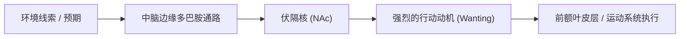
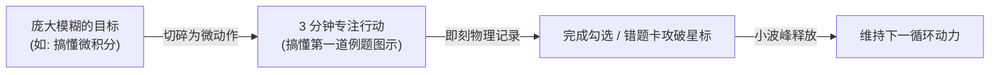

# 多巴胺机制深度解析与正向驱动

> **Key Takeaways**
> - **多巴胺不是“快乐分子”，而是“渴望与行动引擎”**：它驱动的是“想要（Wanting）”而非“喜欢（Liking）”，本质是奖赏预测误差（RPE）的信号发生器。
> - **演化设定的初衷**：在物质匮乏的原始环境中，强制驱使个体消耗宝贵能量去探索、觅食与繁衍，防止因安于现状而灭亡。
> - **“被劫持”的本质**：工业时代的超常刺激（算法、短视频、游戏、高糖高脂）通过“零成本获取 + 变比率奖励”，破坏了“付出努力—获得回报”的稳态回路，导致 D2 受体下调与基线坍塌。
> - **反向正向驱动的关键**：重塑“努力与奖励的偶联”，保护多巴胺基线（避免刺激叠加），并将反馈焦点从“终局结果”转移到“克服阻力的过程”。

---

## 一、多巴胺到底是什么？（破除大众三大误区）

### 1. 概念厘清：神经递质中的“欲望传令兵”

多巴胺（Dopamine, DA）是由脑干（主要是中脑腹侧被盖区 VTA 和黑质 SN）合成的一种儿茶酚胺类神经递质。



### 2. 三大核心认知误区

| 常见误区 | 现代神经科学真实结论 | 代表理论 / 依据 |
| :--- | :--- | :--- |
| **误区 1：多巴胺 = 快乐** | 多巴胺负责**“想要”（Wanting）**，而内源性阿片肽、内源性大麻素才负责**“享受/喜欢”（Liking）**。多巴胺激增时，人可能非常焦虑饥渴，但并不愉悦。 | Kent Berridge 奖赏激励显著性理论 |
| **误区 2：得到奖赏时多巴胺最高** | 得到奖赏时多巴胺往往迅速回落；**多巴胺分泌的顶峰发生在“追逐目标的过程”中**（即期待感最高的那一刻）。 | Robert Sapolsky 神经生物学实验 |
| **误区 3：多巴胺只有好与坏之分** | 多巴胺有两个关键维度：**基线水平（Tonic Baseline）**与**波峰刺激（Phasic Spikes）**。真正决定人长期动力与专注力的是健康稳定的基线，而非瞬间的暴涨。 | Andrew Huberman 神经生物学讲座 |

---

## 二、为什么人类会有这种演化设定？

### 1. 匮乏环境中的“生存发动机”

在远古采集狩猎时代，能量极其昂贵，自然界到处充满危险：
- 如果大脑只有在“吃下浆果”之后才感到舒服，人类根本没有动力在饥肠辘辘、寒冷刺骨时走出洞穴跋涉数公里。
- **演化机制**：只要人类看到灌木丛（线索），多巴胺系统立刻注入一剂“渴望兴奋剂”，抑制疲惫与恐惧，驱动身体调动肌肉、集中注意力去搜索。

### 2. 进化滞后（Evolutionary Mismatch）

- **远古设计**：高努力 $\rightarrow$ 概率性低回报（追逐猎物半天可能空手而归，但必须保持渴望）。
- **现代社会**：手指轻轻一滑，零卡路里消耗 $\rightarrow$ 瞬间获取超常刺激（信息爆炸、娱乐高潮）。
- **结论**：**大脑这套硬件运行的是 20 万年前石器时代的驱动程序，却接入了 21 世纪的人工算法网络。**

---

## 三、“多巴胺系统被劫持”是什么意思？

### 1. 机制一：超常刺激与“脱钩”（Supernormal Stimuli）

自然界不存在“每秒都能切换新猎物”的灌木丛。
短视频、抽卡游戏、算法信息流、精制糖被称为**超常刺激**——它们剥离了现实生活中的“时间延迟”与“精力投入”，让多巴胺波峰在数秒内冲向数十倍于自然状态的峰值。

### 2. 机制二：变比率强化（老虎机效应）

短视频每滑下一条，是爆笑、美女、低俗还是无聊？这是**完全不可预测的**。
神经科学证实：**不可预测的奖励（奖励预测误差 RPE 极大）会引发最大幅度的多巴胺爆发**。大脑误以为自己正在发现“生存奇迹”，从而下达绝对优先的注意力锁定指令。

### 3. 机制三：受体下调与基线坍塌（耐受与空虚）

神经系统遵循严格的**动态平衡（Homeostasis）**：

```
超常刺激频繁轰炸
       ↓
突触后膜 D2 受体发生下调 / 钝化（防烧坏神经元）
       ↓
多巴胺“谷底”跌破原始基线（感受痛苦、烦躁、无聊）
       ↓
日常温和刺激（看书、工作、深思）根本无法激活受体
       ↓
表现为：一学习就犯困/注意力涣散，唯有更强烈的短视频能刺激神经
```

---

## 四、如何反向利用多巴胺进行“正向驱动”？

不要把多巴胺当成敌人去“绝食戒断”，而是要**成为多巴胺系统的架构师**。

### 1. 守住基线：切断“多巴胺叠加”（Dopamine Stacking）

很多人的习惯是：学习/工作时一边听重节奏音乐、一边喝能量饮料、一边案头放着手机随时扫一眼。
- **危害**：这种“刺激叠加”人为拔高了环境刺激阈值，一旦需要面对枯燥的抽象文字和错题复习，大脑便立刻产生戒断式痛苦。
- **实操**：
  - **单调工作流**：高认知负荷任务（做题、写论文、架构设计）尽量在无杂音、无手机、干净的桌面进行。
  - **晨起第一小时无屏幕**：起床后前 60 分钟严禁触摸高刺激媒介（短视频/热搜），保护一整天的多巴胺基线。

### 2. 奖励努力过程，而非奖励终点（Growth Mindset 的生物学本质）

> “如果你只在完成宏大目标时犒赏自己，大脑就会把中间的所有努力过程判定为‘痛苦的折磨’。” —— Dr. Andrew Huberman

- **认知重构**：当做深研错题卡壳、代码报错、思维极其难受时，默念：
  > *“此时此刻前额叶的摩擦与挣扎，正是突触重塑的物理信号；我正在经历能力增长的核心节点。”*
- **神经机制**：**主动将“战胜摩擦感”本身锚定为多巴胺线索**。通过主观认知赋意，让多巴胺在攻坚阶段释放，而非仅仅挂钩于“考了多少分”。

### 3. 人为制造“压缩的反馈回路”（Game-ify the Friction）

学习之所以输给游戏，是因为游戏把大目标切成了无数个 30 秒的反馈环。



- **动作微小化（Micro-stepping）**：把“复习 50 道错题”降级为“先看懂这道题的第一行辅助线”。一旦越过启动阻力，多巴胺就会参与维持行动。
- **进度外部化可视化**：大脑对抽象的“我理解了”缺乏感知，但对“划掉 Checklist、实体便签移入已完成框、错题本盖上攻破印章”有直观的多巴胺响应。

### 4. 间歇性自我奖赏（Intermittent Reward Schedule）

- 不要每一次学习完都给自己固定的大餐或放纵（这会让奖励变成可预测的常态，迅速失去多巴胺边际效应）。
- **利用“变比率奖励”对抗“变比率诱惑”**：
  - 学习 4 个专注番茄钟后，投掷骰子决定是休息 15 分钟、还是去散步、抑或是喝杯好咖啡。
  - 给错题深研加入概率抽盲盒机制（如完成一周复习抽一次心愿单）。

### 5. 普雷马克原则（Premack's Principle：祖母法则）

- **法则逻辑**：高概率行为（你想做的事：打游戏、看电影）必须置于低概率行为（你逃避的事：沉淀错题、写复习文档）**之后**。
- **绝对底线**：**严禁“借贷式奖赏”**（即“我先玩两局游戏放松下，等下更有精力学习”——这在神经生物学上完全是谎言，玩完后多巴胺处于波谷期，更不可能主动开启高负荷认知）。

---

## 总结：驯服多巴胺的核心行动清单

| 维度 | 致命做法（被劫持） | 高阶做法（正向驱动） |
| :--- | :--- | :--- |
| **刺激输入** | 学习时放快歌、喝奶茶、开网页微信 | 创造感官剥夺的“摩擦空间”，保持基线纯净 |
| **反馈焦点** | 盯着遥远不可及的结果（如期末考第一、成名） | 关注当下突破一个盲区带来的“智力闭环” |
| **任务颗粒度** | “今天把这本技术书啃透” | “今天搞定第 3 节的内存泄漏调用栈流程” |
| **奖赏节奏** | 每天固定高频打赏自己，或做完立刻疯狂放纵 | 随机变比率小奖励；先苦后甜，严禁预支 |
| **看待痛苦** | 遇到卡壳认为“我天生不行，好累好困” | 意识到“认知阻力正是大脑在重构神经回路，此为动力源泉” |
