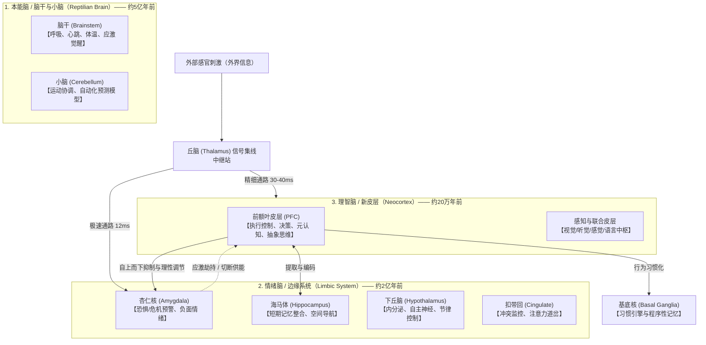
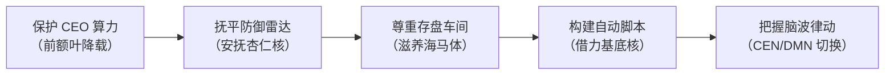

# 大脑结构与核心职责图谱——高效用脑的神经科学基础

> *"大脑并不是一个单体计算机，而是一座演化形成的‘多层联邦政府’——古老的生存本能区掌握快速否决权，年轻的理智皮层负责精密规划。理解各脑区的权责与博弈机制，是所有高阶学习与效能管理的前提。"*

---

## ⚡ Key Takeaways（核心结论前置）

1. **大脑是分层演化的“联邦制架构”**：从底层的本能脑（脑干/小脑）、中层的感情脑（边缘系统），到顶层的理智脑（大脑新皮层/前额叶），越晚演化的结构功能越高级，但生理权重和反应速度往往处于劣势。
2. **前额叶皮层（PFC）是“稀缺而脆弱的 CEO”**：负责逻辑推理、专注力、工作记忆与自制力，但仅占身体 2% 体重却消耗超 20% 能量，极其容易因疲劳、低血糖、多任务切换而“罢工”。
3. **杏仁核是“毫秒级火警与防御雷达”**：感知威胁只需 12 毫秒（比前额叶快近 3 倍）。在压力与焦虑状态下，杏仁核会发动“神经劫持”，切断前额叶供能，使人陷入“战/逃/僵”的原始本能反应。
4. **海马体是“易失性缓存（RAM）与记忆打包机”**：负责将白天的信息打上时间与空间戳记，暂存在海马突触中；**长期记忆的固化必须在深度睡眠和离线休息期间**通过海马体向大脑皮层（硬盘）进行“慢波重放（Sharp-wave Ripples）”。
5. **基底核是“高能耗决策的自动化固化引擎”**：前额叶学新技能费时费力，一旦行为重复成型，基底核便将其封装为“组块（Chunks）”自动执行，以此解放前额叶算力。
6. **科学用脑的底层心法**：**不要试图用意志力强行对抗下层大脑**。合理用脑的核心在于——**降载前额叶（单任务+外部化）**、**安抚杏仁核（命名情绪+深呼吸）**、**滋养海马体（保障睡眠+间隔提取）**、**借力基底核（自动化习惯回路）**。

---

## 一、大脑的宏观全景与演化三层模型

要理解大脑的协同运作，首先需要建立宏观的心智图景。神经科学家保罗·麦克莱恩（Paul MacLean）提出的**“三重脑假说（Triune Brain）”**虽在当代比较神经生物学中被修正为高度联动的复杂网络，但在认知管理与自我审视上仍是极为经典的启发式模型：



---

## 二、核心脑区深度剖析：职责、机制与用脑启示

### 1. 前额叶皮层（Prefrontal Cortex, PFC）：大脑的战略指挥中心

位于前额正后方，是人类进化最晚、发育最慢（约到 25 岁才完全成熟）的脑区。它是人类之所以具备文明、自制力与抽象创造力的生理基石。

#### 核心细分子区域与职责
- **背外侧前额叶（dlPFC）**：**纯理性计算器**。负责工作记忆（保持并操作当前信息）、逻辑推理、数学计算、复杂问题求解。
- **腹内侧前额叶（vmPFC）**：**价值评估与主观权衡**。负责将情感感受与理智整合，评估“这对我是否重要/道德”，形成主观决策偏好。
- **眶额皮层（OFC）**：**奖励预期与冲动制动器**。评估行为带来的即时惩罚与长远奖励，负责抑制即刻诱惑、调整受挫后的行为策略。
- **前扣带皮层（ACC / 背侧 dACC）**：**错误检测与认知冲突侦测器**。当你发现“说漏了嘴”或“做题对答案发现矛盾”时，ACC 会亮起警报，提示 PFC 介入校正。

#### 生理瓶颈与局限
- **极度耗能与容量狭窄**：工作记忆的容量仅有约 4 个信息块（Chunk），注意力极难并行。
- **自我损耗（Ego Depletion）**：连续进行深层决策和抗拒诱惑后，PFC 内的前额叶神经元神经胶质细胞葡萄糖消耗殆尽，并堆积腺苷，导致“决策疲劳”。

> [!TIP] **科学用脑法则 1：PFC 的精力护城河**
> - **黄金周期专注**：将最具挑战的逻辑推理、系统架构、深度创作安排在一天中意志力最充沛的前 2-4 小时（PFC 能量顶峰）。
> - **认知卸载（Cognitive Offloading）**：拒绝纯靠脑子记待办与细枝末节。使用纸笔、知识库或清单将工作记忆外部化，给 dlPFC 释放计算带宽。
> - **微休息补能**：PFC 无法像肌肉那样持续泵血，每专注 45-60 分钟进行 5-10 分钟非认知刺激休息（散步、远眺、深呼吸），避免腺苷过度堆积。

---

### 2. 杏仁核（Amygdala）：生存防御与情绪警报器

位于大脑内侧颞叶深处，形似杏仁，成对存在。它是边缘系统的“安保司令官”。

#### 核心职责与工作机制
- **危险与恐惧检测**：对潜在的生存威胁、外界评判、社交排斥保持超高敏感度。
- **启动急性压力响应（Fight or Flight）**：一旦识别威胁，杏仁核绕过理智大脑，经下丘脑直接激活交感神经系统，释放肾上腺素和去甲肾上腺素，心跳加速、血压上升、血液涌向四肢大肌群。
- **强化情绪记忆印记**：在强烈恐惧、羞耻或极度兴奋时，杏仁核释放神经调质，指示海马体“这个危险极度致命，永久记住它”，形成创伤应激或深刻警惕。

#### 致命现象：“杏仁核劫持（Amygdala Hijack）”
外界信号进入丘脑后，会兵分两路：
1. **短路通路（低通路，约 12ms）**：直接送达杏仁核，粗糙但极速。
2. **高通路（长通路，约 30-40ms）**：送达视觉/感知皮层再到 PFC 进行理性研判。

当杏仁核认为受到重大威胁（如老板当众批评、方案出现重大事故），它会在理智脑完全看清事实之前接管身体控制权，关闭向 PFC 的血液供应与认知资源，导致人**大脑一片空白、手足无措或暴怒失控**。

> [!IMPORTANT] **科学用脑法则 2：驯服杏仁核**
> - **情绪标记法（Name It to Tame It）**：神经影像学证明，当愤怒或恐慌升起时，**只要在心中清晰用词汇精确描述它**（“我现在感受到了焦虑与防御心”），PFC 的语言中枢就会重新激活，向下发送抑制性递质（GABA）冷却杏仁核。
> - **生理刹车（Physiological Sigh）**：连续两次快速吸气 + 一次缓慢悠长吐气，通过膈肌运动激活迷走神经，迅速压低交感神经兴奋度，打断劫持循环。
> - **将阻抗认知为“假警报”**：面对拖延或畏难（如面对枯燥长文/复杂代码），要意识到这只是杏仁核将高认知负荷误判为了“危险”，告诉自己“只做两分钟”，安抚警报。

---

### 3. 海马体（Hippocampus）：记忆编织者与认知地图

形似海马，紧邻杏仁核，是大脑中处理陈述性记忆（事实、知识、经历）的中枢。

#### 核心职责与工作机制
- **陈述性记忆的编码与暂时存储**：你在白天学到的概念、代码语法、业务规则，首先被海马体突触可塑性临时捕获。海马体是记忆的**“编目员”**，不是最终仓库。
- **空间认知与心理地图（Cognitive Map）**：包含著名的**位置细胞（Place Cells）**和**网格细胞（Grid Cells）**（2014年诺贝尔生理学奖），负责空间定向与环境建模。人类甚至将这套空间导航系统借用为**抽象概念的思维架构定位**。
- **成体神经发生（Adult Neurogenesis）**：海马体的齿状回（Dentate Gyrus）是成年人大脑中极少数能够终身持续产生新神经元（Neurogenesis）的区域。

#### 海马体的宿敌与盟友
- **宿敌：长期高皮质醇（Cortisol）**。长期的慢性压力、连续熬夜会导致皮质醇持续冲刷海马体，抑制神经发生，导致海马体神经元突触萎缩，表现为“记性大幅变差、学不进去新东西”。
- **盟友：慢波睡眠（Slow-Wave Sleep）与脑源性神经营养因子（BDNF）**。有氧运动能促进肌肉释放鸢尾素并诱导脑内分泌 BDNF，直接刺激海马体新生神经元连接。

#### 记忆巩固机制：尖波涟漪（Sharp-Wave Ripples）
夜间进入非快速眼动睡眠（NREM）第三期时，前额叶沉寂，海马体会以白天正常速度的 10-20 倍高频回放当天的神经放电模式（Memory Replay），将神经突触变化逐步转移并印刻到大脑皮层各区域中，这一过程称为**系统级记忆巩固（System Consolidation）**。

```
白天感知输入 ───> 海马体快速捕获（临时突触强弱）
                       │
                       │ [夜间深度慢波睡眠 + 尖波涟漪重放]
                       ▼
                 大脑皮层神经网络（长期突触结构重组，变成永久记忆）
```

> [!TIP] **科学用脑法则 3：保护与激发海马体**
> - **睡眠是记忆的固化车间**：熬夜复习是“把水倒进漏斗”——海马体没时间将白天内容转存到大脑皮层，第二天缓存自动溢出丢失。保证 7-8 小时高质量睡眠不是休息，而是**学习的一半工序**。
> - **提取练习（Retrieval Practice）优于反复阅读**：海马体对“被动流入的信息”不敏感，但每次你合上书本，在大脑中尝试“艰难检索与回忆”时，海马体会向皮层发起强有力的突触重构信号，使记忆强度倍增。
> - **有氧运动增加记忆容量**：每周 3 次、每次 30 分钟心率达 120-140 的有氧运动，是刺激海马体 BDNF 分泌最强效的自然药物。

---

### 4. 基底核（Basal Ganglia）：习惯自动化与低能耗执行器

位于大脑基底部，主要包括纹状体（尾状核、壳核）、苍白球、黑质等。

#### 核心职责与工作机制
- **习惯回路与组块化（Chunking）**：学习一项新动作（如开车、盲打、敲击 Vim 快捷键），起初需要 PFC 极度费力地逐个指令监督；一旦熟练，基底核接管并将其打包装订为一个完整的神经动作组块。
- **多巴胺多通道投射与强化学习**：黑质致密部（SNc）与腹侧被盖区（VTA）的多巴胺神经元投射到纹状体，形成“提示（Cue）→ 惯常行为（Routine）→ 奖赏（Reward）”的经典习惯循环。
- **动作门控机制（Gating Mechanism）**：基底核就像一道闸门，不断过滤大脑皮层发出的各种冲动动作，只允许被强化学习选中的“优势行为方案”放行通过。

> [!TIP] **科学用脑法则 4：用基底核分担前额叶负荷**
> - **将高耗能自律沉淀为自动化微习惯**：意志力是易耗品（PFC 驱动），习惯是免耗电程序（基底核驱动）。想要每天读书，不要靠“我今天必须克服懒惰读1小时”，而是设定“坐到书桌前翻开第一页”（基底核动作启动）。
> - **固定工作流模板化**：将日常开发、排障、写作的标准起手式固化为流程清单与肌肉记忆，让前额叶保留电量做最核心的构思与决策。

---

### 5. 下丘脑与自主神经系统：节律与生理稳态调节器

下丘脑体积微小（约杏仁大小），却是控制全身内分泌与自主神经系统的“物理总闸”。

#### 核心职责与工作机制
- **HPA 轴（下丘脑-垂体-肾上腺轴）**：应激反应的核心内分泌回路，控制皮质醇在一天中的节律起伏。
- **视交叉上核（SCN）——主生物钟**：根据眼部视网膜神经节细胞（ipRGCs）感知的蓝光波长，调控松果体褪黑素的合成与抑制，掌管人体的昼夜睡眠-觉醒周期。
- **能量与体温平衡**：监测血液中的血糖、瘦素与生长素，决定饥饿感与代谢水平。

> [!TIP] **科学用脑法则 5：校准神经物理稳态**
> - **晨起第一缕阳光（Morning Sunlight）**：起床后 30-60 分钟内接触 10-15 分钟户外自然光，激活 SCN，重置体内皮质醇峰值，并为 14-16 小时后的褪黑素分泌定下倒计时。
> - **血糖平稳保卫专注**：PFC 是纯靠葡萄糖供能的精细组织，高升糖指数（GI）的饮食会导致胰岛素过山车，引发严重的饭后“脑雾（Brain Fog）”。

---

### 6. 脑岛（Insula）与前扣带回（ACC）：身心内感与调控道岔

- **脑岛（Insula）——内感感知枢纽（Interoception）**：实时感知身体内部的生理状态（心率跳动、呼吸深浅、肠胃蠕动、肌肉酸痛）。高情商与高自我觉察者的脑岛灰质密度普遍较高。
- **前扣带皮层（ACC）——冲突监控与神经道岔**：负责平衡本能冲动与理智决策。当面临“想吃甜食但要控糖”时，ACC 会高度活跃并充当裁判，调集 PFC 的抑制力量。

---

### 7. 小脑（Cerebellum）：不仅是平衡木，更是神经前馈预测机

虽然小脑仅占脑体积 10%，却容纳了**全脑超过 50% 的神经元**。
- **动作与肌肉记忆**：骑车、弹琴、盲打等精细动作的高频纠偏。
- **认知层面的前向预测模型（Internal Forward Models）**：现代神经影像学发现，小脑深度参与了语言语法处理、时间流速预判与认知误差修正。它通过毫秒级预测“预期结果 vs 实际反馈”，为 PFC 扫清基础预测障碍。

---

## 三、大脑运作的高级架构：三大核心神经网络动态博弈

大脑各个区域并不是孤立工作的，而是通过白质纤维束组成跨越全脑的动态功能网络。现代认知神经科学揭示了对日常生活影响最大的**三大核心大尺度脑网络（Large-Scale Brain Networks）**：

```
                    ┌───────────────────────────┐
                    │  突显网络 (SN)             │
                    │  前脑岛 + 背侧前扣带回      │
                    │  【全脑列车调度员 / 裁判官】 │
                    └─────────────┬─────────────┘
                                  │
                 动态切换信号 (Switching Mechanism)
                                  │
         ┌────────────────────────┴────────────────────────┐
         ▼                                                 ▼
┌─────────────────────────────────┐       ┌─────────────────────────────────┐
│ 中央执行网络 (CEN)              │       │ 默认模式网络 (DMN)              │
│ 背外侧前额叶 + 后顶叶皮层        │       │ 内侧前额叶 + 后扣带回 + 海马区   │
│ 【聚焦外部任务、逻辑、算力全开】 │       │ 【向内漫游、发散联想、自我反思】 │
└─────────────────────────────────┘       └─────────────────────────────────┘
```

| 脑网络 | 核心主导脑区 | 典型运作状态 | 优势表现 | 劣势与失控表现 |
|---|---|---|---|---|
| **中央执行网络 (CEN)**<br>*(Central Executive Network)* | 背外侧前额叶 (dlPFC)<br>后顶叶皮层 (PPC) | 深度沉浸在明确的外部任务中（敲代码、算题、推演方案） | 逻辑严密、高度专注、深度产出 | 长时间运转极度耗能，容易思维定势、钻牛角尖 |
| **默认模式网络 (DMN)**<br>*(Default Mode Network)* | 内侧前额叶 (mPFC)<br>后扣带回 (PCC)<br>海马区 | 不做具体任务时的白日梦、发呆、散步、洗澡放空 | 跨领域创意迸发、灵感涌现、整合远距离联想 | 过度活跃会导致**反刍思考（Rumination）、焦虑内耗、沉溺往事与担忧未来** |
| **突显网络 (SN)**<br>*(Salience Network)* | 前脑岛 (AI)<br>前扣带回 (dACC) | 监控内外部环境中最重要的刺激，充当 CEN 与 DMN 之间的“道岔调度员” | 敏锐感知环境变化与疲劳度，促成张弛有度的顺畅切换 | 失调时导致注意力涣散，无法在正确时机进入深度专注 |

> [!NOTE] **创造力与用脑的“双网呼吸律动”**
> 很多难题往往不是在办公桌前死磕出来的，而是在散步、洗澡或小憩时灵光一闪——这就是**CEN 负责“灌入高密度原料”，DMN 负责“在潜意识中发散重组”**的典型例证。合理用脑是学会让 CEN 与 DMN 像呼吸一样交替配合。

---

## 四、核心脑区全景对比与速查矩阵

| 脑区部位 | 演化层级 | 核心生理职责 | 认知 / 心理表现 | 典型失效场景 | 科学用脑应对策略 |
|---|---|---|---|---|---|
| **背外侧前额叶 (dlPFC)** | 新皮层 (理智脑) | 工作记忆、逻辑规划、抽象推演 | 深度思考、自律执行 | 熬夜后大脑迟钝、多任务时频频出错 | 单任务工作、利用清单/知识库外部化、早间攻坚 |
| **眶额/腹内侧 (OFC/vmPFC)** | 新皮层 (理智脑) | 价值判断、奖赏预测、冲动抑制 | 权衡利弊、抵御诱惑 | 忍不住点开短视频、情绪化消费 | 增加物理诱惑门槛、强化长期收益的可视化 |
| **杏仁核 (Amygdala)** | 边缘系统 (情绪脑) | 危机侦测、恐惧应激、恐惧记忆 | 焦虑不安、拖延逃避、情绪应激 | 遭遇负反馈时暴怒、面对难任务直接躺平拖延 | 命名情绪、生理呼吸重置、拆解微小第一步（降低警报） |
| **海马体 (Hippocampus)** | 边缘系统 (记忆枢纽) | 短期记忆编码、认知地图、空间导航 | 吸收新概念、结构化知识构建 | 持续高压下健忘、熬夜复习后第二天全忘 | 保障 7-8h 睡眠固化突触、间隔提取、有氧运动刺激 BDNF |
| **基底核 (Basal Ganglia)** | 皮层下 (习惯引擎) | 动作组块化、习惯回路、多巴胺强化 | 肌肉记忆、无意识自动化运转 | 恶性习惯难以戒除（烟瘾、无意识刷手机） | 拆解习惯回路（修改 Cue，替换 Routine，保留 Reward） |
| **下丘脑 (Hypothalamus)** | 间脑 (生理基座) | 自主神经调控、内分泌、昼夜节律 | 精力波动、食欲、睡眠周期 | 作息错乱导致的白天困倦、长期慢性疲劳 | 早间户外自然光、固定作息、控制碳水防血糖震荡 |
| **脑岛 (Insula)** | 边缘/皮层交界 | 内感感知（心跳/呼吸/体感）、直觉 | 自我觉察、情绪先兆捕捉 | 身心解离、麻木疲劳直到彻底崩溃（Burnout） | 正念冥想、定时扫描身体紧张部位并主动放松 |

---

## 五、基于神经科学的五大科学用脑底层法则

理解了上述生理构件后，“如何合理用脑”就不再是一句抽象的励志口号，而是一套尊重生物物理学规律的**工程调优方案**：



### 1. 保护 CEO 算力：前额叶能量守恒原则
- **拒绝伪多任务（Task Switching）**：前额叶的注意力通道是串行的。频繁在代码、微信、邮件之间切换，每次都在突触间留下“注意力残留（Attention Residue）”，极速耗尽有限的神经资源。
- **重要决策前置**：意志力和高质量判断是有限的稀缺品。早晨先做高阶规划，琐碎沟通留给午后低能期。

### 2. 抚平防御雷达：边缘系统安抚原则
- **情绪没有平复之前，绝不上马理性工作**：杏仁核高亢时，通向前额叶的通路已被阻断。强迫自己“理智点”往往只会加剧神经内耗。先通过深呼吸、喝水、离席走动平息交感神经，再唤醒 PFC。
- **降低任务门槛以躲过警报**：杏仁核对“庞大、模糊、有失败风险”的任务会直接触发“逃跑（拖延）”。把目标拆解到荒谬微小的地步（如“打开文档写第一行代码”），杏仁核就不会拉响防御警报。

### 3. 尊重存盘车间：海马体突触固化原则
- **睡好比学完更重要**：学习的突触物理印刻是在慢波睡眠中完成的。削减睡眠换取学习时间，本质是用“销毁硬盘”的代价来扩充“临时内存”。
- **强制提取与间隔重温**：海马体不是照相机，而是检索放大器。学完之后通过自我提问、向他人解释（费曼技巧）进行逆向提取，才能让海马体高频放电加固神经连接。

### 4. 构建自动脚本：基底核习惯杠杆原则
- **把高耗能动作交给低耗能芯片**：凡是反复出现的行为（晨起起步、环境整理、复盘整理、代码规范检查），全部制作成标准作业程序（SOP）并反复演练，让控制权从高耗能的 PFC 顺移到低耗能的基底核。

### 5. 把握脑波律动：CEN 与 DMN 动态呼吸原则
- **深度工作时屏蔽一切环境干扰**（让 CEN 全力运转）。
- **遭遇瓶颈时主动断开连接**（散步、淋浴、放空，启动 DMN 让全脑远距离语义网络在后台碰撞计算）。真正高效的大脑永远是“张弛有度”，而不是“全天紧绷”。

---

## 六、知识库关联与延伸阅读

- 深入理解大脑的多巴胺预期与驱动机制：[[4. 思考与认知/多巴胺机制深度解析与正向驱动.md|多巴胺机制深度解析与正向驱动]]
- 探讨注意力分配与认知资源瓶颈：[[4. 思考与认知/注意力——大脑的内存与人生的操控杆.md|注意力——大脑的内存与人生的操控杆]]
- 从神经奖赏回路与认知负荷剖析厌学成因：[[4. 思考与认知/人为什么不想学习——认知心理学视角.md|人为什么不想学习——认知心理学视角]]
- 高阶思维模型与系统性决策：[[4. 思考与认知/思维模型/高杠杆思维模型实战手册.md|高杠杆思维模型实战手册]]
