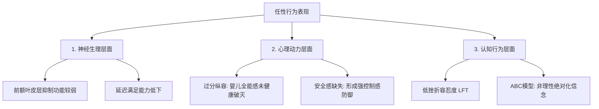

# 任性性格的本质成因与心理重塑

## 笔记概览

### 知识鸟瞰

1. 概念定义与现象描述                             [前提·定义]
   └─ 铺垫 → 核心主张
2. 多维本质成因解构                              [核心·机制]
   ├─ 神经层面：前额叶抑制与延迟满足弱化
   ├─ 动力层面：全能感未健康破灭与控制感防御
   └─ 认知层面：低挫折容忍度（LFT）与 ABC 评估机制
   └─ 关系：神经发育 ↔ 心理防御，互为因果
3. 心理重塑与行为修正                             [实践·行动]
   ├─ 自我修行：觉察隔离、5秒法则与微量脱敏
   └─ 他人引导：温和边界对话模版与自自然结局
   └─ 问题 → 方案 → 限制

主线：本篇笔记从日常生活中的“任性”表现切入，从神经发育、心理动力及认知行为三维视角深入剖析其本质成因，并提供针对自我与他人双向的心理重塑方案与实操话术。

### 各节内容概要

| 章节/部分 | 核心内容 | 关键要点 |
| :--- | :--- | :--- |
| **1. 概念定义** | 明确任性在心理学上的本质定义与典型日常表现 | 任性并非单纯性格劣势，而是冲动抑制弱与控制感依赖的行为防御 |
| **2. 三维本质成因** | 从神经、家庭教养与认知模型深度剖析成因 | 前额叶功能弱化、婴儿全能感遗留、低挫折容忍度（LFT）与 ABC 认知引发 |
| **3. 重塑实战方案** | 给出自我修正三步法与引导他人的真实对话模版 | 5秒暂停觉察、微量脱敏训练、温和而坚定的拒绝与界限维护 |

---

## 1. 任性性格的现象与本质定义

“任性”（Self-willfulness / Capriciousness）在日常生活与心理学中表现为：**只顾个人即时意志、忽视客观规则与他人感受、情绪自我中心化且缺乏自我调节能力**。

> [!note] 典型日常场景与行为模式
> * **场景 A（亲密关系）**：伴侣一旦没有按自己的想法做事（如选了自己不喜欢的餐厅），立即冷战或爆发出强烈情绪，强求对方顺从。
> * **场景 B（职场协作）**：方案在讨论中未被完全采纳，将合理的业务质疑解读为对自己的针对，固执己见拒绝妥协。
> * **场景 C（家庭教育）**：儿童或青少年要求未能立刻满足时摔东西、耍赖，直至家长妥协。

心理学认为，任性并非不可改变的“天性基因”，而是一种**在成长过程中固化下来的行为模式与情绪防御机制**。

---

## 2. 三维本质成因剖析

任性的形成是**神经心理发育、早期教养环境与认知评估模式**共同作用的结果。

### (1) 神经生理层面：前额叶皮层抑制与延迟满足弱化
* **前额叶发育与训练不足**：大脑前额叶皮层（Prefrontal Cortex）负责理性决策、评估行为后果及抑制冲动。任性者在前额叶自我调控回路训练上存在短板。
* **延迟满足（Delay of Gratification）能力匮乏**：更容易被当前即时的欲望或情绪冲动所劫持，无法承受“欲望延后满足”带来的心理张力。

### (2) 心理动力层面：全能感未健康打破与控制感补偿
* **过度纵容型**：婴儿期人人皆有“世界围着我转”的全能感。若养育者缺乏边界与规则教育，个体未能经历“健康的全能感破灭”，导致“我的需求即最高指令”延伸至成年。
* **安全感匮乏型（反向防御）**：幼年遭遇忽视或过度严苛控制，成年后将任性作为**自我保护机制**，通过“强行说了算”来掩盖内心的脆弱、无力感与失控恐惧。

### (3) 认知行为（CBT）层面：低挫折容忍度（LFT）与 ABC 评估机制
* **低挫折容忍度（Low Frustration Tolerance, LFT）**：对“事与愿违”的耐受力极低，一旦遇到阻碍或拒绝，会迅速产生强烈的心理痛苦与生理应激。
* **ABC 认知模型推导**：
  * **A（引发事件）**：请求被他人拒绝，或事情发展超出预期。
  * **B（非理性信念）**：“世界必须随时顺从我，被拒绝等于我没价值/别人在攻击我”。
  * **C（行为结果）**：爆发出暴躁、任性强求或冷漠对抗。

---

## 3. 性格重塑与行为修正实战方案

改变任性需要区分**“自我改造”**与**“应对身边的任性者”**两种情境：

### 自我重塑 vs 他人引导对比策略

| 实施维度 | 自我重塑（如果自己想改） | 他人引导（如何应对任性伴侣/子女） |
| :--- | :--- | :--- |
| **核心机制** | 建立觉察隔离，增强前额叶理性调控 | 建立清晰边界，打破“任性=获利”的正反馈 |
| **实操步骤 1** | **STOP 5秒觉察**：暂停行动 → 命名情绪 → 识别背后需求 | **温和而坚定的拒绝**：认同情绪，拒绝不合理要求 |
| **实操步骤 2** | **微量脱敏训练**：每周主动体验 1-2 次放弃主导权 | **自自然结果承担**：停止替对方的任性决策兜底 |
| **关键心态** | “事情未顺我意，世界不会坍塌，我是安全且可调控的” | “我不攻击你的情绪，但我也绝不妥协我的原则” |

### 自我重塑具体三步法

1. **第一步：建立“暂停-观察”回路**
   * 当产生暴躁、强求冲动时，强制执行“5秒法则”：呼吸 3 次，询问自己：“我现在的愤怒是在防御什么？我真正想要的是关注还是安全感？”
2. **第二步：微量挫折脱敏**
   * 主动寻找微小的不顺心场景（如把就餐地点交由他人决定），在轻微的不适中体验“放弃控制”的安全性，建立前额叶新神经回路。
3. **第三步：换位思考显性化**
   * 在发生冲突时，用笔写下“如果我是对方，听到我刚才的言行会有什么感受”。

> [!tip] 他人引导实战话术模版（应对任性要求）
> * **情境**：伴侣或孩子因要求未满足而发脾气耍赖。
> * **错误回应（提供正反馈妥协）**：“好了好了，怕了你了，就按你说的办吧。”（这会强化“任性有收益”的回路）
> * **错误回应（攻击性对抗）**：“你这人怎么这么自私任性？太不理智了！”（这会激发对方的防御机制，引发更强烈的冲动）
> * **正确回应（温和而坚定的拒绝模版）**：
>   * *“我知道你现在非常想去那家餐厅/买这个玩具（接纳并确认情绪与感受），但我今天已经安排了其他行程/超出了预算（阐述客观界限）。我们可以下周再安排（提供可预测的方案），但今天不能按这个办（坚守底线）。”*

---

## 核心概念速查

| 概念 | 一句话说明 | 直观类比 | 为什么重要 |
| :--- | :--- | :--- | :--- |
| **前额叶抑制功能** | 大脑中负责控制冲动、评估后果与延迟满足的理性中枢 | 汽车的刹车系统 | 理解任性并不是纯粹的道德品质问题，而是神经调控回路锻炼不足的问题 |
| **婴儿全能感** | 婴儿期认为“我的念头能支配外部世界”的原始心理状态 | 以为自己手握世界遥控器 | 揭示过度纵容如何导致个体心理年龄滞留于婴幼儿期 |
| **低挫折容忍度 (LFT)** | 无法忍受任何阻碍、拒绝或不顺心的心理脆弱状态 | 玻璃杯一撞就碎 | 认知行为疗法（CBT）中改变任性与暴躁的核心干预切入点 |

---

## 核心要点

* `[结论]` 任性本质上是一种由于**前额叶抑制能力低下、全能感未健康破灭及低挫折容忍度**所导致的冲动防御行为。
* `[机制]` 任性行为往往通过“发作情绪 → 他人妥协 → 需求满足”形成**正反馈强化回路**；打破回路的核心在于切断这一奖赏链条。
* `[行动原则]` 自我改善需通过 **“5秒暂停觉察 + 挫折脱敏训练”** 来重塑神经回路；应对他人任性则必须保持 **“温和而坚定的边界与话术模版”**。
* `[限制]` 极度固化的任性行为可能伴有深层创伤或神经发育障碍（如 ADHD），单靠个人意志力调整见效较慢，必要时需结合专业心理咨询。

---

## 参考来源

* 《认知行为疗法（CBT）基础与应用》
* 发展心理学：个体情绪调节与前额叶发育机制
* 心理动力学：客体关系理论与婴儿全能感发展
