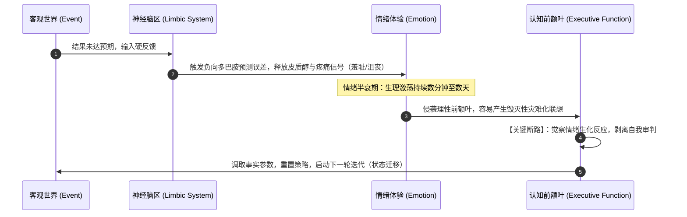
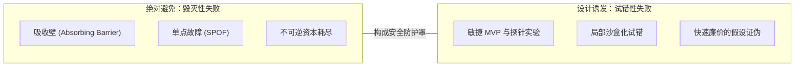
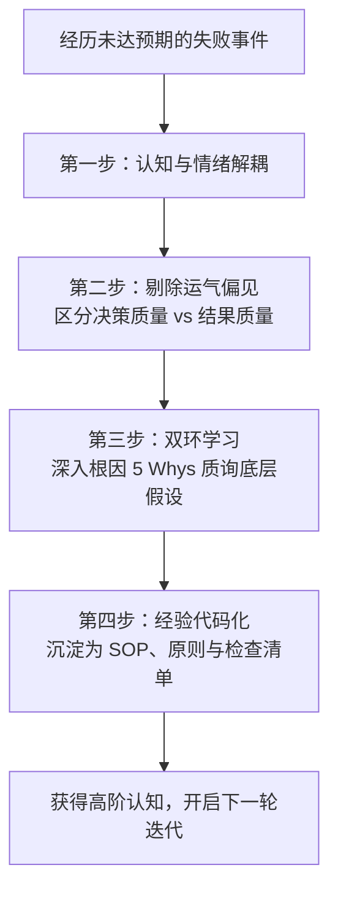

# 失败的本质解构与认知重塑指南

> [!IMPORTANT] 核心思想
> **失败在本体论上永远只属于“事件”与“阶段状态”，绝不可用于定义“人的本质”。** 真正的失败不是成功的对立面，而是负反馈自适应系统的核心校准信号。在无限游戏中，只要没有触碰致命的“吸收壁”，所有的未达预期都是认知系统逼近真实的探索代价。

---

## 笔记概览

### 知识鸟瞰

```mermaid
flowchart TD
    Q1["失败的归属与本体"] --> A1["形容事物 vs 形容人<br>（范畴谬误与标签化陷阱）"]
    Q1 --> A2["瞬态阶段 vs 复合情绪<br>（物理反馈与神经递质落差）"]
    
    Q2["多维深层理解"] --> B1["信息论：高熵有效信息与波普尔证伪"]
    Q2 --> B2["控制论：负反馈调节与巡航修正机制"]
    Q2 --> B3["演化论：变异筛选与反脆弱滋养"]
    
    Q3["工程化防范与容错"] --> C1["规避吸收壁：杜绝单点暴毙与破产风险"]
    Q3 --> C2["事前验尸 Premortem 与安全边际"]
    Q3 --> C3["小步快跑：将大赌注拆为微型探针"]
    
    Q4["复盘转化算法"] --> D1["认知解耦：剥离情绪，还原事实流水线"]
    Q4 --> D2["杜绝结果偏见：区分运气体方差与决策偏差"]
    Q4 --> D3["双环学习：从改变手段升级为重塑底层假设"]
    Q4 --> D4["经验资产化：沉淀为原则与防呆 Checklists"]
    
    Q5["高阶哲学洞见"] --> E1["模拟退火：逃离平庸的局部最优解"]
    Q5 --> E2["信息耗散：认知秩序跃迁必经的能量摩擦"]
    Q5 --> E3["英雄叙事：创伤后成长与生命厚度重构"]
```



### 各节内容概要

| 章节模块 | 核心议题 | 关键结论与方法论 |
| :--- | :--- | :--- |
| **1. 概念澄清** | 失败是形容人还是事情？ | 失败是外部事件的客观测度，用来形容人属于严重的“范畴谬误”与身份绑架。 |
| **2. 存在形态** | 是一种可逆状态还是情绪？ | 双重属性：客观上是高度可逆的收敛中途稳态；主观上是预期落差引爆的应激神经生化潮涌。 |
| **3. 认知跃迁** | 如何本质化理解失败？ | 失败是唯一携带高密度校准信号的反馈载体，是系统自适应生存的必要摩擦。 |
| **4. 防御工程** | 如何科学“避免”失败？ | 避免毁灭性失败（规避吸收壁），主动拥抱高频可控的小失败；利用安全边际与事前验尸防患未然。 |
| **5. 转化算法** | 如何从中提取成功钥匙？ | 四步复盘法：情绪事实解耦 → 剔除运气方差 → 双环质询底层假设 → 经验代码化与 SOP 固化。 |
| **6. 高阶洞见** | 对失败有哪些更深层认知？ | 模拟退火的跳出机制、熵减过程的必要代价、叙事弧光与心理反脆弱。 |

---

## 1. 概念澄清：失败到底是形容人还是事情的？

### 1.1 语言学与本体论：严重的范畴谬误（Category Mistake）

在日常语义中，人们常将“项目失败了”与“我是一个失败者（Loser / Failure）”混为一谈。从本体论上看，这存在根本性的范畴错位：

- **事情（Events / Projects）**：具有明确的时间窗口、边界条件、投入资源与量化目标的离散物理系统。当系统的实际输出低于预设阈值时，称之为“事件失败”，这是一个**客观的事实验证**。
- **人（The Self / Agent）**：是一个终身处于持续演化、适应、重构过程中的复杂生物与心智生命体。人是具备无限可能性的**演化过程本身**，而不是某个静态的工业制成品。

将对局部事件的测量结果，直接投影并粘贴在主体的整个人格与自我价值上，在认知心理学中被称为**过度概括（Overgeneralization）**与**身份认同绑架**。

```
❌ 错误认知链路：行动产生偏差 → 事情失败 → 我是一个失败的人（静态定性、习得性无助）
✅ 正确认知链路：行动产生偏差 → 验证了该策略在当前边界下的无效性 → 获得了新数据 → 调整下一步参数
```

### 1.2 心理学视角：解释风格与思维模式

心理学家阿伦·贝克（Aaron Beck，认知疗法奠基人）与卡罗尔·德韦克（Carol Dweck）的研究表明，将失败归属于人还是事情，决定了心智系统的韧性：

| 维度 | 固定型思维 / 悲观解释风格（归因于人） | 成长型思维 / 建设性归因（归因于事） |
| :--- | :--- | :--- |
| **内在性 (Personalization)** | “我能力不行、我不配、我很笨” | “当前策略有盲区，外部参数发生了漂移” |
| **持久性 (Permanence)** | “我永远都不可能做好这件事情” | “这只是当下的一个实验结果，下个周期可重置” |
| **普遍性 (Pervasiveness)** | “我搞砸了这件事，我整个人生都全盘溃败” | “这次的技术选型失误，不影响我的综合架构素养” |

> [!NOTE] 结论
> **失败在宇宙物理中只存在于“事件”这一孤立维度上。** 世界上只有“未达预期的事情”，从来没有“失败的人”；唯一的例外，是当事人主动将自己的主体意志投降，停止了迭代过程。

---

## 2. 存在形态：可逆状态还是一种情绪？

失败具备**客观系统状态**与**主观心理情绪**的双重形态。认清这两者的分离与互动，是摆脱痛苦的关键。

### 2.1 作为客观系统的“可逆状态”（State）

在动力系统与控制论视角下，失败是一种**未达成终极收敛条件的瞬态（Transient State）**。

- **无限游戏（Infinite Game）与有限游戏**：詹姆斯·卡斯提出，有限游戏以输赢为目的，终场哨响即宣告失败；而人生的核心追求大多是无限游戏（健康、思维、创造、事业、爱），其目的是让游戏一直玩下去。
- **状态的可逆性（Reversibility）**：除了物理生命的终结或法律意义上的不可逆毁灭，绝大部分世俗状态（失业、亏损、考试未过、关系破裂）都是动态可逆的。只要资源与心智底牌仍在，它只是下一次迭代循环的起点。

### 2.2 作为主观神经机制的“复合情绪”（Emotion）

当失败发生时，大脑边缘系统与多巴胺奖励通路会产生剧烈的神经递质波动：

1. **多巴胺预测误差（Reward Prediction Error, RPE）为负**：现实给出的多巴胺反馈远低于大脑先验预期，触发强烈的生化戒断感与沮丧。
2. **社会性疼痛激活**：神经影像学证实，经历排斥、否定与惨重失败时，大脑激活的脑区（背侧前扣带回 dACC）与肉体遭遇物理剧痛时完全重叠。
3. **情绪簇的涌现**：产生羞耻感（担心被群体抛弃）、内疚感（对资源的浪费自责）、无力感与恐惧。



> [!TIP] 应对法则：情绪与状态的物理隔离
> **接纳情绪，但不把情绪当作判决书。** 情绪是远古基因遗留的警报机制，允许自己在暴风雨中停留，感受多巴胺落差带来的心理酸痛；但要明白，生化反应具有半衰期（通常在情绪风暴后 72 小时内大幅衰退），**绝不在神经化学递质紊乱时做出对人生的终极状态判定**。

---

## 3. 认知跃迁：如何从本质上理解失败？

### 3.1 信息论视角：失败是高熵的珍贵硬信号

在通信与信息科学中，一个完全在预期内的事件所包含的信息量（信息熵）趋近于零；而一个出乎意料的失败事件，包含着极高的**信息增量（Information Gain）**。

- **顺境掩盖了漏洞**：成功常常是由运气、系统红利和隐性冗余共同构成的假象，容易强化认知盲区（幸存者偏差）。
- **失败提供了边界的真实硬度测试**：卡尔·波普尔（Karl Popper）的证伪主义揭示，千万只白天鹅无法证明“所有天鹅皆白”，但一只黑天鹅即可完成证伪。**每一次严谨的失败，都以不可辩驳的事实排除了一条不可行路径，使你与真实世界完成了一次高精度的校准。**

### 3.2 控制论视角：系统自适应的负反馈机制

控制论之父诺伯特·维纳（Norbert Wiener）提出，没有任何系统能够靠单向发射指令精确抵达终点。

- 巡航导弹在 99% 的飞行时间内都处于“偏离目标”的微小失衡状态中，它之所以能精准命中，完全依赖于连续不断地捕捉“偏差信号”（即微型失败），并通过舵翼进行反向补偿（负反馈调节）。
- **没有错误反馈，系统就会在盲目中积累隐性误差，直至整体失控。失败不是成功的对立面，而是成功必不可少的纠偏罗盘。**

### 3.3 演化与复杂系统：反脆弱（Antifragile）的食物

纳西姆·塔勒布在《反脆弱》中指出：
- **脆弱系统**：厌恶压力、随机性与波动，在平稳中积累隐患，最终毁于一次黑天鹅（如过度保护的温室花朵）。
- **反脆弱系统**：从波动、压力与局部小失败中汲取养分，不仅能从打击中复原，甚至变得更加强韧（如免疫系统接触微弱抗原产生抗体，肌肉纤维在撕裂微损伤后超量恢复）。

---

## 4. 防御工程：如何科学地“避免”失败？

“试图避免一切失败”是人类最大的认知陷阱之一，这会导致极端脆弱与行动瘫痪。现代工程学与决策科学的真正原则是：**杜绝毁灭性失败，拥抱高频可控的小微失败**。



### 4.1 首要铁律：严密规避“吸收壁”（The Absorbing Barrier）

在概率论中，一旦随机游走触碰到“吸收壁”（比如破产、失去生命、丧失自由、信用彻底破产），后续的概率期望值立刻变为零，游戏强行终止。

- **杜绝致命杠杆**：绝不在单次决策中赌上全部身家或不可逆资产。
- **保留冗余（Margin of Safety）**：巴菲特与芒格强调的安全边际——无论你的桥梁设计承重是多少，都要留出 30%~50% 的额外冗余以应对未知风暴。

### 4.2 事前验尸（Premortem Analysis）与红军对抗

心理学家加里·克莱因（Gary Klein）提出的前瞻性逆向复盘法：

1. **假设确定毁灭**：在项目立项或重大决策实施前，召集核心团队，宣布：“现在是 1 年后，我们的项目遭遇了灾难性溃败，公司破产/计划全盘崩塌。请用 10 分钟写出导致这场惨剧的核心死因。”
2. **打破盲目乐观**：这个流程将心理安全感倒置——指出潜在缺陷不再被视为“不合群或泼冷水”，而是展现洞察力的比赛。
3. **查缺补漏与预设熔断器**：针对最致命的前 3 大死因，提前建立“断路器（Circuit Breaker）”与应对预案。

### 4.3 降低单次失败成本，缩短反馈半衰期（Fail Fast, Fail Cheap）

- **探针机制**：不要一上来修建完整的大教堂，先搭一个纸箱模型。
- **沙盒隔离（Blast Radius Control）**：限制每次冒险的“爆炸半径”。例如，新业务仅允许在某个封闭分校测试，若失败，只损失预设的 5% 预算，绝不波及主营业务盘。

---

## 5. 转化算法：如何从失败中提取成功钥匙？

从挫败走向成功，不是靠喝心灵鸡汤，而需要一套严谨的**经验萃取算法**。



### 步骤一：认知解耦（Cognitive Decoupling）

- 立即阻断灾难化脑补：“我不是不行，而是系统当前的输出有偏差。”
- 建立纯事实事件流：记录时间、情境、参与人、输入资源、环境状态、执行动作与测量指标。不掺杂任何形容词与道德审判。

### 步骤二：剔除“结果偏见”（Outcome Bias & Resulting）

前世界扑克冠军安妮·杜克（Annie Duke）在《对赌》中阐明：
- **好决策 × 坏运气 = 坏结果**（此时绝不能轻易推翻原本胜率高达 80% 的科学策略！盲目修改只会陷入过拟合）。
- **坏决策 × 好运气 = 好结果**（这是最致命的毒药，让人产生自己无所不能的幻觉）。
- **复盘的焦点永远在“决策过程的质量”**，而不是单纯看当下的输赢。

### 步骤三：开展“双环学习”（Double-Loop Learning）

哈佛商学院克里斯·阿吉里斯（Chris Argyris）提出：

```
【单环学习】发现错误 → 调整行为动作（“推销没成功，那我明天多打 50 个推销电话！”）
【双环学习】发现错误 → 质疑底层目标与范式假设（“客户真的需要这个产品吗？我们的目标客群定位是否完全搞错了？”）
```

使用 **5 Whys（丰田五问法）** 穿透表象：
1. 为什么这次上线崩溃了？（数据库连接池被打满了）
2. 为什么连接池打满了？（某个慢 SQL 查询耗时高达 8 秒）
3. 为什么会有慢 SQL 上线？（索引未创建且缺少全链路压测）
4. 为什么缺少全链路压测就发布了？（发布排期过于仓促，压测流程被临时跳过）
5. 为什么排期会失控并跳过关键检查？（团队缺少发布门禁自动化与硬性阻断机制）—— **找到系统性解！**

### 步骤四：经验资产化（Codification into Systems）

达利欧的经典公式：`痛苦 + 反思 = 进步`。但进步必须物化为组织或个人系统的资产：
- **清单化（Checklists）**：在阿图·葛文德《清单革命》中，外科手术与航天系统的零事故率依赖于防呆清单。将每一次踩过的坑，变成清单上的一条勾选框。
- **原则化（Principles）**：提炼成简洁的一阶准则（例如：“凡是未在灰度集群验证超过 24 小时的新版本，一律禁止全量发布”）。

---

## 6. 高阶洞见：关于失败的深层次哲学与科学理解

### 6.1 模拟退火算法：失败是逃离“局部最优解”的必要能量

在计算机科学与物理学中，**模拟退火（Simulated Annealing）**被用于解决极复杂的全局寻优问题：
- 如果一个算法在寻优时**只接受比当前更好的状态**（贪心算法 / 梯度下降），它很快就会滑入一个狭隘的“局部最优解（Local Optimum）”，并在那里永远止步。
- 想要找到整个大地图上的“全局最优解（Global Optimum）”，算法**必须以一定的概率接受一个更糟糕的解（甚至是显著的失败）**。只有通过这种剧烈的扰动，它才能被踹出舒适的浅坑，跨越高耸的势垒，跃迁到更辽阔的全新维度。
- **人生的重大挫败，往往是系统在逼迫你跳出一个平庸的局部最优解。**

### 6.2 热力学耗散：认知秩序跃迁所支付的“熵代价”

在非平衡态热力学中，任何一个开放系统想要建立更高阶的内部秩序（实现负熵），必须向外部环境耗散能量并产生局部的混乱。
- 获得真正扎实的真知、敏锐的直觉和深邃的判断力，从来不是凭空看书能获得的。
- **失败就是你在现实世界的泥泞中，为完成认知系统的“熵减与秩序升级”所必须支付的物理耗散成本。** 没有失败，就没有真正的认知生长。

### 6.3 英雄之旅与生命叙事（The Hero's Journey）

约瑟夫·坎贝尔（Joseph Campbell）在神话学中总结的“千面英雄”叙事结构：
- 没有一个引人入胜的主角是一路顺风走到底的。真正的史诗必然经历“坠入深渊（Abyss）”、“遭遇濒死考验”、“在废墟中完成蜕变”。
- 心理学上的**创伤后成长（Post-Traumatic Growth, PTG）**表明，一个经历过重大失败并自主重构了心智的人，其共情能力、抗逆力、精神深度与生命辽阔感，远非从未受挫者所能比拟。
- **失败是命运赋予你生命剧本的最强着色剂。裂痕，正是光照进来的地方。**

---

## 7. 实践工具包：失败复盘与反脆弱转化模板

```markdown
### 📝 深度复盘看板（Post-Mortem Canvas）

**1. 事件基本面（Facts Only）**
- 目标预设指标：[例如：Q3 达成 100 万营收]
- 实际输出结果：[例如：实际达成 35 万]
- 关键时间节点与客观动作：[客观列出核心事件序列]

**2. 归因诊断（Attribution Matrix）**
- 运气 / 外部波动（方差）：[哪些是不可控的市场/环境突变？]
- 执行 / 战术漏洞（偏差）：[哪些是 SOP 不健全或沟通失误？]
- 核心假设破裂（双环认知）：[我们最底层的哪个前提假设被现实击穿了？]

**3. 根因穿透（5 Whys 钻取）**
- Why 1: ...
- Why 2: ...
- Why 3: ...
- Why 4: ...
- Why 5: ...（触及组织或心智底层根因）

**4. 资产化转化（System Hardening）**
- [ ] **新增防呆清单项**：在 [XXX流程] 中增加针对 [XXX风险] 的强制检查。
- [ ] **凝练决策原则**：当未来再次遇到 [类似情境] 时，默认执行 [XXX准则]。
- [ ] **设定安全熔断器**：当 [某核心指标] 跌破 [警戒线] 时，无条件暂停并止损。
```
