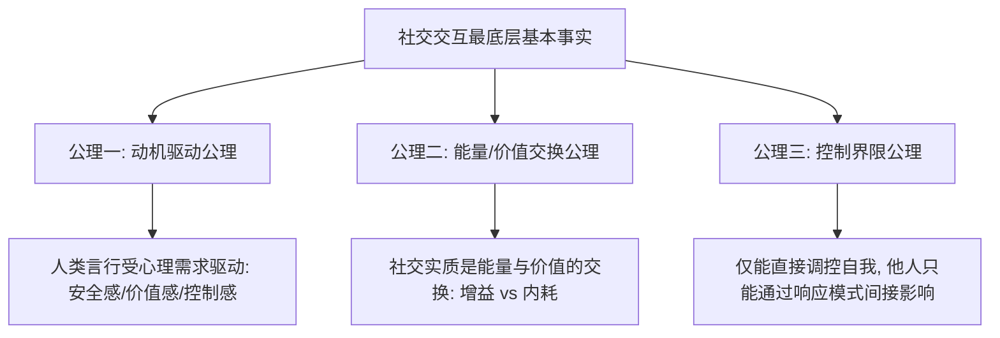

# 第一性原理视角下的人际社交与情商模型

## 笔记概览

### 知识鸟瞰

1. 传统迷思与本质重构                             [前提·定义]
   └─ 铺垫 → 核心主张
2. 人际社交三大底层公理                           [核心·机制]
   ├─ 公理一：动机驱动（求安全感/价值感/控制感）
   ├─ 公理二：能量与价值交换
   └─ 公理三：控制界限与间接影响
   └─ 关系：公理一 ↔ 公理二，互为约束
3. 高情商推导四大支柱与实战                        [实践·行动]
   ├─ 支柱一：自我信号解码器（观察者视角与觉察隔离）
   ├─ 支柱二：他人需求诊断系统（超越语词与镜像同理）
   ├─ 支柱三：能量与价值交换机（放弃Ego争夺与赋能）
   └─ 支柱四：系统边界与协议机制（NVC案例与拒绝模版）
   └─ 问题 → 方案 → 限制

主线：本篇笔记通过第一性原理剥离话术套路，建立人际社交三大底层公理，并据此推导出现代高情商系统的四大落地支柱及具体沟通对话模版。

### 各节内容概要

| 章节/部分 | 核心内容 | 关键要点 |
| :--- | :--- | :--- |
| **1. 传统迷思 vs 本质** | 区分表象社交技巧与底层情商逻辑 | 高情商并非讨好圆场，而是低损耗解码需求与高效交互 |
| **2. 三大底层公理** | 提出驱动社交行为的核心不变量 | 动机驱动（欲望/安全/价值）、能量交换、控制界限 |
| **3. 四大实施支柱** | 建立可落地的修养与沟通框架，附真实例子 | 识己（信号解码）、察人（需求诊断）、赋能（放弃Ego）、立界（NVC与拒绝模版） |

---

## 1. 传统迷思 vs 第一性原理重构

传统观点常将“情商”（EQ）等同于会说话、懂阿谀奉承、善于面面俱到或圆场。这种缺乏底层逻辑的“套路式情商”，往往导致个体产生巨大的**情绪劳动内耗与虚伪感**。

从**第一性原理（First Principles Thinking）**出发，我们需要剥离一切表象套路，推导至社交中最底层的基本事实：

```
习惯性套路: 察言观色 / 阿谀逢迎 / 忍气吞声 ❌ (损耗高、不可持续)
                 ↓ (第一性原理剥离)
本质定义: 解码核心需求 + 最低损耗交互 + 能量增益 
```

### 传统社交套路 vs 第一性原理高情商场景对照

| 典型场景 | 传统讨好型/套路型回应（表象） | 第一性原理高情商回应（本质） |
| :--- | :--- | :--- |
| **面对别人的挑剔指责** | 强行压抑愤怒，赔笑讨好或事后背地抱怨 | 启动观察者视角，解码对方“缺乏掌控感”的需求，用事实+界限回应 |
| **团队方案产生严重分歧** | 争得面红耳赤非要证明“我是对的” | 放弃 Ego 争夺，聚焦共同目标，将分歧转化为“方案优缺点决策表” |
| **朋友向你倒情绪垃圾** | 无底线倾听甚至跟着一起骂 | 给予情绪确认（“这确实让人沮丧”），同时温和捍卫个人精力界限 |

---

## 2. 人际社交的三大第一性公理

任何深刻的人际交往行为，底层均基于以下三条无可怀疑的公理（Axioms）：



1. **公理一（动机驱动公理）**：人的一切言行与情绪，本质上均受**底层心理需求**（安全感、价值感、控制感、归属感）驱动。每个人最关心的主体永远是自己。
2. **公理二（能量/价值交换公理）**：人际交互本质上是**情绪、能量与信息的交换系统**。良性互动增加系统能量（赋能），不良互动消耗系统能量（内耗）。
3. **公理三（控制界限公理）**：个体只能直接掌控自身的心理与言行，无法直接操纵他人大脑；但可以通过改变**自我投射与回应机制**来重塑互动的反馈链条。

---

## 3. 基于公理推导的高情商四大支柱

基于上述公理，高情商可以系统重构为四大可训练的实施支柱：

```
                       【高情商四柱模型】
      ┌────────────────────────┬────────────────────────┐
      ▼                        ▼                        ▼
【支柱一】自我信号解码    【支柱二】他人需求诊断    【支柱三】能量价值交换    【支柱四】系统边界协议
 (观察者视角/需求识别)    (超越语词/心理安全)      (放弃Ego/赋予价值)       (NVC结构化/温和拒绝)
```

### 支柱一：自我信号解码器（基于公理三：先调控自我）
* **本质逻辑**：你无法输出你没有的东西。如果你无法识别自己的真实需求与情绪来源，表现出的任何“高情商”都只是强行压抑或伪装，不可持续。
* **底层修炼与自查步骤**：
  1. **觉察隔离**：情绪起伏时，从参与者切换为观察者。
     * *自我对话范例*：“我现在感到非常愤怒，是因为我的专业权威在会议上受到了质疑，触碰到了我的控制感失控风险。”
  2. **情绪自给**：不在社交中过度索取外界的认同来填补自我价值缺陷，建立内部稳定的自尊系统。

### 支柱二：他人需求诊断系统（基于公理一：人人都寻求被看见）
* **本质逻辑**：人最关心的永远是自己。每个人在社交中都在无意识地寻求三样东西：**被看见（理解）、被认可（价值感）、被保护（安全感）**。表面的言语与发脾气只是冰山一角。
* **底层修炼**：
  1. **超越语词看意图**：听对方“说了什么”，更看对方“为什么在这个时刻这样说”。（例如：对方突然挑剔细节，底层可能是对项目进展失去掌控感的焦虑）。
  2. **给予确定性（情绪镜像法）**：倾听时不急于评价或给建议，先确认对方的情绪状态。
     * *镜像对话范例*：“听起来这件事的反复变化让你感到非常受挫和疲惫，换作是我也会有同样的感受。”

### 支柱三：能量与价值交换机（基于公理二：降低系统损耗）
* **本质逻辑**：可持续的人际关系必须是平衡的能量与价值交换系统（包括情绪价值、信息价值、资源价值）。“低情商”行为本质上是 Ego 膨胀导致的能量吸血与防御激发。
* **底层修炼**：
  1. **不争夺“控制权”与“正确性”**：分清“事实争论”与“立场/情绪争论”。绝大多数社交摩擦都是在争夺“谁是对的”（自我膨胀），放弃无谓的正确性争夺可以省去 80% 的社交损耗。
  2. **提供高阶情绪价值**：认可对方的独特优势、给对方出彩和下台阶的机会（给予确认感）。

### 支柱四：系统边界与协议机制（基于公理三：清晰界限）
* **本质逻辑**：没有边界的情商叫“讨好”，有边界的情商才叫“吸引”。高情商必须包含高效的人际协议（Communication Protocol）与自我保护界限。

> [!tip] 实战沟通案例与话术模版

#### 1. 非暴力沟通（NVC）结构化表达模版
* **公式**：**客观事实 → 我的感受 → 我的底层需求 → 明确具体的请求**。
* **指责攻击型表达（低情商）**：“你太不尊重人了，总是这么随随便便！”
* **NVC 结构化表达（高情商）**：“你刚才迟到了 30 分钟（**事实**），这让我觉得自己的时间没有被尊重，感到有些受挫（**感受/需求**）。希望下次如果你遇到堵车，能提前 10 分钟发个微信告诉我（**具体请求**）。”

#### 2. 温和而坚定的拒绝协议模版
* **原则**：**剥离“事情”与“关系”**。拒绝的是“请求/事情”，尊重的是“人”。坚决捍卫自己的能量边界，同时用温和的态度维护彼此的关系。
* **直接怼人型**：“我没空，你自己不会做吗？”（伤害关系）
* **委曲求全型**：“好吧……那我加班帮你弄吧。”（伤害自我界限）
* **高情商拒绝模版**：“非常感谢你在这项重要任务上对我的信任（**尊重人与给予认可**），但我目前手头的几个紧急项目已经占满了全部精力，为了保证产出质量，这次我无法承担这个任务（**清晰拒绝事**）。你可以尝试找张同事看看，或者等我下周三忙完后再交流。”

---

## 核心概念速查

| 概念 | 一句话说明 | 直观类比 | 为什么重要 |
| :--- | :--- | :--- | :--- |
| **冰山模型** | 表象言行只是水面一角，底层心理需求才是动机全貌 | 浮在水面上的冰山 | 避免停留在口角争执，实现深度社交共情与意图诊断 |
| **正确性争夺 (Ego Dispute)** | 执着于证明“我是对的，你是错的”的无意义自尊争斗 | 两个驾驶员在窄路互不相让 | 消耗社交能量的最常见低情商陷阱，引发防御与对立 |
| **非暴力沟通 (NVC)** | 剥离情绪指责、聚焦事实与需求表达的结构化沟通协议 | 应用程序间标准化的 API 接口 | 降解沟通摩擦力、建立高情商边界的关键实操工具 |

---

## 核心要点

* `[结论]` 高情商不是讨好与话术套路，而是**基于第一性原理高效解码需求、减少交互损耗的系统能力**。
* `[机制]` 人际社交的本质是**心理需求（安全/价值/控制）驱使下的能量交换**；提升情商的核心在于从“Ego争夺”转向“需求赋能”。
* `[行动原则]` 情商修炼遵循八字法则——**“识己（解码信号）、察人（诊断需求）、赋能（放弃争对错）、立界（NVC与拒绝模版）”**。
* `[限制]` 高情商不意味着绝对的妥协。在核心价值观或底线受到侵犯时，清晰严厉的边界声明同样是高情商的体现。

---

## 参考来源

* 马歇尔·卢森堡《非暴力沟通》
* 第一性原理思维（First Principles Thinking）在组织与人际中的应用
* 情绪智力（Emotional Intelligence）理论模型
