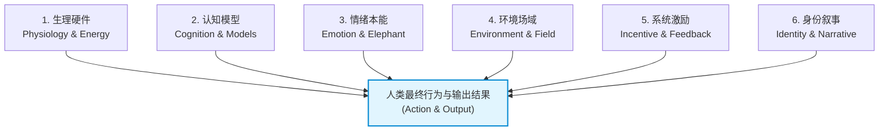
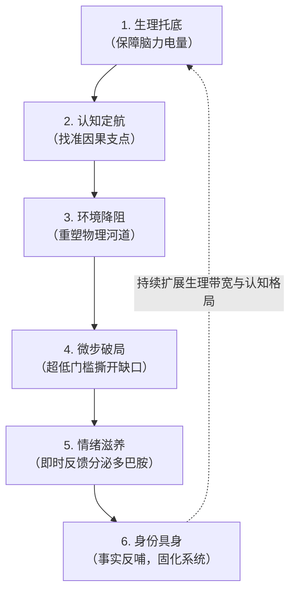

# 行为改变动力学——认知重塑与多维驱动模型

> [!IMPORTANT] 核心思想
> **改变认知是改变行为与输出结果的“罗盘”，但绝非孤立的“第一推动力”。**
> 人类从来不是纯粹靠理性思考行动的逻辑机器，而是运行在生物硬件、环境力场、情绪生化与系统激励综合咬合下的“复杂自适应实体”。
> 破除“知易行难”的死局，不能靠“认知唯心主义”的反复说教，而必须通过**生理托底、认知定航、环境降阻、微步破局、情绪滋养与身份具身**的多维协同，让行为在正向反馈回路中自发演化。

---

## 笔记概览

### 知识鸟瞰

```mermaid
flowchart TD
    Q1["认知的定位与价值"] --> A1["贝叶斯先验：现实的主观滤镜"]
    Q1 --> A2["认知失调防御：对抗低维蛮干"]
    Q1 --> A3["逻辑层次降维：信念对行为的压制力"]
    
    Q2["认知的局限与去神圣化"] --> B1["认知的脆弱性：新皮质难敌边缘系统"]
    Q2 --> B2["知易行难本质：预测模型与本能回报的脱节"]
    Q2 --> B3["具身认知反转：行动倒逼思考的威力"]
    
    Q3["行为驱动六大动力源"] --> C1["生理底座：神经递质、睡眠与前额叶能量"]
    Q3 --> C2["认知模型：因果映射、价值判断与注意力"]
    Q3 --> C3["情绪本能：大象驱动力与无情绪即无决策"]
    Q3 --> C4["环境场域：勒温力场、阻力设计与选择架构"]
    Q3 --> C5["系统激励：反馈回路、多巴胺强化与系统稳态"]
    Q3 --> C6["身份叙事：自我概念与终极操作系统"]
    
    Q4["工程化协同落地"] --> D1["六阶跃迁链条：从硬件供能到具身内化"]
    Q4 --> D2["反思避坑：警惕四种伪改变陷阱"]
```



### 各节核心要点速查

| 章节模块 | 核心议题 | 关键结论与方法论 |
| :--- | :--- | :--- |
| **一、认知的定位** | 为什么改变结果必须先改认知？ | 认知是大脑对世界的“先验模型”，旧认知会将新行为判定为异常与能耗浪费，引发不可避免的行为反弹。 |
| **二、认知的局限** | 认知是第一要素吗？ | **不是唯一的第一要素。** “知而不行”是神经生化与本能博弈的结果；具身认知证明“行动重塑认知”往往比“思考改变行动”更高效。 |
| **三、多维动力源** | 还有哪些要素驱动行为？ | **生理硬件、认知罗盘、情绪引擎、环境容器、系统激励、身份叙事**六大要素共同构成行为矢量。 |
| **四、要素干预矩阵** | 如何系统性评估与干预？ | 拆解各要素层级、失效场景、对应理论及工程化干预手段。 |
| **五、工程化闭环** | 如何实现稳定不可逆的蜕变？ | “生理托底 → 认知定航 → 环境降阻 → 微步破局 → 情绪滋养 → 身份具身”六阶协同演化模型。 |

---

## 一、为什么说“要想改变行为和结果，必须先重塑认知”？

在传统心理学和日常直觉中，人们常说“认知决定行为，行为决定结果”。这一判断之所以成立，是因为大脑认知在行为控制中扮演着**顶层因果映射系统**的角色。


### 1.1 大脑是一台“贝叶斯预测机器”（Predictive Coding）
认知神经科学的核心发现之一是：**大脑并非被动接收环境信号的传感器，而是一台自上而下运行的主动预测引擎。**
- **先验信念（Prior Beliefs）**：决定了大脑在毫秒级时间内如何解释模糊的现实。
- **选择性注意（Selective Attention）**：大脑只把稀缺的意识带宽分配给“符合当前认知模型”的信号。
- **例证**：若一个人的底层认知是“人际交往是零和掠夺”，当面对他人的友善时，其大脑模型会立即将该信号预测为“伪善或陷阱”，从而输出防御与刺探的行为，最终引致对方的疏离，反向“坐实”其猜忌的认知。

### 1.2 意志力抗不过“认知失调”（Cognitive Dissonance）
如果底层认知未经重构，单凭意志力在表层强推新行为，必然遭遇**认知失调机制**的反扑：
- **前额叶皮质（PFC）过载**：意志力本质上是前额叶对古老冲动的自上而下压制（Top-down Inhibition），极度消耗葡萄糖与神经化学介质。
- **能量节约本能**：当行为与深层认知冲突（例如：认知认同“我不值得过自律的生活”，行为却在强迫苦行），大脑会将该状态标记为“高熵、高耗能的异常危机”，通过分泌皮质醇制造焦虑与疲惫，诱导行为报复性反弹（如节食后的暴饮暴食）。

### 1.3 逻辑层次的降维打击（Dilts 神经逻辑层次）
在罗伯特·迪尔茨（Robert Dilts）的 NLH 模型中，人类心智存在清晰的系统层级：

$$\text{愿景/精神} \xrightarrow{} \text{身份认同} \xrightarrow{} \text{信念与价值观（认知）} \xrightarrow{} \text{能力} \xrightarrow{} \text{行为} \xrightarrow{} \text{环境}$$

- **低维努力的局限**：在“行为层”拼命努力（增加时长、咬牙打卡），若在“认知层”（不相信方法有效、不相信自我价值）存在死结，系统将始终在低效摩擦中打转。
- **高维认知的降维效应**：当认知层完成**范式转移（Paradigm Shift）**，原先需要耗费巨大心力的行为会自然顺应新模型，演化为自发行为。

---

## 二、认知是驱动行为的第一要素吗？（解构与去神圣化）

> [!WARNING] 警惕“认知唯心主义”
> 很多人把“认知重塑”当成包治百病的灵丹妙药，认为只要“想通了、看透了”，生活就会自发好转。这是一种脱离物理与生理现实的虚幻自嗨。

### 2.1 认知的脆弱性：“知易行难”的神经学真相
人类大脑存在古老的结构断层：
- **新皮质（Neocortex）**：负责语言、逻辑抽象推理与宏大愿景，演化历史仅数十万年。
- **边缘系统（Limbic System）与脑干**：负责情绪、本能冲动与即时生存，演化历史数亿年。

**纯粹的概念性认知只停留在大脑皮层，缺乏直连运动神经元与多巴胺通路的“执行抓手”。** 当面临即时诱惑或生存压力时，古老的边缘系统能在毫秒级内切断新皮质的控制权。这就是为什么“道理懂得再多，关键时刻依然冲动/拖延”。

### 2.2 具身认知与自我知觉：“通过行动改变思考”往往更快
现代具身认知学派（Embodied Cognition）与达里尔·贝姆的**自我知觉理论（Self-Perception Theory）**证实：**因果链条在很多时候是反向的。**

> **“人很难靠坐着思考来进入一种新的行动方式，但完全可以通过行动进入一种新的思考方式。”**  
> —— 理查德·帕斯卡尔（Richard Pascale）


- **认知失调的逆向利用**：当一个人做出某种行为后，大脑为了消除“我为什么会做这件事”的认知失调，会自动调低阻抗、重写信念来合理化行动（如“门面效应”与“登门槛效应”）。
- **具身动作反哺大脑状态**：挺直脊柱、深长呼吸、轻装漫步，身体的物理力学状态会直接通过迷走神经向大脑发送安全与自信信号，反向修正思维的内容与倾向。

---

## 三、驱动人类行为与输出的“六大核心要素”

行为与输出是整个心智-生理-环境系统的**合力矢量**。要精准把控行为，必须全面考量以下六大平级且相互交织的要素：



### 1. 生理底座与神经生化（Physiological State & Hardware）
- **算力与能量瓶颈**：前额叶皮质是全脑最耗能的器官。睡眠不足（低于 6 小时）、高血糖波动（精制碳水）、慢性应激（皮质醇居高不下），会导致前额叶前部供血不足，陷入**“生理性意志力衰竭”**。
- **决定行为的阈值**：生理处于亏空状态时，大脑会自动切换为能耗极低的“节能应激模式”，此时任何复杂的远期规划与深度思考都会被本能掐断。

### 2. 认知模型与因果滤镜（Cognitive Models & Filters）
- **方向罗盘**：提供因果假设、信息过滤与长期战略方向。
- **心智表征深度**：普通人看到问题往往看到表象（单点线性因果），高阶认知者看到系统动力学（增强回路、延迟反馈、隐藏变量）。认知决定了你的航线是否开往正确的港口。

### 3. 情绪本能与潜意识（Affect, Emotion & The Elephant）
- **大象与骑象人**：心理学家乔纳森·海特（Jonathan Haidt）著名的隐喻：理性认知是“骑象人”，情绪与本能是体量庞大的“大象”。骑象人只能指引方向，但大象一旦受到惊吓或被欲望吸引，骑象人的拉扯毫无意义。
- **无情绪即无决策**：神经学家安东尼奥·达马西奥在《笛卡尔的错误》中指出，失去情绪感知能力的人类会丧失给选项赋予“价值权重”的能力，陷入无限分析的决策瘫痪。**情绪不是理性的敌人，情绪是行动的推进剂。**

### 4. 环境场域与阻力设计（Environment & Choice Architecture）
- **勒温场论**：心理学公式 $B = f(P, E)$（行为是人与环境交互的函数）。
- **福格行为模型（BJ Fogg）**：$B = \text{MAP}$（动机、能力、提示）。当一个行为在物理空间中具备极高的摩擦力（Friction），再强的动机也会失效。
- **助推与环境决定论**：把手机放在视线之外、把吉他拿掉琴套架在书桌旁、把健身服前一天晚上摆在床头。**改变行为最高效且省力的方式不是折磨心灵，而是重塑物理动线。**

### 5. 规则激励与反馈回路（Incentives & Cybernetics）
- **查理·芒格铁律**：“你给我看他的激励机制，我就能给你推导他的产出结果（Show me the incentive and I will show you the outcome）。”
- **反馈延迟杀手**：人类多巴胺系统受**奖励预测误差（RPE）**驱动。如果行为的正面反馈延迟长达数月（如读书、减脂），而坏习惯的反馈在秒级兑现（如刷短视频、吃甜食），系统激励就会压倒道德认知。
- **系统稳态**：如果一个组织或生活模式的利益闭环在奖励平庸与推诿，任何个人认知的觉醒都会在系统的自我维持机制中被消解。

### 6. 身份认同与生命叙事（Identity & Narrative）
- **核心操作系统**：认知最深沉、最稳固的结晶，是**自我概念（Self-Concept）**与无意识叙事。
- **投票理论**：在《原子习惯》中，詹姆斯·克利尔指出：真正的习惯改变是身份的改变。
  - “我在努力戒烟”（依然把自己定位为烟民，行为全靠克制）。
  - “我不吸烟，我不是烟民”（身份重新锚定，违背该身份的行为会自动产生心理违和感）。

---

## 四、六大要素对比与工程化干预矩阵

| 驱动要素 | 系统角色 | 底层生理 / 心理机制 | 失效/盲区场景 | 工程化干预手段 |
| :--- | :--- | :--- | :--- | :--- |
| **生理硬件** | 算力承载层 | 脑糖代谢、腺苷蓄积、心率变异性(HRV)、脑肠轴 | 睡眠剥夺或透支时，任何认知瞬间崩盘 | 规律昼夜节律、7-8h 深度睡眠、低 GI 饮食、心肺耐力底色 |
| **认知模型** | 战略罗盘层 | 贝叶斯概率修正、心理表征、因果推断网络 | 容易沦为“口头理论家”，产生虚假的掌控感 | 第一性原理拆解、双环复盘、反直觉反事实检验 |
| **情绪本能** | 动力引擎层 | 边缘系统、杏仁核预警、多巴胺趋利回避 | 情绪过激引发认知窄化；情绪耗竭导致抑郁麻木 | 情绪解耦命名法、重构威胁为挑战、激活好奇心与成就感 |
| **环境场域** | 物理河道层 | 感觉刺激输入、选择架构设计、微摩擦阻力 | 脱离特定环境后，未内化的好行为易迅速瓦解 | 动线重构、触发提示物（Prompts）显性化、增加干扰项操作步数 |
| **系统激励** | 动力学闭环 | 奖励预测误差（RPE）、变比率强化、负反馈调节 | 激励指标扭曲导致伪勤奋（古德哈特定律） | 拆分微型里程碑、建立可视化即时正反馈、拉长负向恶果可见度 |
| **身份叙事** | 操作系统层 | 自我归属感、叙事自我（Narrative Self）、道德锚定 | 固化消极标签（如“我数学不好”）引发自我阻碍 | 身份重写、通过微小确定性事实（Micro-Wins）持续投票 |

---

## 五、工程化落地：构建“行为-认知-系统”的正向自适应闭环

真正能够引发长期、不可逆改变的方法，不是单点孤军奋战，而是**让六大要素形成咬合齿轮，产生正向动力学共振**。



### 5.1 六阶蜕变实施法则

1. **第一步：生理托底（Energy First）**
   - 不要在极度疲惫或饥饿时做重大决策或推行艰难计划。
   - 优先通过高质量睡眠、晨间光照与控糖将大脑恢复至“高心智带宽”状态。
2. **第二步：认知定航（Compass Alignment）**
   - 质询旧假设：“我过去一直在重复的低效行为，背后的底层恐惧或获利动机是什么？”
   - 确立清晰、精简的物理因果链条，不贪多，只找核心杠杆解。
3. **第三步：环境降阻（Friction Engineering）**
   - 彻底优化行动上下文：将阻碍专注的诱因（手机、零食、纷杂网页）移至需要物理位移才能触及的地方。
   - 让正确行为的触发物出现在必经动线上。
4. **第四步：微步破局（Micro-Action Activation）**
   - 制定小到“大脑无法拒绝、不需要动用意志力”的启动动作（如：翻开书读 1 页、写 50 个字、做 2 个深蹲）。
   - 用具身的微动作跨过静摩擦力，打破沉睡惯性。
5. **第五步：情绪滋养（Incentive Hook）**
   - 拒绝“延迟满足的自我折磨”，在行动后立刻建立微小的多巴胺仪式（打钩确认、深呼吸享受掌控感、成就感命名）。
   - 让大象感知到：“做这件事很安全，而且立刻有好处”。
6. **第六步：身份具身（Identity Reinforcement）**
   - 记录可验证的物理成果，不断向大脑潜意识广播：“看，事实证明我正在成为这样的人。”
   - 认知被事实不断校准，从而彻底蜕变为主观现实。

---

## 六、避坑指南：警惕四种伪改变陷阱

```
┌─────────────────────────────────────────────────────────────┐
│                     改变路径的四大误区                       │
├──────────────────────────────┬──────────────────────────────┤
│ 1. 认知充饥（知识暴食症）    │ 2. 意志蛮干（苦行僧陷阱）    │
│ 误区：以为看了书懂了就算改了 │ 误区：无视生理与环境，死磕硬扛│
│ 恶果：脑内自嗨，现实一团糟   │ 恶果：前额叶耗竭，报复性暴饮暴食│
├──────────────────────────────┼──────────────────────────────┤
│ 3. 真空修行（温室象牙塔）    │ 4. 单点归因（机械还原论）    │
│ 误区：试图脱离系统激励改习惯 │ 误区：出了问题全怪“自己态度不行”│
│ 恶果：一旦回到旧环境瞬间打回原形│ 恶果：陷入深层内耗与自我攻击 │
└──────────────────────────────┴──────────────────────────────┘
```

> [!TIP] 总结金句
> - **想清楚是起点，动起来是解药，环境是河道，生理是水源。**
> - 不要试图靠意志力去驾驭惊涛骇浪，要顺应水流的动力学，在源头改道，在岸边铺路。
