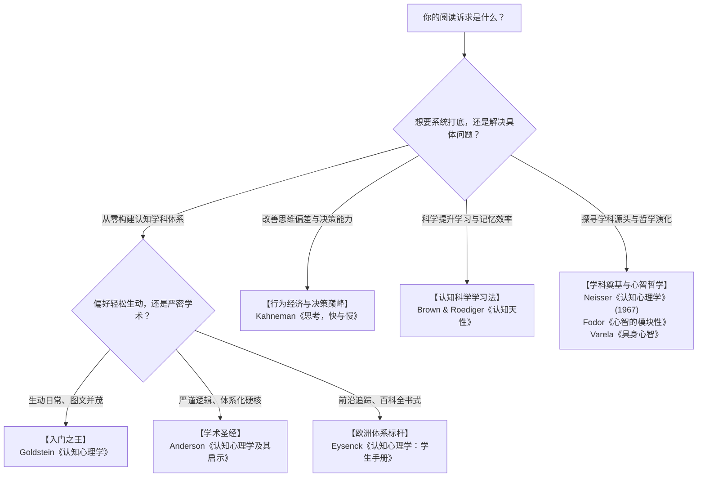

# 认知心理学权威书单与研读路线图

> [!IMPORTANT] 导读指南 (Key Takeaways)
> - **认准学科边界**：认知心理学是严谨的**实证与实验科学**（基于反应时测量、眼动追踪、脑成像与计算模型），**绝不同于通俗励志心理学或未经实证的玄学鸡汤**。
> - **入门首选**：非心理学专业首推 **Goldstein 的《认知心理学》**（通俗易懂、日常案例丰富），而非直接生啃理论专著。
> - **学术圣经**：追求理论严谨与逻辑骨架首推 **John R. Anderson 的《认知心理学及其启示》**；追求全面前沿首推 **Eysenck 的《认知心理学：学生手册》**。
> - **认知应用巅峰**：行为决策选 **Kahneman 的《思考，快与慢》**；科学学习方法选 **Roediger 的《认知天性》**。

---

## 研读路线图 (Decision Flowchart)

---

## 一、系统体系篇：全球高校通选权威教材 (Academic Standards)

如果你希望建立一棵**枝叶分明、没有逻辑漏洞的认知心理学知识树**，这几部教材是全球公认的标准参考系。

### 1. 《认知心理学：将心智、研究与日常经验相连接》
- **原著名**：*Cognitive Psychology: Connecting Mind, Research, and Everyday Experience*
- **作者**：E. Bruce Goldstein（E. 布鲁斯·戈尔德斯坦，匹兹堡大学名誉教授）
- **权威地位**：北美高校本科认知心理学使用频率最高的教材之王，中文版多次再版（中国轻工业出版社万千心理引进）。
- **学术定位与特色**：
  - **门槛最低、趣味性最强**：作者极其擅长把抽象的实验室实验（如斯特鲁普效应、注意资源衰减范式）用直观的日常生活体验串联起来。
  - **视觉化与实验还原**：书中配图丰富，对经典心理学实验的“实验假设 $\to$ 实验设计 $\to$ 数据图表 $\to$ 结论局限”推导极其清晰。
- **推荐指数**：⭐⭐⭐⭐⭐（首选入门教材）

---

### 2. 《认知心理学及其启示》
- **原著名**：*Cognitive Psychology and Its Implications*
- **作者**：John R. Anderson（约翰·R·安德森，卡内基梅隆大学心理与计算机科学教授，认知科学最高奖“鲁梅哈特奖”得主，ACT-R 认知架构创立者）
- **权威地位**：全球认知科学界教父级专著，中科院心理所、北大心理系等权威院校长期指定研究生考研与研读参考书。
- **学术定位与特色**：
  - **计算主义与信息加工的集大成者**：从神经认知底层，到长时记忆的命题网络、语言产生与问题解决，逻辑推演极其严密。
  - **紧扣“启示”（Implications）**：不仅讲大脑如何加工信息，更聚焦这些认知规律对教育、人机交互与日常认知的启发。
- **推荐指数**：⭐⭐⭐⭐⭐（体系深造圣经）

---

### 3. 《认知心理学：学生手册》
- **原著名**：*Cognitive Psychology: A Student's Handbook*
- **作者**：Michael W. Eysenck & Mark T. Keane（迈克尔·W·艾森克 & 马克·T·基恩）
- **权威地位**：欧洲乃至全球心理学界公认体量最庞大、覆盖最前沿的巨著（千页级）。
- **学术定位与特色**：
  - **批判性思维与多学派兼收**：不仅讲述传统实验认知心理学，还深度整合了**认知神经心理学（脑损伤病人研究）**和**计算认知科学（神经网络模型）**。
  - 每一章都会列出主流学派的争论焦点与现存理论缺陷，极具学术穿透力。
- **推荐指数**：⭐⭐⭐⭐☆（高阶学术工具书）

---

## 二、应用与决策篇：大众认知界公认度最高的顶尖神作

这些书虽然不是以大学教本形式排版，但作者均为**认知科学界泰斗或诺奖级学者**，其影响力深远重塑了现代社会科学、商业与学习方法论。

### 4. 《思考，快与慢》
- **原著名**：*Thinking, Fast and Slow*
- **作者**：Daniel Kahneman（丹尼尔·卡尼曼，2002 年诺贝尔经济学奖得主，认知心理学家）
- **权威地位**：行为经济学与认知决策领域的珠穆朗玛峰，也是过去半个世纪引用量最高的心理学著作之一。
- **核心认知模型**：
  - **双系统理论**：直觉冲动的系统 1（快、无意识、耗能极低）与理性审慎的系统 2（慢、耗费注意力、易疲劳）。
  - **启发式与认知偏差**：锚定效应、可得性启发、代表性偏差、前景理论（损失厌恶）。
- **阅读价值**：它深刻揭示了“人类大脑在做决策时，认知处理管道天然存在的系统性缺陷”。
- **推荐指数**：⭐⭐⭐⭐⭐（人人必读）

---

### 5. 《认知天性：让学习轻而易举的心理学规律》
- **原著名**：*Make It Stick: The Science of Successful Learning*
- **作者**：Peter C. Brown, Henry L. Roediger III, Mark A. McDaniel（后两位是当代认知记忆领域的顶级学者）
- **权威地位**：被誉为**“学习科学领域最靠谱的实证之作”**，打破了无数反科学的直觉假象。
- **颠覆性实证认知**：
  - 反复划重点、机械重读是最无效的“伪勤奋”（仅带来“我记住了”的流畅性错觉）。
  - 真正高留存的记忆建立在**“合意困难（Desirable Difficulties）”**之上：检索练习（Testing Effect）、间隔复习（Spaced Retrieval）、穿插练习（Interleaving）。
- **阅读价值**：将认知心理学关于记忆存取、巩固与神经突触重塑的硬核规律，转化为了可以直接指导学习实践的极简心智模型。
- **推荐指数**：⭐⭐⭐⭐⭐（实战落地首选）

---

### 6. 《看不见的大猩猩：聪明人为什么会犯错》
- **原著名**：*The Invisible Gorilla: How Our Intuitions Deceive Us*
- **作者**：Christopher Chabris & Daniel Simons（克里斯托弗·查布里斯 & 丹尼尔·西蒙斯）
- **权威地位**：凭借著名的“无意视盲（Inattentional Blindness）实验”荣获搞笑诺贝尔心理学奖，其实验被几乎所有现代心理学教材引用。
- **核心关注**：彻底粉碎人类对自我注意力的狂妄幻觉。系统剖析六大日常错觉：注意力错觉、记忆错觉、自信错觉、知识错觉、因果错觉与潜能错觉。
- **推荐指数**：⭐⭐⭐⭐☆（趣味与警醒兼具）

---

## 三、进阶思想与哲学范式：探寻心智运转的底层本体 (Foundational & Theoretical)

如果你对“大脑到底是如何实现思考的”这一哲学与神经机制充满好奇，以下著作代表了认知科学史上的里程碑与转向：

### 7. 《心智的模块性》
- **原著名**：*The Modularity of Mind* (1983)
- **作者**：Jerry Fodor（杰里·福多，心智哲学与认知科学泰斗）
- **权威地位**：认知科学哲学奠基作，提出了心智系统的“三层架构”（传感器 $\to$ 输入系统/专用计算模块 $\to$ 中央高阶认知系统）。
- **核心思想**：知觉处理系统具有“信息封装性”（Informational Encapsulation）——即使你知道面前是错觉图，你的眼睛依然会看到错觉，因为底层模块不受高阶理性控制。

---

### 8. 《具身心智：认知科学和人类经验》
- **原著名**：*The Embodied Mind: Cognitive Science and Human Experience* (1991)
- **作者**：Francisco J. Varela, Evan Thompson, Eleanor Rosch（弗朗西斯科·瓦雷拉等）
- **权威地位**：**第二代认知科学（具身认知革命）的开山之作**。
- **核心颠覆**：反思第一代认知科学“把人脑纯粹当做孤立运行的冷酷计算机”的计算主义局限。论证了**认知不是头颅内孤立符号的推演，而是由具有物理形态的肉身在具体环境中的动作交互与演化共同生成的**。

---

## 四、权威书单全景横向评测矩阵

| 书名 | 理论深度 | 趣味与易读性 | 实战指导性 | 最适合人群 |
| :--- | :---: | :---: | :---: | :--- |
| **《认知心理学》(Goldstein)** | ★★★☆☆ | ★★★★★ | ★★★☆☆ | **从零开始自学，建立完整学科框架的首选第一本书** |
| **《认知心理学及其启示》(Anderson)** | ★★★★★ | ★★☆☆☆ | ★★★★☆ | **追求理论深度、严密推演与认知架构的硬核自学者** |
| **《认知心理学：学生手册》(Eysenck)** | ★★★★★ | ★★☆☆☆ | ★★☆☆☆ | **考研、科研人员或需要全面文献批判的从业者** |
| **《思考，快与慢》(Kahneman)** | ★★★★☆ | ★★★★☆ | ★★★★★ | **希望洞察人类决策偏差、提升思维质量的思考者** |
| **《认知天性》(Roediger 等)** | ★★★☆☆ | ★★★★★ | ★★★★★ | **渴望突破传统学习困境、掌握科学用脑法则的人** |
| **《看不见的大猩猩》(Simons 等)** | ★★☆☆☆ | ★★★★★ | ★★★★☆ | **希望了解注意力局限、破除直觉自信的大众读者** |
| **《具身心智》(Varela 等)** | ★★★★★ | ★☆☆☆☆ | ★★☆☆☆ | **关注心智哲学、前沿人工智能与认知本体论的探索者** |

---

## 五、研读心法与避坑指南

1. **警惕“伪认知心理学”畅销书**：
   - 市场上很多书名带“认知”的书籍（如各种“认知觉醒”、“认知突破”等商业快餐书），本质是个人经验总结与感性励志文集，**不是认知心理学**。认知心理学是一门**讲求严谨控制变量、神经测量与数理统计的反直觉科学**。
2. **“教材打底 + 专题突破”的高效闭环**：
   - 先翻阅一本通俗教材（如 Goldstein），把**“知觉 $\to$ 注意 $\to$ 工作记忆 $\to$ 长时记忆 $\to$ 概念图式 $\to$ 推理决策”**的核心主线锚定；
   - 随后直接切入经典专著（如卡尼曼的《思考，快与慢》和罗迪格的《认知天性》），将理论迅速映射到工作决策与高效学习中。

---

## 关联笔记
- [[4. 思考与认知/思维模型/认知心理学解构——认知、心理与行为动力系统.md|认知心理学解构——认知、心理与行为动力系统]]
- [[4. 思考与认知/思维模型/行为改变动力学——认知重塑与多维驱动模型.md|行为改变动力学——认知重塑与多维驱动模型]]
- [[4. 思考与认知/认知负荷理论与思维扩容指南.md|认知负荷理论与思维扩容指南]]
- [[4. 思考与认知/人为什么不想学习——认知心理学视角.md|人为什么不想学习——认知心理学视角]]
