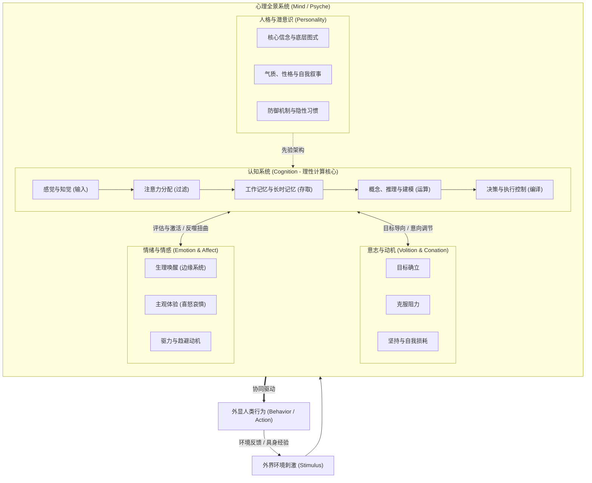
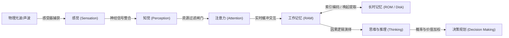
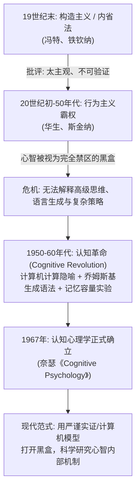
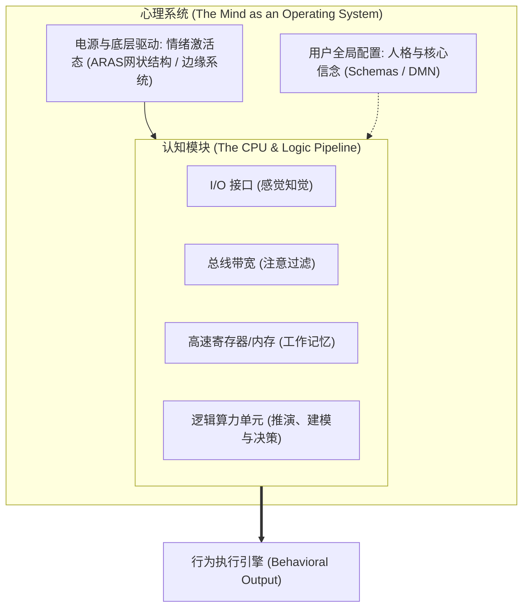
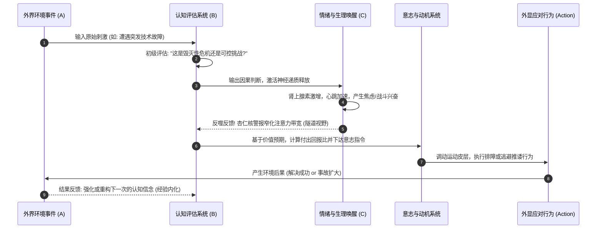

# 认知心理学解构——认知、心理与行为动力系统

> [!IMPORTANT] 核心要点前置 (Key Takeaways)
> - **概念层级**：**“心理（Mind / Psyche）”是全局精神生命系统的全集**（涵盖知、情、意与人格），而**“认知（Cognition）”是该系统中的信息加工与计算引擎**（专门负责信息的接收、编码、存储、检索与逻辑处理）。
> - **学科诞生（认知革命）**：认知心理学并非名词的随意拼贴，而是 20 世纪 50~60 年代对抗“行为主义黑盒论”的革命性产物。它借助**计算机科学的信息加工隐喻**，首次用严谨实证方法打开了“刺激（S）到反应（R）”之间不可见的心智内部黑盒。
> - **两者的架构关系**：如果把人类心智比作一台先进的主机，**“心理”是整套运行环境与操作系统**（含能耗管理、情绪驱动器、人格配置文件），**“认知”则是 CPU 数据通路与算法逻辑**（负责客观运算与模型构建）。
> - **对行为的分立影响**：认知是行为的**“导航仪与编译器”**（决定如何理解世界并制定策略），心理要素（情绪、欲望、意志）是行为的**“发动机与刹车片”**（提供行动能量与价值权衡）。
> - **对行为的协同控制（知情意行）**：人类没有纯粹的理性认知，认知评估激活情绪体验，情绪强弱扭曲注意与认知判断，动机赋予行动推力，行为结果再反向修正认知图式。

---

## 知识全景图



---

## 一、本体界定：什么是“心理”？什么是“认知”？

要厘清两者的关系，首先必须回到哲学与心理学的基础概念底座。

### 1.1 什么是“心理”（Mind / Psyche）？

在科学心理学语境下，**心理是人脑对客观现实的主观能动反映**。它是人类个体所有精神活动、意识体验与潜意识过程的**全集（Umbrella Term）**。

传统心理学将完整的“心理现象”划分为两大支柱、四大板块：

| 心理结构板块 | 对应核心心理过程 | 核心功能与本质 | 神经生物学关键底座 |
| :--- | :--- | :--- | :--- |
| **知（认知过程）** | 感觉、知觉、注意、记忆、思维、想象、语言 | **解释世界**：把物理信号转换为主观理解与因果模型 | 前额叶皮层 (PFC)、顶叶、颞叶海马体 |
| **情（情感过程）** | 情绪（生理本能）、情感（社会高级情感）、心境 | **评估价值**：判断外界事物对生存与繁衍利害关系的即时生理预警 | 杏仁核、脑岛、前扣带回 (ACC)、腹内侧前额叶 |
| **意（意志过程）** | 动机、目标设定、冲动克制、抗压耐受、自控力 | **克服阻力**：面对阻碍与即时诱惑，坚持长期目标的定向能动性 | 背外侧前额叶 (dlPFC)、基底核纹状体 |
| **人格（个性特质）** | 性格、气质、能力、核心价值观、自我概念、潜意识防御 | **个体差异**：一个人在长期演化中固化下来的稳定行为反应风格 | 默认模式网络 (DMN)、神经递质基线水平 |

**本质提炼**：心理是一个**“全生命周期、富含温度、包含理性与非理性、意识与潜意识”的主观世界总和**。

---

### 1.2 什么是“认知”（Cognition）？

“认知”源于拉丁语 *cognoscere*（意为“去获知、去调查、去了解”）。在现代认知科学中，**认知专指大脑获取、加工、存储、提取和使用信息的计算过程（Information Processing）**。

认知并不是单一的状态，而是一条精密的信息处理闭环流水线：



1. **输入与转译（感觉与知觉）**：将外界的物理量（光子、震动分子）转译为神经电化学脉冲，在大脑中构建模式（例如：看见一团红白相间的光斑，识别为“苹果”）。
2. **过滤与聚焦（注意力机制）**：人脑每秒接收上千万比特的物理信息，前额叶与丘脑网状核构成“漏斗”，只允许约 40~50 比特进入意识通道。
3. **缓冲与操纵（工作记忆）**：相当于大脑的运行内存（RAM），容量仅为 $4\pm1$ 个组块，供高阶逻辑运算暂存数据。
4. **结晶与架构（长时记忆与心智图式）**：海马体将短期信息压缩巩固为新皮层的永久突触网络，形成人理解现实的“先验知识框架（Schemas）”。
5. **运算与推演（思维、推理与决策）**：基于先验概念进行因果模拟、归纳演绎、反事实推断（“如果我这样做，会发生什么？”）。

---

### 1.3 核心维度直观对比

| 比较维度 | 心理 (Mind / Psychology) | 认知 (Cognition) |
| :--- | :--- | :--- |
| **逻辑范畴** | **全集概念（整体）** | **子集机制（核心部件）** |
| **关注内核** | 主观体验、情绪感受、动机渴望、人格特质、精神意义 | 信息结构、编码算法、计算瓶颈、记忆存储、逻辑推演 |
| **典型属性** | **“热处理”（Hot）**：带有主观价值偏好、情感倾向与生存本能 | **“冷处理”（Cold）**：客观计算、模式识别、真假对错判断 |
| **比喻** | 整套**计算机操作系统 + 用户体验 + 生态软件** | **CPU 架构与数据流水线算法** |
| **失调表现** | 抑郁、焦虑症、人格障碍、意志瘫痪、虚无感 | 认知失调、逻辑谬误、记忆遗忘、注意力涣散、知觉失认 |

---

## 二、历史溯源：为什么“认知心理学”会放在一起讨论？

既然“认知”只是心理现象的一个子集，为什么心理学会专门开辟出一门统治级学科叫**“认知心理学（Cognitive Psychology）”**？

这并不是同义反复，而是一场**推翻“行为主义专制”的科学革命史**。



### 2.1 第一阶段：内省法的失败与行为主义的“黑盒禁锢”
- **19 世纪末（内省法）**：现代心理学奠基人冯特（Wundt）等人试图通过让受试者“口头反思并报告自己的内在感觉”来拆解心理元素。但内省法极度主观、无法被他人独立复现，导致心理学陷入伪科学危机。
- **20 世纪初至 50 年代（行为主义的极端反弹）**：
  - 华生（Watson）和斯金纳（Skinner）发起行为主义，主张：**科学心理学只能研究客观可见的“外显行为”，一切看不见的内部精神世界都是伪命题**。
  - 心理学被简化为公理式的刺激-反应公式：$$\text{刺激 (S)} \longrightarrow \boxed{\text{黑盒 (大脑 / 心智)}} \longrightarrow \text{反应 (R)}$$
  - 行为主义明令**禁止探讨思想、信念、记忆、注意力与心智表征**，甚至把思维荒谬地解释为“微弱的喉部肌肉抽搐”。

### 2.2 第二阶段：认知革命（Cognitive Revolution）的爆发
到了 1950 年代，行为主义撞上了无法突破的认知天花板：
1. **计算机科学的降临（信息论与计算隐喻）**：图灵（Turing）、冯·诺依曼（Von Neumann）与香农（Shannon）的研究证明：**复杂的“信息处理”完全可以通过物理载体（硬件上的符号处理算法）客观实现**。这给心理学家带来了惊天启示——**大脑是生物硬件，心智是运行其上的软件信息加工程序**！
2. **语言学的毁灭性打击（乔姆斯基）**：1959 年，乔姆斯基（Noam Chomsky）公开撰文批驳斯金纳的《语言行为》。他证明：儿童能在极少输入下说出从未听过的复杂句子，若非大脑拥有先天的“深层认知语法结构（Universal Grammar）”，单纯靠条件反射强化根本不可能习得语言。
3. **人类信息加工的物理边界被实证**：1956 年乔治·米勒（George Miller）发表了《神奇的数字 $7 \pm 2$》，用无可辩驳的实验证明：人类工作记忆存在极其精准的容量带宽限制。

### 2.3 第三阶段：1967 年乌尔里克·奈瑟与学科定名
1967 年，美国心理学家**乌尔里克·奈瑟（Ulric Neisser）**出版了开创性巨著《认知心理学》（*Cognitive Psychology*），正式奠定了该学科的名称与体系。

> **为什么叫“认知心理学”？**
> 其核心宗旨是：**宣布心理学必须从“黑盒行为主义”中彻底觉醒，重新把“人类的心智运作机制”作为科学研究的核心，但手段不再是 19 世纪的主观内省，而是结合计算机模拟、严密实验控制、反应时测量与神经测谎的硬核实证方法。**

---

## 三、架构关系：心智操作系统与信息计算内核

如果要建立一个清晰的模型来理解认知与心理的深层连接，可以用三层系统透镜进行投射：



### 3.1 “全集生态”与“核心算力”
- **认知是心理的逻辑骨架**：没有认知，情绪将失去对象（你不会无缘无故害怕，你必须先“认知”到前方有一条蛇）；意志将失去航向（没有因果模拟，就无法设定明天要干什么）。
- **心理是认知的能量环境**：纯粹的认知算法是没有偏好与动能的冷代码。赋予这套算法“价值权重、优先级中断、执行渴望与恐惧制动”的，正是情感、欲望与意志等心理热动力。

### 3.2 “冷认知”与“热心理”的神经解剖学对应
- **冷认知（Cold Cognition）**：主要由**背外侧前额叶皮质（dlPFC）、顶叶皮层与海马体**构成的额顶控制网络（FPN）主导，负责抽象推理、规则计算、工作记忆更新与理性抑制。
- **热心理（Hot Affect & Motivation）**：主要由**杏仁核、伏隔核（奖励中枢）、脑岛、下丘脑与腹内侧前额叶（vmPFC）**构成的边缘系统主导，负责即时快感预测、痛感预警、应激反应与主观情绪体验。

---

## 四、动力学影响：它们分别与共同如何影响人的行为？

行为（Behavior）是人类面对世界时最终交出的答卷。认知与心理在其中扮演着精细的分工与纠缠耦合。

### 4.1 认知如何独立/主导影响行为（行为的“导航仪与编译器”）

认知系统决定了行为的**“方向、策略与精确度”**：

1. **现实表征决定行为反应（主观真实超越客观真实）**：
   - 人类并不是对客观物理世界做出反应，而是对自己脑中**重构出的认知图式（Mental Models）**做出反应。
   - *案例*：同样是在走廊里看到同事没打招呼径直走过。
     - 认知解释 A（“他在生我的气、他看不起我”） $\to$ 行为：疏远、敌意反击或内耗自责。
     - 认知解释 B（“他可能在赶时间或在想紧急的事”） $\to$ 行为：神色自若、继续做手头工作。
2. **贝叶斯先验与预期偏差**：
   - 认知是一台预测引擎。你走路不会踩空台阶，是因为认知预先计算了重力和肌肉步长；你在职场做战略汇报，是因为认知推演了听众的利益关注点。
3. **工作记忆负荷决定行为质量**：
   - 当外界认知负荷超过工作记忆容量时，前额叶控制力骤降，行为会从高维的“理性深思”断崖式跌落至“低维自动驾驶习惯”（如打翻水杯、暴饮暴食、放弃复杂思考）。

---

### 4.2 心理其他要素如何独立/主导影响行为（行为的“发动机与刹车片”）

如果只有认知，人会陷入死寂的逻辑计算中无法动弹。情绪、动机与人格决定了行为的**“启动、强度与持久性”**：

1. **无情绪即无决策（躯体标记假说）**：
   - 神经科学家安东尼奥·达马西奥（Antonio Damasio）在其名作《笛卡尔的错误》中研究了脑腹内侧前额叶受损的患者“艾略特（Elliot）”。艾略特的认知计算智商高达 130，逻辑推演完美无缺，但因为切除了连接情绪的情感中枢，他失去了一切情感偏好。
   - **结果令人震惊**：他无法完成任何日常行为决策——连挑选一家餐厅、选择蓝色还是黑色圆珠笔，他都可以坐在桌前逻辑推演 5 个小时而无法落笔。**行为需要情绪在潜意识中迅速对选项打上“趋近（好）”或“逃避（坏）”的价值标记。**
2. **动机与多巴胺期望控制行动能量**：
   - 行为不是由目标的崇高程度驱动的，而是由中脑边缘多巴胺通路的**奖励预测误差（Reward Prediction Error）**驱动。当潜意识预期行动能带来多巴胺峰值时，行为才会被强力启动。
3. **潜意识心理防御机制**：
   - 心理压抑（Repression）、投射（Projection）和合理化（Rationalization）常常绕过理性认知，悄悄接管行为。例如“拖延症”往往不是时间规划能力不足（认知缺陷），而是深层的**完美主义与害怕失败的自尊防御（心理情绪冲突）**。

---

### 4.3 认知与心理的共同（交互耦合）机制：知情意行协同动力学

在真实的人类日常生活中，**认知与心理从来不是孤立割裂的，而是时刻处于高度密集的双向动态正负反馈环路中**：



#### 关键互动范式：

1. **拉扎勒斯认知评估模型（Lazarus' Cognitive Appraisal Theory）**：
   - 情绪从来不是事件直接引发的，而是由“两阶段认知评估”决定的：
     - **初级评估**：这事关乎我的切身利益吗？（威胁、挑战、还是无关？）
     - **次级评估**：我有足够的能力与资源应对吗？（能搞定 $\to$ 激发兴奋斗志；搞不定 $\to$ 激发恐惧焦虑）。
2. **情绪反噬对认知的“劫持”与“隧道视野”**：
   - 当心理层面的恐惧或愤怒被引爆时，杏仁核会向下丘脑分泌大量去甲肾上腺素和皮质醇，强行关闭前额叶的高阶深思功能（所谓的“气急攻心”、“急中出错”）。此时，认知带宽被极度窄化，只能进行二元对立的原始反应。
3. **CBT 认知行为疗法（认知作为四两拨千斤的抓手）**：
   - 在艾利斯的理性情绪行为疗法（REBT）和贝克的认知行为疗法（CBT）中：
     $$\text{A (诱发事件)} \to \text{B (信念与认知)} \to \text{C (情绪与行为结果)}$$
   - 人们往往误以为是 A 直接导致了 C（“老板骂我让我抑郁放弃”）。然而心理学干预的核心证明：**我们无法改变 A，也很难直接用蛮力按死 C，但我们可以通过“重塑 B（认知审视与重构）”，彻底改变下游的情绪与行为产出。**

---

## 五、心智跃迁：从知识理解到自我操控系统

理解了“认知心理学”、“认知”与“心理”的底层骨架，其最高阶的应用价值在于建立成熟的**元认知与心智掌控能力**。

```
+-------------------------------------------------------------------------+
|                        三阶心智进化层次                                 |
+-------------------------------------------------------------------------+
| [3. 具身重构]  用微小动作与物理环境改变，倒逼认知重构与情绪重写        |
|               (动作先于状态: 坐姿挺拔、微步启动、环境减阻)             |
+-------------------------------------------------------------------------+
| [2. 认知解离]  打破“认知即我”的错觉，建立前额叶观察者视角              |
|               (从“我很愤怒”进化为“我观察到大脑正产生愤怒与心跳加速”)     |
+-------------------------------------------------------------------------+
| [1. 机械受控]  认为环境直接决定情绪，情绪直接决定行为 (行为主义受害者) |
|               (被刺激本能操纵，陷入条件反射与伪勤奋内耗)               |
+-------------------------------------------------------------------------+
```

1. **跳出算法看算法（元认知监察）**：
   - 明白你的“认知（思维）”只是大脑写出来的预测脚本，它**不是客观事实本身**。学会审视你的自动化思维（“这真的无法解决吗？还是我的工作记忆超载了？”）。
2. **冷热解离（接纳情绪，校准认知）**：
   - 心理情绪负责报警，认知系统负责决策。允许情绪像天气一样发生（热），但不要让情绪直接拿到方向盘。前额叶必须担当清醒的法官（冷），在感受情绪的同时，独立计算理性行动方案。
3. **具身认知反转回路（行动塑造心智）**：
   - 认知不仅决定行为，**行为与身体状态也反向重塑认知**（具身认知 Embodied Cognition）。当你感到心理瘫痪、认知枯竭时，不要试图坐在椅子上“硬想通”，通过起立拉伸、深呼吸、迈出微小的物理第一步，直接向大脑神经系统灌注掌控感信号，自下而上重构认知与心理稳态。

---

## 关联阅读与引用

- [[4. 思考与认知/思维模型/行为改变动力学——认知重塑与多维驱动模型.md|行为改变动力学——认知重塑与多维驱动模型]]：系统解构认知、环境、生理与行为改变的六大驱动力。
- [[4. 思考与认知/大脑结构与核心职责图谱——高效用脑的神经科学基础.md|大脑结构与核心职责图谱——高效用脑的神经科学基础]]：前额叶、边缘系统、海马体与三大脑网络的神经生物学底层。
- [[4. 思考与认知/认知负荷理论与思维扩容指南.md|认知负荷理论与思维扩容指南]]：人类工作记忆瓶颈与高阶思维扩容法则。
- [[4. 思考与认知/人为什么不想学习——认知心理学视角.md|人为什么不想学习——认知心理学视角]]：多巴胺预测误差、认知阻抗与即时反馈机制解析。
