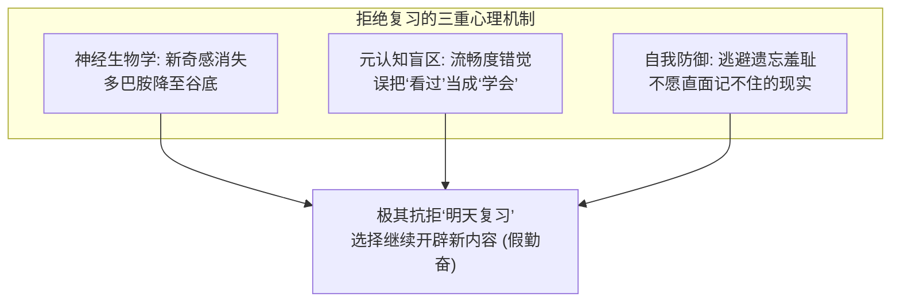

# 突破抗拒复习的心理困境与科学复习法

> **Key Takeaways**
> - **讨厌复习不是自律缺陷，而是大脑的三重本能偏见**：新奇多巴胺缺失、被动重读的虚假流畅感（能力错觉），以及直面遗忘的自尊防御。
> - **不复习在生理上等于“焚烧昨天的努力”**：遗忘是大脑的主动修剪机制；未经提取巩固的信息 48 小时内丢失 70% 以上，复习不是额外增量，而是保护沉没成本的唯一手段。
> - **复习之所以痛苦，是因为用错了姿势**：“盯着笔记重读”是低效且折磨的反人性方式；**最高效的复习必须是“提取测试（Retrieval Practice）”与“必要难度（Desirable Difficulty）”**。
> - **无痛落地法**：利用“白纸闭卷 3 分钟回顾”、以考代看、将复习前置为“今日学习的启动热身”，彻底摆脱沉重的“复习仪式感”。

---

## 一、为什么我们从小到大都极度讨厌“复习”？

你从小讨厌复习不是偶然的个例，它是人类大脑演化底层机制和后天错误教育方式共同作用的必然结果。



### 1. 神经生物学根源：新奇感（Novelty）归零，多巴胺断供
- 学习新概念、新章节时，大脑处于“探索模式”，信息的新奇性会自然触发多巴胺释放，哪怕难也能撑下去。
- 而“复习昨天学过的”在大脑原始系统看来是**“毫无新意、在已知领地上打转”**。此时多巴胺系统拒绝给前额叶供能，你会本能地觉得乏味、枯燥、哈欠连天。

### 2. 元认知错觉：流畅度偏误（The Fluency Illusion）
- 昨天你刚理解这个概念时，大脑中留有残留印象。当你今天看一眼标题或笔记时，大脑产生了一种**“熟悉感（Familiarity）”**。
- **致命陷阱**：大脑极其懒惰，它会把“我认得这个东西”**错判为**“我已经掌握了这个东西”。
- 潜意识会发出危险指令：*“这题我昨天不是懂了吗？再看一遍纯粹浪费时间，还不如去刷点新东西。”*

### 3. 自尊防御机制：逃避“遗忘引发的挫败感”
- 如果你合上书去回忆昨天的内容，必然会遇到“想不起来、卡壳、模糊”的情况。
- 这种卡壳会直接攻击你的自我效能感：*“我昨天花了两个小时，今天居然连这个公式/框架都背不出来？我是不是太笨了？”*
- 为了保护脆弱的自尊心，大脑选择**逃跑**：只要我不去复习检验，我就能一直保留“我昨天学得很好”的心理安慰。

### 4. 传统教育的误导：把“复习”定义成了“反人性的枯燥重读”
- 从小老师和家长教给我们的复习方式是：**把课本重新看一遍、把笔记抄一遍、把背诵篇目机械读三遍**。
- 这种被动输入（Passive Rereading）在认知科学中已被证明是**效率最低、耗费意志力最多、体验最糟糕的方式**。没人会喜欢这种单调的酷刑。

---

## 二、复习的神经科学本质：必要性与重要性

如果你算一笔时间投资账，就会发现：**不复习，才是世上成本最高的浪费。**

### 1. 生理现实：大脑是一台“主动遗忘机器”

大脑每天消耗人体 20% 的能量。为了生存，海马体有一套严苛的**突触修剪机制（Synaptic Pruning）**：
- **凡是未经“多次检索唤醒”的信息，大脑都会自动打上“代谢垃圾”的标签，并在 24~48 小时内直接清空。**
- 艾宾浩斯曲线证明：学完 24 小时后，未经巩固的信息自然流失 70% 以上。

```
不复习的学习曲线：
[ 投入 2 小时学习 ] → [ 48 小时后遗忘 75% ] → [ 1 个月后完全归零 ] 
→ 最终结果: 你的 2 小时生命彻底蒸发。

带微复习的学习曲线：
[ 投入 2 小时学习 ] + [ 次日 5 分钟提取 ] + [ 4 天后 3 分钟速测 ] 
→ 最终结果: 80% 信息沉淀进长期皮层，终身受用。
```

### 2. 神经可塑性与“记忆再巩固”（Reconsolidation）

神经科学核心发现：**记忆不是刻在石头上的雕像，而是每次被提取时都会被“重新唤醒、重新编辑、强化加固”的神经突触回路。**

- **学习新知识**：只是在神经元之间架起了一条临时的细线；
- **下周再学新的**：这条细线已经断了，你必须重头架起；
- **复习（主动提取）**：给这条细线包裹髓鞘质（Myelin），把它变成高速公路光纤。**复习不是查漏补缺，复习是把短期工作记忆物理刻录进大脑皮层的唯一物理过程。**

---

## 三、范式转移：错误复习 vs. 科学复习

| 维度 | 传统痛苦复习（反人性、低效） | 科学高效复习（低阻力、高留存） |
| :--- | :--- | :--- |
| **核心动作** | **被动重读**（拿着笔记从头看到尾） | **主动提取**（闭卷自问、自测、费曼转述） |
| **心智状态** | 昏昏欲睡、机械翻页、产生假性熟悉感 | 精神集中、寻找盲区、解谜通关 |
| **时间安排** | 专门划出 2 小时整块时间（阻力极大） | 零碎化嵌入：课前 3 分钟、如厕/通勤 5 分钟 |
| **对待卡壳** | 沮丧挫败：“我怎么又忘了，好烦” | 欣喜：“太好了，我精准找到了突触薄弱点！” |
| **长期留存率** | 20% ~ 30% | 75% ~ 90% |

---

## 四、彻底解决“讨厌复习”的四大破局法

解决这个问题的原则是：**不要试图提升意志力去强迫自己，而是改变复习的形式与启动阻力。**

### 1. 策略一：扔掉笔记本，执行“白纸闭卷回忆法”（3 分钟极简版）

**严禁拿着昨天的笔记看！** 看笔记会让你立刻陷入无聊与流畅错觉。

- **实操流程**：
  1. 拿出一张废纸（或 iPad 草稿本），不翻开任何笔记；
  2. 计时 3 分钟，在纸上画出昨天核心内容的**逻辑骨架**（3 个核心关键词、1 个流程图，或者一句话总结）；
  3. 停笔，只翻开笔记对照：**我漏掉了哪一条？**
  4. 只看漏掉的那一条 30 秒，搞定！
- **心理优势**：耗时极短（只需 3~5 分钟），没有阅读大段文本的压迫感，像在做填字游戏。

### 2. 策略二：把复习改名为“今日学习的启动热身（Warm-up）”

很多人抗拒复习，是因为把复习当成了“额外压在身上的大任务”。

- **心理重构**：不要单独设立“复习时间块”。
- **操作规则**：**在开始今天的新任务之前，强制前置 5 分钟的“昨日检查点”**。
  - 比如今天计划学新代码/新知识，先别开新章节；
  - 告诉自己：*“我只花 5 分钟看看昨天写的 3 个核心结论，看完了我就能正式开跑。”*
  - 这就像运动前的拉伸，是大脑进入心流的缓冲垫，而不是负担。

### 3. 策略三：为明天的自己预留“线索问题”（Cue Questions）

人在面对空洞的“复习昨天笔记”时阻力最大，因为不知道具体要干嘛。

- **实操技巧（康奈尔笔记法核心）**：
  - 昨天学完收尾时，在笔记最上方写 **3 个灵魂拷问**（只留问题，不留答案）。
  - 例如：*“为什么说多巴胺不是快乐分子？”、“认知负荷超载的三个生理征兆是什么？”*
  - 明天复习时，你只需要**看这 3 个问题，在脑海里自问自答 60 秒**。能答上来就过，答不上来再扫一眼答案。
  - **把“背书”变成了“答题通关”**。

### 4. 策略四：重塑对“遗忘”的认知意义——拥抱“必要难度”

> 认知心理学罗伯特·比约克（Robert Bjork）提出：**“必要难度（Desirable Difficulty）理论”——提取越费劲，记忆越牢固。**

- 当你明天复习卡壳、死活想不起来时，**绝对不要自责！**
- 脑科学机制显示：**正是大脑拼命回忆而不得、神经元剧烈放电的那 10 秒钟，向大脑发出了最强烈的“此突触极度关键，必须重组加强”的生长信号。**
- **心理暗示法则**：每次卡壳时，告诉自己：*“很好，我的神经突触正在发生物理重构，这一秒正是智商提升的关键时刻。”*

---

## 五、极简落地执行卡（Tomorrow's Action）

明天早晨/下次学习开始前，严格按以下步骤试运行一次：

```
[ ] Step 1. 绝对不要看笔记内容！
[ ] Step 2. 找一张白纸，闭眼深呼吸 10 秒：昨天我学的内容，最核心的 2 个概念是什么？
[ ] Step 3. 在纸上写下那两个词，并试着用自己的话画箭头解释它们的关系。
[ ] Step 4. 翻开笔记 10 秒钟核对，修正一个细节偏差。
[ ] Step 5. 揉掉废纸扔进垃圾桶，大功告成（耗时全程不超过 4 分钟）。
```
