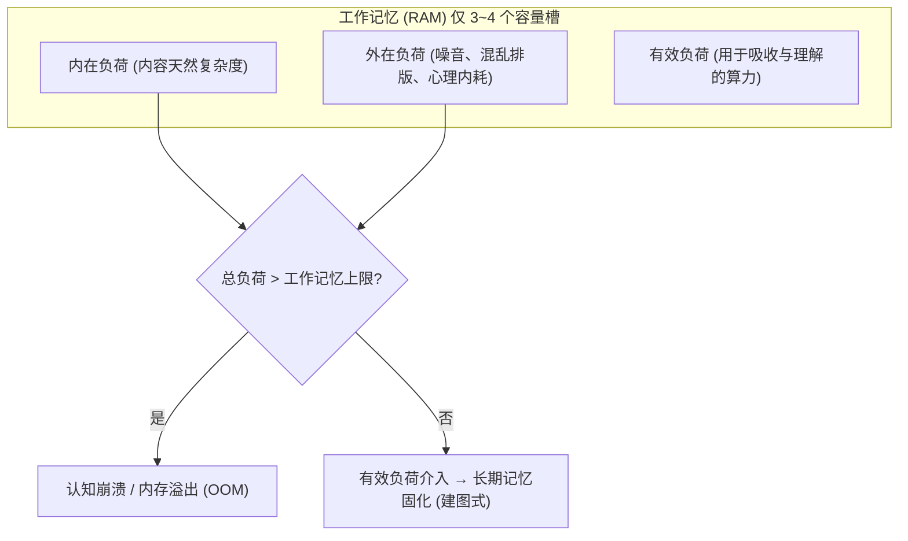

# 认知负荷理论与思维扩容指南

> **Key Takeaways**
> - **认知负荷过载的本质是“计算内存溢出（OOM）”**：大脑工作记忆只有 3~4 个有效组块容量，当“内在难度 + 外在干扰”超出上限时，系统直接触发保护性死机。
> - **典型外在表象**：视线失焦与频繁哈欠（假困）、反复阅读同一句话却不进脑子、以及本能逃避到低认知任务（如刷手机、整理桌面、机械刷水题）。
> - **所谓的“天赋弱”，本质是原始工作记忆（RAM）较小**；但认知科学证明：**顶尖高手并非 RAM 巨大，而是掌握了高级“信息压缩算法（图式组块）”与“外接硬盘（认知外包）”**。
> - **改命式扩容策略**：降低元素交互度（样例学习）、彻底外包工作记忆（草稿纸与外部图解）、将基础底层动作“自动化”（降到无需占内存）。

---

## 一、认知负荷过载到底是什么意思？

### 1. 理论根基：约翰·斯威勒（John Sweller）认知负荷模型

人类大脑的记忆系统结构类似于计算机：
- **长期记忆（Long-term Memory）**：类似于**硬盘**，容量近乎无限，存储已掌握的概念和模型（图式 Schema）。
- **工作记忆（Working Memory）**：类似于**内存（RAM）**，容量极度贫瘠（传统认为 7±2 个组块，现代实验证实复杂任务下仅 **3~4 个独立单元**），且未经复述的信息只能留存十几秒。



### 2. 三种认知负荷的相互挤压

| 负荷类型 | 产生原因 | 举例 | 能否消除/压缩 |
| :--- | :--- | :--- | :--- |
| **内在认知负荷<br>(Intrinsic Load)** | 知识点本身的**元素交互度（Element Interactivity）**。各概念必须同时在脑中联立运算。 | 学习微积分公式证明、阅读高度抽象的分布式架构设计。 | 无法直接消灭，但可通过**分步降维**逐个瓦解。 |
| **外在认知负荷<br>(Extraneous Load)** | 糟糕的信息呈现方式、环境噪音、情绪焦虑、寻找工具的打扰。 | 教材术语晦涩不说人话、桌面杂乱、一边学一边担心“我学不会怎么办”。 | **必须全力剔除的纯垃圾消耗**。 |
| **有效认知负荷<br>(Germane Load)** | 真正用于把新信息与旧知识结合、构建长期图式所需的思考努力。 | 画概念脑图、自我提问、提炼底层通用规律。 | **需要尽可能留出空间给它**。 |

**核心公式**：
$$\text{有效学习空间} = \text{工作记忆总容量} - (\text{内在负荷} + \text{外在负荷})$$
一旦前两者之和超过上限，有效负荷直接归零——**无论你多拼命看书，大脑都已经无法写入任何新知识**。

---

## 二、负荷过载的表现与身体“保护机制”

当负荷过载时，大脑并不像电脑那样弹窗报错，而是表现出一系列欺骗性的生理与心理现象：

### 1. 生理低功耗模式：防御性“假困”与脑雾
- **突发性哈欠与眼皮沉重**：工作记忆由前额叶皮层（PFC）维持，PFC 是人体单位能耗最高的器官。当算力不足时，大脑启动**保护性抑制（Protective Inhibition）**，强制诱发困意以切断高耗能输入。
- **“复读机式阅读”（Reading without Registering）**：一页书读了 4 遍，眼睛在动，但脑子一片空白，不知道刚才看了什么。

### 2. 行为代偿与假性勤奋：位移行为（Displacement Activity）
- **突然想做低级事务**：本来打算深研一道高难度错题，刚坐下 5 分钟，突然强烈想去收拾桌子、洗杯子、削铅笔、回微信。
- **逃向“机械刷题”**：因为深研需要极高算力，大脑本能把目标替换为“无脑刷套卷、画荧光笔、机械抄笔记”——**用身体的忙碌掩盖大脑的算力崩溃**。

### 3. 情绪崩溃：焦虑、易怒、无助感
- 当面临过多杂乱信息无法理顺时，杏仁核被激活，大脑判定当前处于“受威胁状态”，引发焦躁、坐立不安甚至自我否定（“我是不是太笨了”）。

---

## 三、大脑“天赋较弱”的人有办法改善吗？

### 1. 彻底颠覆“天赋论”：RAM 不够，算法来凑

许多人误以为学神拥有“超大内存”，但认知科学的经典实验彻底粉碎了这个神话：

> **国际象棋大师实验（Chase & Simon, 1973）**：
> - 面对**真实棋局**：特级大师一眼就能记住全盘布局，业余棋手只能记几个子。
> - 面对**完全随机摆放的棋子**：大师的记忆成绩**断崖式下跌，和普通人毫无区别**！

**实验结论**：
所谓高手，其底层 RAM（工作记忆物理槽位）和普通人基本一致。**高手的唯一秘密是长期记忆库里存储了成千上万个“高密度信息块（Chunks / 图式）”**。

```
普通人视角（元素离散，内存迅速挤爆）：
[ 兵在E4 ] + [ 马在F3 ] + [ 象在C4 ] + [ 对方弃兵 ] = 4 个槽位（已满载，死机）

大师视角（图式压缩，只占 1 个槽位）：
[ 经典意大利开局进攻变体 ] = 1 个槽位（剩余 3 个槽位自由运算后续走法）
```

---

## 四、算力不足者的四大“改命扩容”实操策略

如果你自感记忆力一般、理解慢、容易脑子卡顿，**严禁与大脑硬件硬刚**，必须采用以下策略对认知流进行改造：

### 1. 策略一：认知外包（Cognitive Offloading）——给大脑挂载“外接内存”

绝不要在纯脑内空想复杂的逻辑，必须把工作记忆的维持压力转移给物理介质：

| 操作方式 | 具体手法 | 原理 |
| :--- | :--- | :--- |
| **草稿纸可视化** | 做复杂题或分析时，把所有中间变量、已知条件全写在纸上。 | 脑子只负责**处理**，纸张负责**存储**。 |
| **打断点调试法** | 读长篇难懂论文/技术架构时，每读懂一段画一个微型框图。 | 避免每次都要把前情提要重新加载一遍。 |
| **双通道输入** | 阅读图表时配语音讲解，或自己轻声自言自语复述。 | 利用**双编码理论（Dual-Coding）**：视觉工作记忆与听觉回路并行，分摊单一通道压力。 |

### 2. 策略二：利用“样例效应”（Worked Example Effect）破局

认知负荷理论的一大王牌发现是：**对初学者而言，盲目死磕独立解题（自主探索）是最低效、最容易挤爆内存的做法。**

- **错误做法**：基础不牢就去挑战综合难题，脑内同时运算公式定理、解题思路与计算步骤 $\rightarrow$ 瞬间 OOM，挫败厌学。
- **正确做法（样例学习法）**：
  1. **先看全解透析（Worked Example）**：看专家写好的标准逐步推导，把全部认知负荷集中在“理解推导步骤的逻辑连接”上。
  2. **再做镜像模仿（Faded Example）**：做一道完全一致、仅数字或场景微变的原型题。
  3. **最后做独立填空**：逐步隐去解题提示，直至脱离参考。

### 3. 策略三：元素降维与隔离（Element Isolation）

当一个知识点的“元素交互度”极高时，**严禁一口吞下**：


- 比如学习编程语言的多线程高并发：先彻底孤立搞懂什么是“单线程执行栈”；再单独搞懂“操作系统的时钟中断与上下文切换”；最后才把两者合成“并发竞态问题”。

### 4. 策略四：过度学习与“自动化”（Automaticity）

- **定义**：将基础高频动作训练到**脊髓反射级别**（不占用前额叶任何工作记忆）。
- **案例**：
  - 开车新手：握方向盘、看后视镜、踩刹车、听导航同时发生，手忙脚乱，下车大汗淋漓（满载过载）。
  - 老司机：可以一边单手打方向盘，一边与副驾谈笑风生，因为驾驶动作已经彻底**自动化**，内存占用为 0。
- **实操**：找出你所学领域最底层、最频繁出现的 20% 基础知识（常用公式、基础英语词根、常用代码语法），进行**无脑过度练习**。当它们不再消耗你的注意力时，你就能把全部内存留给最棘手的高级问题。

---

## 五、自检与应对工具卡（Cheat Sheet）

当你感到“脑子发木、看不进去、想睡又想刷手机”时，立刻对照执行：

```
[ ] 1. 停下当前阅读，深呼吸 3 次（降低交感神经兴奋带来的外在负荷）
[ ] 2. 拿出一张空白 A4 纸，把正在卡壳的“那句话/那个点”抄在正中央
[ ] 3. 灵魂拷问：我现在卡住是因为这个概念涉及了哪几个我不懂的名词？
      → 把不懂的名词拆出来，先只查第一个
[ ] 4. 桌面是否有手机或未关的无用标签页？
      → 全部关掉，降低外在干扰
[ ] 5. 去看一眼别人的参考答案推导，不要继续死磕空想（启用样例效应）
```
